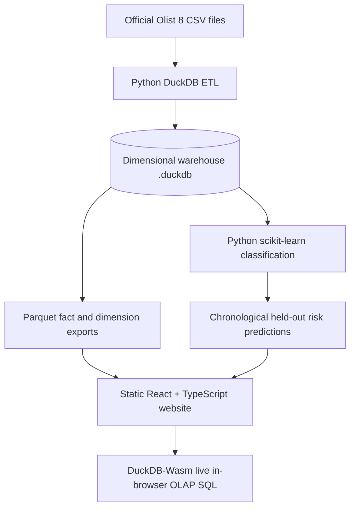

# PromisePulse: React + Browser SQL Dashboard Migration

**A real implementation module for your existing PromisePulse project.**

This migration replaces the *presentation layer* of Streamlit with a responsive React + TypeScript SPA, and allows the analytic dashboard to operate without a running PostgreSQL server.

It does not delete or overwrite your existing Python, PostgreSQL, Streamlit, documentation, or tests. It creates a separate DuckDB-powered export pipeline so you can test the new architecture before removing anything.

## Architecture



## Screens

- **Overview:** orders, payment-based revenue, average order value, observed late-delivery rate, geographic and category analytics.
- **OLAP Lab:** real SQL execution for `ROLLUP`, drill-down, slice, dice, and pivot. Parameters are exposed, SQL is visible, rows are exportable.
- **Risk Center:** genuine held-out historical predictions (if trained), validation-selected threshold, actual late outcomes, and baseline-vs-model metrics.
- **Data Catalog:** official dataset source, license, file rows, warehouse table grain and a live SQL table preview.
- **Pipeline & Quality:** data lineage, counts, duplicate/foreign-key/outcome checks and reproducible commands.

### To integrate into your existing repository

Read **[docs/ADD_TO_EXISTING_PROJECT.md](docs/ADD_TO_EXISTING_PROJECT.md)**. It gives safe copy commands that leave your existing project intact.

### Standalone setup

If you place this archive in a new directory, first copy your **official** Olist CSV files into `data/raw/`, preserving their names. (You can also use `--raw-dir /path/to/your/existing/data/raw`.)

```bash
python -m venv .venv
source .venv/bin/activate
python -m pip install -r requirements-export.txt
python scripts/build_web_data.py --raw-dir data/raw --train
cd web
npm install
npm run dev
```

Build for static hosting:

```bash
cd web
npm run build
```

Upload only `web/dist/` to a static host. At build time, it includes the `.parquet` exports. No Docker database or Python API server is required for web visitors.

**Important:** The static site still needs its generated data assets. Without them it shows setup instructions and no fabricated charts.

## Database schema and measurements

| Warehouse table | Fact grain / role |
| --- | --- |
| `fact_orders` | one row per order; payments, order/item aggregates, shipment outcome |
| `fact_order_items` | one row per `(order_id, order_item_id)`; item price, freight, seller and product references |
| `dim_customer` | one row per `customer_id`, plus persistent `customer_unique_id` |
| `dim_product` | one row per product with translated category |
| `dim_seller` | one row per seller and location |
| `dim_date` | one row per calendar date in observed purchases |

**Revenue:** payment sums belong to `fact_orders`; category item sales belong to `fact_order_items`. Never join payment totals onto multiple item records and sum them.

**Late outcome:** only a delivered order with nonmissing actual and estimated delivery dates is labeled late/on time. Other records have NULL outcomes.

**Model evaluation:** chronological train/validation/test, label maturity before training cutoffs, dummy baseline, Logistic Regression, missing-data handling, numeric scaling, categorical encoding and threshold selection on validation only. The exported risk queue covers **only** held-out test orders. No future delivery timestamps or reviews are passed as model inputs. The historical promised-delivery field is assumed observable at purchase; this assumption must be disclosed in the report.

## Required dataset citation

> Olist. *Brazilian E-Commerce Public Dataset by Olist*. Kaggle. https://www.kaggle.com/datasets/olistbr/brazilian-ecommerce. CC BY-NC-SA 4.0.

Preserve original upstream repository attribution: https://github.com/credough/olist-sales-analytics-pipeline.

## What is verified here

- Python files were syntax-checked.
- TypeScript source was checked for parsability.
- SQL-generation unit tests are provided.
- **Not yet verified in this environment:** real Olist data export, successful installation of npm dependencies, Vite build, rendered React app, DuckDB-Wasm runtime compatibility, and genuine classification metrics. The execution environment used to author this package does not have the original CSVs or npm network access. Run the commands above on your machine to establish those facts.

## Operational notes

- Exported Parquet files are generated locally and intentionally not included in the archive.
- Reload the website after exporting new warehouse data.
- DuckDB-Wasm SQL runs in-browser, but the full ETL and sklearn training operations occur *offline*, triggered by a local command. This is a static/serverless **runtime**, not a claim that training works without Python.
- No secret or access token is needed by website visitors.
