# PromisePulse — E-Commerce Intelligence & Delivery Risk Analytics

<div align="center">
  
  <p><strong>Enterprise-grade Data Warehousing, In-Browser OLAP Analytics & Historical Delivery Risk Mining</strong></p>

  [](LICENSE)
  [](https://www.kaggle.com/datasets/olistbr/brazilian-ecommerce)
  [](https://duckdb.org/)
  [](https://react.dev/)
  [](https://scikit-learn.org/)

  [Key Features](#key-features) • [System Architecture](#system-architecture) • [Dimensional Warehouse](#dimensional-warehouse) • [OLAP Operations](#olap-operations) • [Data Mining Methodology](#data-mining-methodology) • [Dashboard Gallery](#dashboard-gallery) • [Academic Relevance](#academic-relevance) • [Installation & Setup](#installation-and-setup)
</div>

---

### Executive Overview

**PromisePulse** bridges the divide between offline dimensional data warehousing and modern client-side analytical exploration. Built upon the comprehensive [Brazilian E-Commerce Public Dataset by Olist](https://www.kaggle.com/datasets/olistbr/brazilian-ecommerce) (100k orders spanning 2016–2018), PromisePulse models raw transactional logs into an audited **Star Schema**, applies leak-free **chronological classification** to evaluate order-placement delivery risk, and delivers interactive multi-dimensional **SQL OLAP operations directly inside the browser using DuckDB-Wasm and Parquet**.

Unlike traditional analytics dashboards that rely on heavy server fleets or compute pre-aggregated static numbers, PromisePulse executes real SQL queries—including `ROLLUP`, slicing, dicing, and pivoting—entirely in the user's browser without contacting a remote database server.

---

## PromisePulse 5.0 — All Six University Data-Mining Modules

**New additional implementation; all original features preserved.** PromisePulse 5.0 now has **19 navigable destinations** (including a new academic **Syllabus Hub**), adding six academic laboratories directly aligned to the 30-hour university syllabus. No previous module, chart, geographic state map, theme, home screen, or AI Studio was removed. A seventh *academic* navigation entry, **Syllabus Hub**, links the six syllabus laboratories, shows the official contact-hour distribution, presents the verified empirical population counts, and filters by phase.

| Module | Syllabus hours | Functional evidence |
| --- | ---: | --- |
| 1. Warehouse & ETL | 8 | Star/fact constellation explorer, actual warehouse relations, physical records, raw-to-Parquet stages, OLAP linkage |
| 2. Data Lakes | 3 | Raw CSV file provenance, data curation, real CSV/Parquet file sizes and source record analysis |
| 3. EDA & Preprocessing | 5 | Seven statistical profiles, histograms, quartile box plots, missingness, 7×7 Pearson matrix, PCA/transformation explanations |
| 4. Classification Lab | 5 | Trained Decision Tree and Gaussian Naive Bayes; logistic and majority baselines; four regression methods, out-of-time evaluation |
| 5. Clustering Lab | 4 | K-Means, Ward agglomerative and divisive Bisecting K-Means, **actual dendrogram**, PCA scatter, silhouette and elbow plots |
| 6. Pattern Mining | 5 | Real Apriori, FP-Growth and Eclat itemsets, closed itemsets, support/confidence/lift, association-rule network and mining timing |
| **Total** | **30** | Historical Olist source-backed, reproducible experiments |

**New historical experiment export:** [`web/public/data/mining_lab.json`](web/public/data/mining_lab.json) is generated with `scripts/build_mining_lab.py` from the existing included Olist Parquet files and verified with `scripts/verify_mining_lab.py`. At current export, 950 sampled customers were clustered (a true 52-leaf Ward dendrogram), and 649 eligible multi-category baskets yielded 47 association rules. Classification metrics are explicitly reported as weak, rather than claiming predictive improvements.

<div align="center">
  <a href="docs/screenshots/v5/clustering-dendrogram-light.png">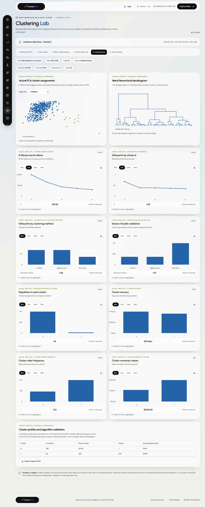</a>
  <p><em>Genuine screenshot: K-Means PCA clustering and Ward hierarchical dendrogram from the offline Olist experiment.</em></p>
  <a href="docs/screenshots/v5/apriori-fpgrowth-eclat-dark.png">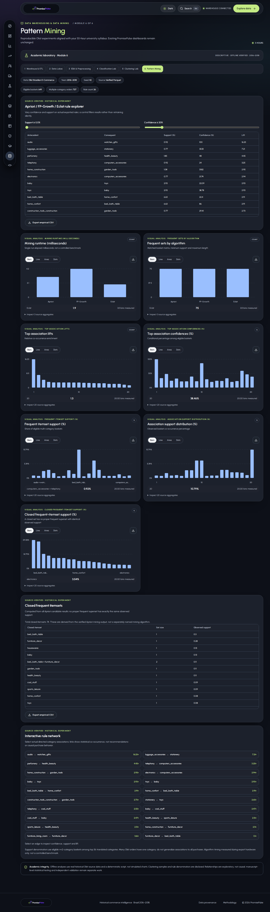</a>
</div>

**Detailed syllabus documentation:** [30-hour module-to-feature matrix, reproducibility and exact empirical outcomes](docs/SYLLABUS_V5.md).

**Verified syllabus gallery (existing 16 captures plus three new Syllabus Hub views):** [Screenshots covering all six syllabus modules, light/dark themes, mobile, and the preserved original Overview](docs/SCREENSHOT_GALLERY_V5.md).

**Reproduce the syllabus experiments locally:**

```bash
pip install -r requirements-export.txt
python scripts/build_mining_lab.py
python scripts/verify_mining_lab.py
cd web
npm ci
npm run build
npm run dev
```

This extension is educational and exploratory. The rendered cloud lake and snowflake alternatives are conceptual where not deployed; clustering uses bounded samples, minority-class classification performance is weak, and association support uses a clearly defined small multi-category basket cohort. Figure quantity by itself is not evidence of research novelty, causal findings, or acceptance by a top-quartile journal.

---

## PromisePulse 4.0 — Landing, AI Evidence, 12 Destinations & 66 Research Charts

**New in the research expansion (feature branch):** a premium **Welcome** page now opens first; the existing premium dashboard, geographic Brazil choropleth, light/dark modes, AI risk classifier, original Atlas and OLAP modules remain intact. The floating left navigation has expanded from 7 to **12 accessible destinations**, with a scrollable mobile dock. No unrelated UI redesign or fake operational feed has been introduced.

<div align="center">
  <a href="docs/screenshots/v4/welcome-light.png">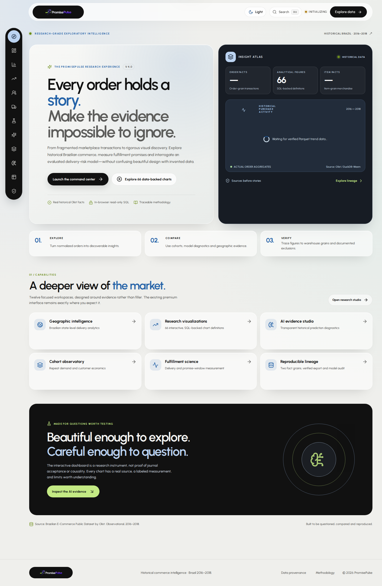</a>
  <p><em>New opening screen. Figures are based on the bundled Olist Parquet manifest and DuckDB-Wasm month grouping, not stock artwork or fabricated data.</em></p>
</div>

| Component | Quantified addition | Key purpose |
| --- | ---: | --- |
| Existing Analytics Atlas | 36 views, preserved | Nine historical lenses of four source-backed charts each |
| Customer Cohorts | +6 | Repeat ordering, observed customer-value / review cohorts |
| Delivery Lab | +6 | Actual versus promised delivery outcomes and durations |
| Research Studio — Basket | +6 | Order-grain basket size, paid value, freight and reviews |
| Research Studio — Product Weight & Freight | +6 | Item-grain weight bands, merchandise value and listed freight |
| AI Studio | +6 | Evaluated hold-out model risk, calibration, lift and late-case concentration |
| **Research chart definitions** | **66 total** | 36 original + 30 additional; each supports chart modes, source table and CSV export |
| Floating navigation | **12 destinations** | Welcome, Overview, Intelligence, Atlas, Cohorts, Delivery, Research, AI, OLAP, Risk, Catalog and Pipeline |

**AI Studio** includes an accessible question selector that generates transparent, deterministic answers from historical `risk_predictions` and the published evaluation manifest. **It is not a generative AI chatbot or a newly trained model.** The old model's weak minority-class precision and historical evaluation limits remain explicitly disclosed.

<details>
<summary><strong>View proof of the new research and AI screens</strong></summary>

| Light mode | Dark mode |
| --- | --- |
| [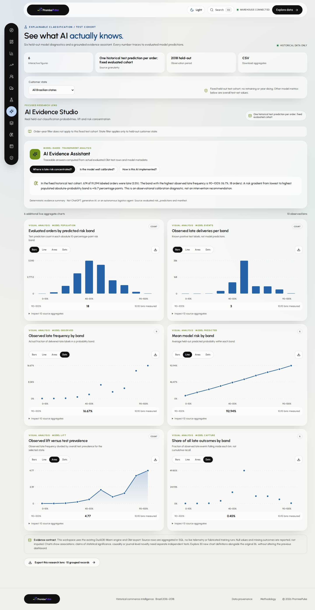](docs/screenshots/v4/ai-studio-light.png) | [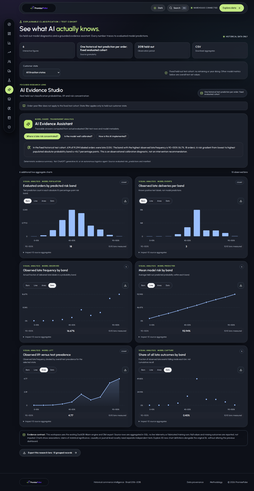](docs/screenshots/v4/ai-studio-dark.png) |
| [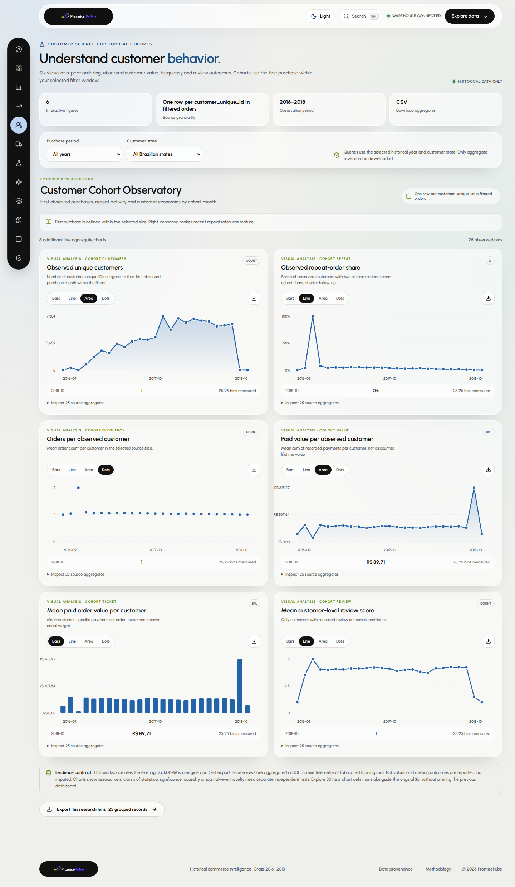](docs/screenshots/v4/customer-cohorts-light.png) | [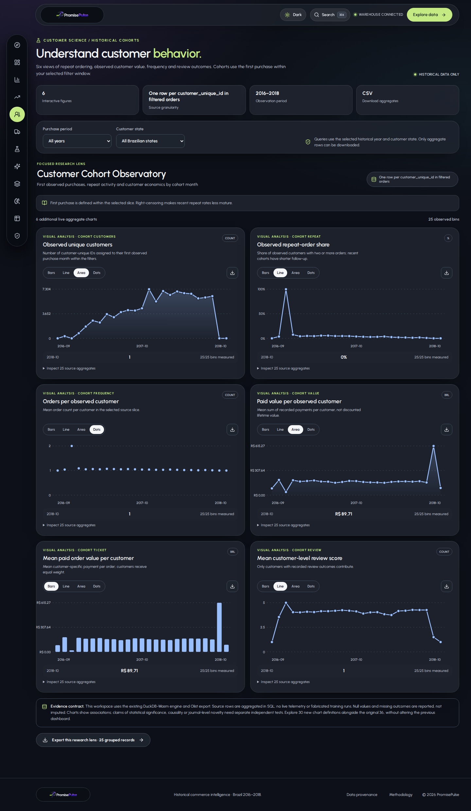](docs/screenshots/v4/customer-cohorts-dark.png) |
| [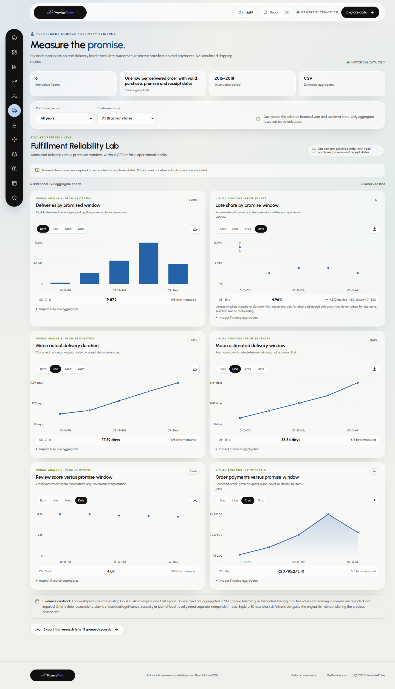](docs/screenshots/v4/delivery-lab-light.png) | [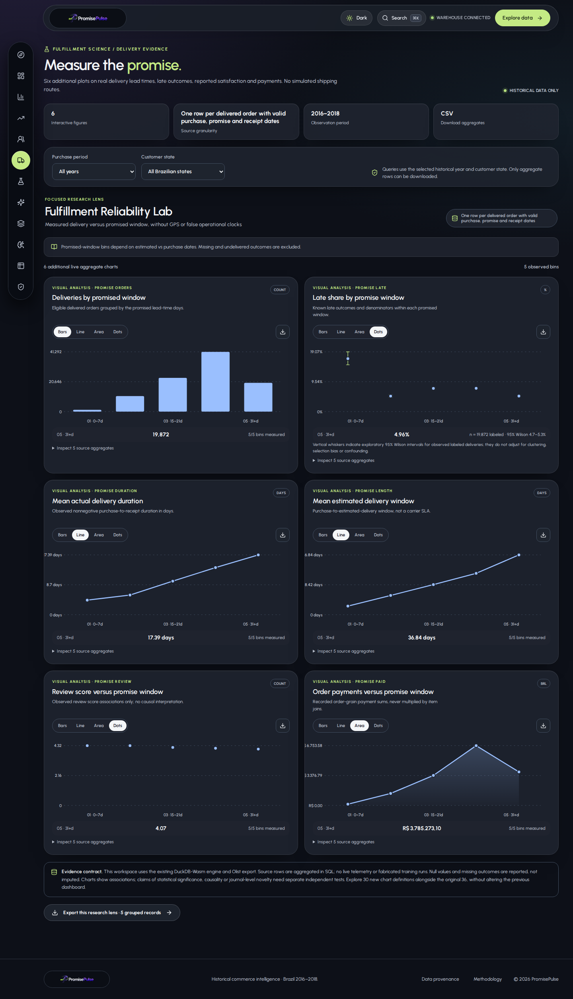](docs/screenshots/v4/delivery-lab-dark.png) |

</details>

**New documentation:** [16 authentic V4 screenshots](docs/SCREENSHOT_GALLERY_V4.md) · [Detailed V4 research methods and all chart definitions](docs/RESEARCH_EXPANSION_V4.md) · [Existing 36-chart methodology](docs/ANALYTICS_ATLAS_METHODOLOGY.md) · [Original 18-screen V3 gallery](docs/SCREENSHOT_GALLERY.md).

**Validation:** `npm run build` + original SQL/theme/Atlas checks + `node tests/test_research_expansion.cjs`; `web/scripts/capture-v4.mjs` also opens the real browser application, queries all new figures, checks AI explanation controls and takes real desktop/mobile screenshots. Larger figure count is not a substitute for independent scientific inference or acceptance by a Q1 journal.

---

## Hero Dashboard — PromisePulse 3.0

<div align="center">
  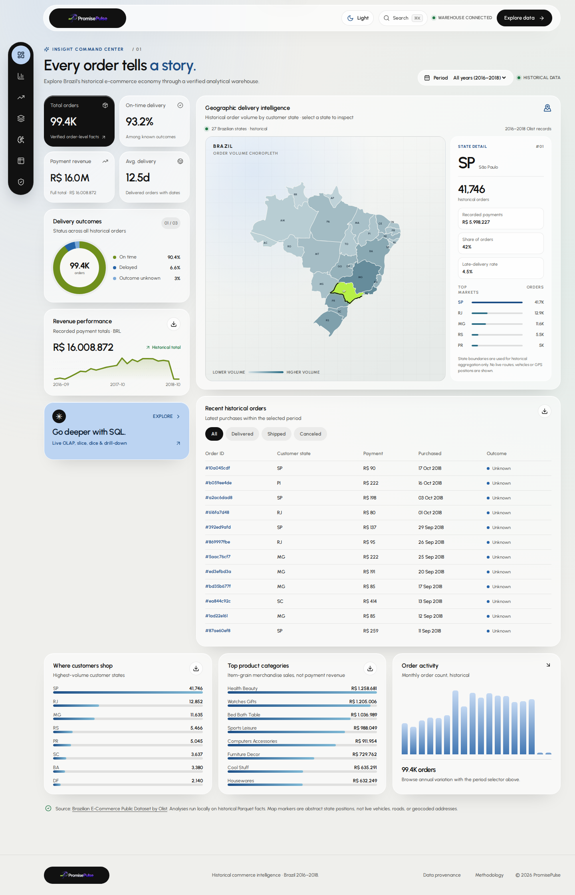
  <p><em>Figure 1: Authentic Chromium capture of the React/DuckDB-Wasm dashboard displaying historical Olist metrics, an interactive Brazilian customer-state choropleth, and descriptive analytics. This is not a live shipment map.</em></p>
  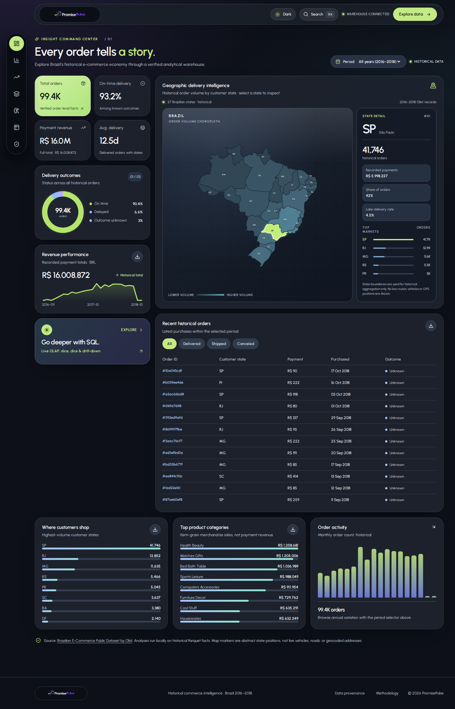
  <p><em>Figure 2: The same verified historical analytics rendered using the accessible charcoal-glass appearance.</em></p>
</div>

See the [18-image, real-browser UI gallery](docs/SCREENSHOT_GALLERY.md) for every workspace, dark mode, research laboratory and mobile layouts.

---

## Project Overview

Modern e-commerce enterprises face two foundational data challenges:
1. **Financial Discrepancies & Grain Confusion**: Orders frequently contain multiple items, each with varying prices, shipping fees, sellers, and product categories. Naively joining items and summing revenue produces severe multi-counting errors.
2. **Post-Purchase Delivery Friction**: Customer satisfaction deteriorates when delivery expectations are breached. Predicting late deliveries at purchase time enables proactive intervention, but models frequently suffer from catastrophic target leakage (e.g., using shipping timestamps or transit logs not yet available at checkout).

### Why the Olist E-Commerce Dataset?
The Brazilian E-Commerce Public Dataset provided by Olist contains 100,000 real anonymized orders from marketplaces across Brazil. Its multi-table relational structure (orders, order items, payments, reviews, customers, sellers, products, geolocation) mirrors real-world production complexities:
- Highly skewed geographical distribution across 27 federative units.
- Non-trivial fulfillment delays caused by continental logistics across Brazil.
- One-to-many relationships between orders, items, and payment installments.

### How PromisePulse Combines Warehousing and Mining
* **Data Warehousing Foundation**: Transforms 8 normalized transactional CSV files into an immutable Star Schema consisting of two distinct fact tables (`fact_orders` and `fact_order_items`) and four conformed dimension tables (`dim_customer`, `dim_product`, `dim_seller`, `dim_date`).
* **Predictive Data Mining**: Implements a chronologically bounded classification pipeline using `scikit-learn`. The model predicts delivery risk strictly using features known at checkout (purchase calendar attributes, destination state, item volume, basket value, freight ratio, and promised fulfillment window), tuned on a dedicated validation window and evaluated against out-of-sample test orders.
* **Serverless Analytical Interface**: Exports verified dimensional tables to Apache Parquet files, allowing a zero-backend React Single-Page Application (SPA) to instantiate an in-memory DuckDB-Wasm database engine directly within the client's browser thread.

---

## Key Features

For a complete walkthrough see the [User Guide](docs/USER_GUIDE.md), [Research Reproducibility](docs/RESEARCH_REPRODUCIBILITY.md), and [Screenshot Gallery](docs/SCREENSHOT_GALLERY.md).

* **Executive Performance Overview**: Interactive historical evaluation of aggregate order volume (99,441 facts), total payment revenue (R$ 16.01M), average basket size (R$ 160.99), and empirical late delivery rate (6.8%).
* **Interactive In-Browser OLAP Lab**: First-class support for multi-dimensional operations (`ROLLUP`, Drill-down, Slice, Dice, and Pivot) executing standard SQL in milliseconds via WebAssembly.
* **Predictive Delivery-Risk Investigation**: Interactive triage center featuring adjustable probability decision thresholds, dynamic client-side confusion matrix recalculation, and CSV investigation export.
* **Audited Data Catalog**: Comprehensive provenance documentation detailing source CSV bytes and record counts, table grain definitions, and interactive local read-only SQL table previews.
* **Automated Data Quality & Reconciliation**: Strict zero-tolerance assertions guaranteeing primary key uniqueness, referential foreign-key completeness, and exact penny-level revenue reconciliation.
* **Responsive Modern Glass Interface**: Warm-light and charcoal-dark modes with the floating desktop icon dock, adaptive bottom dock, reusable card tokens, keyboard search and no additional UI component framework.

---

## Analytics Atlas — 36 Reproducible Interactive Charts

The optional **Analytics Atlas** workspace adds a single dock destination while preserving the existing dashboard, Brazilian state choropleth, OLAP Lab, Risk Center, and both themes. Its 36 views comprise 32 grouped trend/ranking/distribution plots and four advanced research plots, with one lens loaded on demand.

| Research lens | Interactive views | Unit of observation |
| --- | ---: | --- |
| Commercial pulse | 4 | Purchase month, one row per order |
| Weekly behavior | 4 | Purchase weekday, one row per order |
| Hourly demand | 4 | Purchase hour, one row per order |
| Regional comparisons | 4 | Customer state, one row per order |
| Fulfillment anatomy | 4 | Nonnegative observed delivery-duration bands |
| Customer experience | 4 | Orders with recorded review score |
| Product economics | 4 | Item facts grouped by product category |
| Seller geography | 4 | Order-item facts grouped by seller state |
| Research laboratory | 4 | Weekday×hour / state×month / review×punctuality matrices and held-out calibration |

Use the global **Year** and **Customer state** filters to query DuckDB-Wasm Parquet aggregations; navigate each figure by keyboard, inspect selected bins, switch line/bar/area/dot representation, expand underlying aggregate tables and download CSVs. Late-rate plots include labeled-outcome denominators and exploratory **95% Wilson** interval whiskers, which do not adjust for confounding or clustered customer orders. Risk calibration uses the model's actual held-out cohort rather than the year filter; no fabricated live logistics data is present.

**Technical appendix:** [Figure inventory, SQL lineage, denominators, exclusions and publication limits](docs/ANALYTICS_ATLAS_METHODOLOGY.md). **Code:** `web/src/AnalyticsAtlas.tsx`, `web/src/atlasQueries.ts`, `web/src/atlas.css`. **Verification:** `node tests/test_atlas.cjs`.

These interactive visualizations support exploratory research; they do **not** establish novel scientific findings, causal effects or journal acceptance.

---

## Dashboard Gallery — Verified PromisePulse 3.0 Capture

All gallery images are generated from the running React application and the published historical Parquet export. They are not Cadra screenshots or synthesized/mock charts.

| Workspace | Light theme | Dark theme | Primary task |
| --- | --- | --- | --- |
| **Overview** | [View](docs/screenshots/v3/overview-light.png) | [View](docs/screenshots/v3/overview-dark.png) | Aggregate orders, payments and the historical state choropleth |
| **Intelligence** | [View](docs/screenshots/v3/intelligence-light.png) | [View](docs/screenshots/v3/intelligence-dark.png) | Historical order and delivery patterns |
| **Analytics Atlas** | [View](docs/screenshots/v3/atlas-commerce-light.png) | [View](docs/screenshots/v3/atlas-commerce-dark.png) | Four linked views in the commerce lens; 36 figures across nine lenses |
| **Research laboratory** | [View](docs/screenshots/v3/atlas-laboratory-light.png) | [View](docs/screenshots/v3/atlas-laboratory-dark.png) | Historical multidimensional cross-tabs and held-out calibration |
| **OLAP Lab** | [View](docs/screenshots/v3/olap-lab-light.png) | [View](docs/screenshots/v3/olap-lab-dark.png) | Roll-up, drill-down, slice, dice, pivot and query result tables |
| **Risk Center** | [View](docs/screenshots/v3/risk-center-light.png) | [View](docs/screenshots/v3/risk-center-dark.png) | Historical held-out classification threshold analysis |
| **Data Catalog** | [View](docs/screenshots/v3/data-catalog-light.png) | [View](docs/screenshots/v3/data-catalog-dark.png) | Dataset provenance and warehouse relations |
| **Pipeline & Quality** | [View](docs/screenshots/v3/pipeline-quality-light.png) | [View](docs/screenshots/v3/pipeline-quality-dark.png) | ETL lineage, quality checks and reconciliation |

Mobile captures: [Overview](docs/screenshots/v3/overview-mobile-light.png) · [Analytics Atlas](docs/screenshots/v3/atlas-commerce-mobile-light.png).

**More information:** [Full screenshot gallery](docs/SCREENSHOT_GALLERY.md) · [Capture manifest](docs/screenshots/v3/CAPTURE_MANIFEST.json) · [User guide](docs/USER_GUIDE.md) · [Research reproducibility](docs/RESEARCH_REPRODUCIBILITY.md).

**Reminder:** visualizations are descriptive; publication and Q1-journal acceptance require additional statistically validated research and venue-specific assessment.

---

## System Architecture

PromisePulse enforces a strict separation between **offline compute** (heavy data extraction, cleansing, dimensional modeling, and model training) and **client-side analytical presentation** (zero-latency SQL querying and visualization).

<div align="center">
  
  <p><em>Figure 2: End-to-end architecture diagram detailing the offline DuckDB + scikit-learn pipeline and the zero-server browser DuckDB-Wasm runtime.</em></p>
</div>

<details>
<summary><strong>View Mermaid Architecture Source</strong></summary>

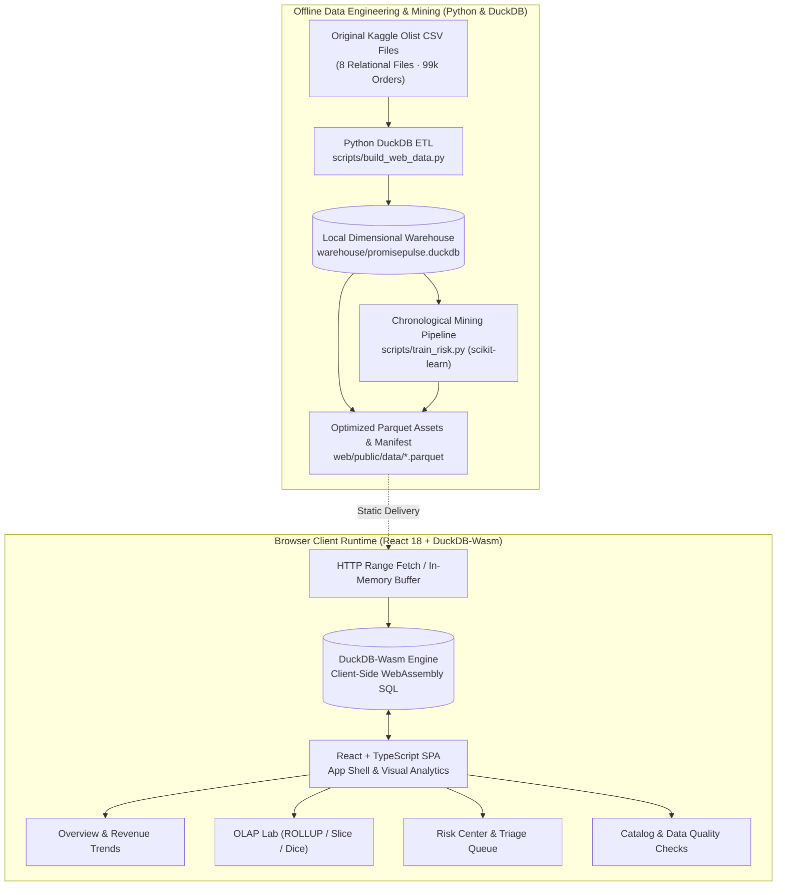
</details>

---

## Dimensional Warehouse

The analytical backbone of PromisePulse is a conformed **Star Schema** designed to eliminate fan-out errors and support rapid OLAP aggregations.

### Schema Entity-Relationship Diagram

<div align="center">
  
  <p><em>Figure 3: Conformed Star Schema dimensional model with fact_orders, fact_order_items, and four dimension tables.</em></p>
</div>

<details>
<summary><strong>View Mermaid Schema ER Source</strong></summary>

```mermaid
erDiagram
    dim_customer ||--o{ fact_orders : places
    dim_date ||--o{ fact_orders : timestamps
    fact_orders ||--|{ fact_order_items : contains
    dim_product ||--o{ fact_order_items : classifies
    dim_seller ||--o{ fact_order_items : fulfills
    fact_orders ||--o| risk_predictions : evaluates

    fact_orders {
        VARCHAR order_id PK
        VARCHAR customer_id FK
        VARCHAR order_status
        TIMESTAMP purchase_ts
        DATE purchase_date FK
        TIMESTAMP estimated_delivery_ts
        TIMESTAMP delivered_ts
        DATE delivered_date
        INTEGER item_count
        DOUBLE item_total
        DOUBLE freight_total
        DOUBLE payment_total
        DOUBLE review_score
        BOOLEAN is_late
    }

    fact_order_items {
        VARCHAR order_id FK
        INTEGER order_item_id PK
        VARCHAR product_id FK
        VARCHAR seller_id FK
        DOUBLE price
        DOUBLE freight_value
    }

    dim_customer {
        VARCHAR customer_id PK
        VARCHAR customer_unique_id
        VARCHAR customer_city
        VARCHAR customer_state
    }

    dim_product {
        VARCHAR product_id PK
        VARCHAR category
        DOUBLE weight_g
    }

    dim_seller {
        VARCHAR seller_id PK
        VARCHAR seller_city
        VARCHAR seller_state
    }

    dim_date {
        DATE date_day PK
        INTEGER year
        INTEGER quarter
        INTEGER month
        VARCHAR year_month
    }

    risk_predictions {
        VARCHAR order_id PK
        TIMESTAMP purchase_ts
        VARCHAR customer_state
        DOUBLE order_value
        TIMESTAMP estimated_delivery_ts
        INTEGER actual_late
        DOUBLE risk_probability
        INTEGER predicted_risk
        VARCHAR risk_band
    }
```
</details>

### Table Grains and Architectural Rationale

| Table Name | Entity Role | Primary Grain | Total Rows | Description & Key Columns |
| :--- | :--- | :--- | :--- | :--- |
| `fact_orders` | Accumulating Fact | 1 row per `order_id` | **99,441** | Order-level monetary totals (`payment_total`), item aggregates, customer FK, purchase date FK, delivery timestamps, and boolean `is_late` label. |
| `fact_order_items` | Transactional Fact | 1 row per `(order_id, order_item_id)` | **112,650** | Item price and freight allocation, product FK (`product_id`), seller FK (`seller_id`). |
| `dim_customer` | Conformed Dimension | 1 row per `customer_id` | **99,441** | Maps order customer tokens to persistent individuals (`customer_unique_id`, 96,096 distinct individuals), customer cities, and customer states. |
| `dim_product` | Conformed Dimension | 1 row per `product_id` | **32,951** | Product physical characteristics and translated English categories (e.g., `bed_bath_table`, `health_beauty`). |
| `dim_seller` | Conformed Dimension | 1 row per `seller_id` | **3,095** | Seller marketplace accounts and originating geographic states. |
| `dim_date` | Conformed Dimension | 1 row per calendar day | **774** | Complete calendar spanning 2016-09-04 to 2018-10-17 with year, quarter, month, and `year_month` formatting. |
| `risk_predictions` | Analytical Fact | 1 row per out-of-sample order | **19,294** | Held-out test period predictions containing predicted risk probabilities, binary flags, and actual late delivery outcomes. |

#### Preventing Revenue Double-Counting
In e-commerce reporting, an order with 3 items totaling R$ 150 paid in 1 transaction will produce 3 rows in `order_items` and 1 row in `order_payments`. Joining raw items directly with payments creates cartesian fan-out, inflating total revenue threefold (to R$ 450). 

PromisePulse resolves this by:
1. Aggregating payments independently per `order_id` inside `fact_orders.payment_total`.
2. Aggregating item prices independently inside `fact_orders.item_total` and allocating line items to `fact_order_items.price`.
3. Validating that `payment_total_delta_cents = 0` and `item_sales_delta_cents = 0` during data reconciliation.

---

## OLAP Operations

The **OLAP Lab** allows users to explore the multidimensional cube through standardized analytical operations. Every query executes live against the browser's DuckDB-Wasm engine.

### 1. Roll-Up (Hierarchical Aggregation)
* **Objective**: Summarize metrics by climbing up the geographic and temporal hierarchies, producing state-level subtotals and grand totals using SQL-standard `GROUP BY ROLLUP`.
* **Executable SQL Query**:
```sql
SELECT 
    CASE WHEN GROUPING(c.customer_state) = 1 THEN 'ALL STATES' 
         ELSE COALESCE(c.customer_state, 'Unknown') END AS state,
    CASE WHEN GROUPING(d.year_month) = 1 THEN 'ALL MONTHS' 
         ELSE d.year_month END AS month,
    COUNT(*) AS orders,
    ROUND(SUM(o.payment_total), 2) AS payment_revenue
FROM fact_orders o
JOIN dim_customer c USING (customer_id)
JOIN dim_date d ON o.purchase_date = d.date_day
WHERE o.purchase_date BETWEEN DATE '2016-01-01' AND DATE '2018-12-31'
GROUP BY ROLLUP(c.customer_state, d.year_month)
ORDER BY state, month
LIMIT 100;
```
* **Analytical Insight**: Enables management to observe revenue contributions per state across time while simultaneously receiving aggregated totals for executive reporting without secondary query passes.

### 2. Drill-Down (Navigating to Greater Detail)
* **Objective**: Deconstruct high-level regional performance into lower-level temporal grains (e.g., examining monthly breakdowns specifically for São Paulo `SP`).
* **Executable SQL Query**:
```sql
SELECT 
    c.customer_state AS state,
    d.year_month AS month,
    COUNT(*) AS orders,
    ROUND(SUM(o.payment_total), 2) AS payment_revenue
FROM fact_orders o
JOIN dim_customer c USING (customer_id)
JOIN dim_date d ON o.purchase_date = d.date_day
WHERE o.purchase_date BETWEEN DATE '2016-01-01' AND DATE '2018-12-31'
  AND c.customer_state = 'SP'
GROUP BY 1, 2
ORDER BY 2;
```
* **Analytical Insight**: Reveals monthly growth trajectories within the platform's primary market (SP accounted for >40,000 orders), isolating demand spikes during promotional periods (e.g., Black Friday in November 2017).

### 3. Slice (Fixing One Dimension)
* **Objective**: Select a 2D rectangular sub-slice of the data cube by fixing the geographic dimension (`customer_state = 'SP'`) and examining fulfillment status distributions.
* **Executable SQL Query**:
```sql
SELECT 
    c.customer_state AS state,
    o.order_status AS status,
    COUNT(*) AS orders,
    ROUND(SUM(o.payment_total), 2) AS payment_revenue,
    ROUND(100.0 * COUNT(*) FILTER (WHERE o.is_late = true) / NULLIF(COUNT(o.is_late), 0), 2) AS late_pct
FROM fact_orders o
JOIN dim_customer c USING (customer_id)
WHERE o.purchase_date BETWEEN DATE '2016-01-01' AND DATE '2018-12-31'
  AND c.customer_state = 'SP'
GROUP BY 1, 2
ORDER BY orders DESC;
```
* **Analytical Insight**: Shows that while São Paulo achieves high delivery completion rates (40,501 delivered orders), its late delivery rate remains controlled at 4.49%, significantly lower than remote territories.

### 4. Dice (Sub-Cube Selection)
* **Objective**: Filter across multiple dimensions simultaneously (specifying states `SP` and `RJ` and restricting order statuses to `delivered`, `shipped`, `canceled`).
* **Executable SQL Query**:
```sql
SELECT 
    c.customer_state AS state,
    o.order_status AS status,
    COUNT(*) AS orders,
    ROUND(SUM(o.payment_total), 2) AS payment_revenue
FROM fact_orders o
JOIN dim_customer c USING (customer_id)
WHERE o.purchase_date BETWEEN DATE '2016-01-01' AND DATE '2018-12-31'
  AND c.customer_state IN ('SP', 'RJ')
  AND o.order_status IN ('delivered', 'shipped', 'canceled')
GROUP BY 1, 2
ORDER BY 1, 2;
```
* **Analytical Insight**: Enables direct comparative operational benchmarking between two high-density economic hubs, revealing cancellation and in-transit failure rates.

### 5. Pivot (Cross-Tabulation & Rotation)
* **Objective**: Rotate dimensions by projecting monthly order volumes for two competing states side-by-side using SQL `FILTER` clauses.
* **Executable SQL Query**:
```sql
SELECT 
    d.year_month AS month,
    COUNT(*) FILTER (WHERE c.customer_state = 'SP') AS SP_orders,
    COUNT(*) FILTER (WHERE c.customer_state = 'RJ') AS RJ_orders,
    COUNT(*) AS all_states_orders
FROM fact_orders o
JOIN dim_customer c USING (customer_id)
JOIN dim_date d ON o.purchase_date = d.date_day
WHERE o.purchase_date BETWEEN DATE '2016-01-01' AND DATE '2018-12-31'
GROUP BY 1
ORDER BY 1;
```
* **Analytical Insight**: Produces an immediate comparative growth matrix without requiring backend reshape or Python pivoting operations.

---

## Data Mining Methodology

PromisePulse frames delivery risk as a **binary classification problem at the time of order checkout**.

```
Problem: Predict whether an order will arrive after its promised estimated delivery date.
Target Label: actual_late ∈ {0, 1}
  - 1 (Late): delivered_customer_date::DATE > estimated_delivery_date::DATE
  - 0 (On-Time): delivered_customer_date::DATE <= estimated_delivery_date::DATE
  - Excluded: Orders canceled, unavailable, or missing final delivery timestamps (2,971 rows)
```

### 1. Leakage Safeguards & Feature Engineering
A frequent flaw in e-commerce machine learning is data leakage: utilizing features that could not have been known when the decision was made. PromisePulse strictly enforces a **checkout-time feature set**:

| Feature Name | Type | Processing | Rationale |
| :--- | :--- | :--- | :--- |
| `item_count` | Numeric | Median Imputation + Standard Scaling | Number of discrete physical items in the order. |
| `item_total` | Numeric | Median Imputation + Standard Scaling | Total merchandise price in BRL. |
| `freight_total` | Numeric | Median Imputation + Standard Scaling | Total shipping fee incurred. |
| `promised_days` | Numeric | Median Imputation + Standard Scaling | Days between purchase date and estimated delivery date. |
| `purchase_month` | Numeric | Median Imputation + Standard Scaling | Calendar month capturing macro seasonality (holidays, Q4). |
| `purchase_weekday` | Numeric | Median Imputation + Standard Scaling | Day of week capturing weekend logistics dispatch lag. |
| `customer_state` | Categorical | One-Hot Encoding (`handle_unknown='ignore'`) | Destination federative unit capturing geographical transit distance. |

> **Strict Non-Leakage Rule**: No delivery timestamps, carrier pickup timestamps, tracking progress events, or customer review scores are provided to the model.

### 2. Chronological Train / Validation / Test Splitting
Random $k$-fold cross-validation is inappropriate for temporal logistics data because future deliveries leak information back into historical training sets. PromisePulse uses strict **temporal splitting** with label maturity cutoffs:

* **Training Window** (First 65% of orders: 58,731 samples): Orders purchased and delivered prior to cutoff date 1.
* **Validation Window** (Next 15% of orders: 12,435 samples): Orders purchased and delivered between cutoff date 1 and cutoff date 2. Used exclusively for hyperparameter validation and optimal decision threshold selection.
* **Test Window** (Final 20% of orders: 19,294 samples): Held-out test set spanning **2018-05-26 to 2018-08-29**. Used strictly for final benchmark reporting.

### 3. Empirical Model Evaluation Results

Due to severe class imbalance (late deliveries represent only ~3.5% of out-of-sample orders in the test window), standard accuracy is a misleading metric (a trivial classifier predicting 0 achieves 96.5% accuracy but catches zero delays). The optimal operating threshold ($\tau = 0.60$) was chosen strictly on the validation set to maximize F1-score.

| Metric | Dummy Prior Baseline | PromisePulse Balanced Logistic Model | Relative Gain |
| :--- | :--- | :--- | :--- |
| **Precision** | 0.000 (0.0%) | **0.049** (4.9%) | $+4.9\text{ percentage points}$ |
| **Recall** | 0.000 (0.0%) | **0.288** (28.8%) | $+28.8\text{ percentage points}$ |
| **F1-Score** | 0.000 | **0.083** | $+0.083$ |
| **ROC-AUC** | 0.500 | **0.698** | $+0.198$ |
| **PR-AUC** (Avg Precision) | 0.035 | **0.068** | $+94.3\%\text{ increase}$ |

#### Held-Out Confusion Matrix (19,294 Test Orders at $\tau = 0.60$)
* **True Positives (TP)**: **194** correctly flagged late orders.
* **False Positives (FP)**: **3,779** flagged orders that arrived on time.
* **False Negatives (FN)**: **480** unflagged orders that arrived late.
* **True Negatives (TN)**: **14,841** correctly identified on-time deliveries.

#### Limitations of the Historical Classifier
* **Transit Blindness**: The model operates strictly at purchase time. Unforeseen weather disruptions, carrier strikes, or vehicle breakdowns occurring days later cannot be anticipated by checkout features alone.
* **False Positive Rate**: To capture ~29% of late deliveries, the model accepts a notable false positive rate. In operations, this queue is used for low-cost preventive measures (e.g., priority dispatching, routing to expedited carriers, or setting conservative delivery estimates).

---

## Dataset Source and Attribution

* **Official Dataset**: [Brazilian E-Commerce Public Dataset by Olist](https://www.kaggle.com/datasets/olistbr/brazilian-ecommerce)
* **Dataset Provider**: Olist
* **License**: Creative Commons Attribution-NonCommercial-ShareAlike 4.0 International ([CC BY-NC-SA 4.0](https://creativecommons.org/licenses/by-nc-sa/4.0/))
* **Temporal Period**: 2016 – 2018 (Historical dataset; not live orders)

### Processed File Inventory

| Source CSV File | Staging Table | Source Rows | Raw File Size |
| :--- | :--- | :--- | :--- |
| `olist_customers_dataset.csv` | `raw_customers` | 99,441 | 9.03 MB |
| `olist_orders_dataset.csv` | `raw_orders` | 99,441 | 17.65 MB |
| `olist_order_items_dataset.csv` | `raw_order_items` | 112,650 | 15.44 MB |
| `olist_order_payments_dataset.csv` | `raw_order_payments` | 103,886 | 5.78 MB |
| `olist_order_reviews_dataset.csv` | `raw_order_reviews` | 99,224 | 14.45 MB |
| `olist_products_dataset.csv` | `raw_products` | 32,951 | 2.38 MB |
| `olist_sellers_dataset.csv` | `raw_sellers` | 3,095 | 0.17 MB |
| `product_category_name_translation.csv` | `raw_product_category_translation` | 71 | 2.61 KB |

### Verified Post-ETL Dimension & Fact Counts
* **`fact_orders`**: 99,441 facts (96,470 orders with verified final delivery outcomes; 2,971 unlabeled).
* **`fact_order_items`**: 112,650 item-level facts.
* **`dim_customer`**: 99,441 customer records (mapping to 96,096 distinct individual customers).
* **`dim_product`**: 32,951 dimension records.
* **`dim_seller`**: 3,095 dimension records.
* **`dim_date`**: 774 calendar dates.
* **`risk_predictions`**: 19,294 evaluated test orders.

---

## Upstream Project Attribution

This project builds upon architectural concepts and data engineering patterns established in:
* **Upstream Repository**: [credough/olist-sales-analytics-pipeline](https://github.com/credough/olist-sales-analytics-pipeline)
* **Original Author**: Christopher Dougherty

### Enhancements and Novel Contributions in PromisePulse
1. **Serverless Browser Architecture**: Replaced the previous Streamlit and Dockerized PostgreSQL architecture with a modern React 18 + Vite SPA powered by embedded **DuckDB-Wasm**.
2. **In-Browser OLAP Engine**: Added dynamic client-side SQL execution supporting `ROLLUP`, Drill-down, Slicing, Dicing, and Pivoting without server dependencies.
3. **Rigorous Machine Learning Pipeline**: Implemented a leak-free chronological train/validation/test framework in `scripts/train_risk.py` with explicit label maturity cutoffs and validation-only threshold tuning.
4. **Interactive Risk Center**: Created an interactive risk investigation UI featuring real-time client-side confusion matrix recalculation and CSV triage export.
5. **Modern Luxury Design System**: Engineered a custom responsive interface matching high-end design principles without heavyweight external UI component libraries.

---

## Installation and Setup

### Prerequisites
* **Linux Environment** (Ubuntu 20.04+ or modern Linux distribution)
* **Python 3.10+** (Python 3.11 tested)
* **Node.js 18+** (Node.js 20+ recommended) and `npm`

---

### Step 1: Clone Repository and Set Up Python Environment

```bash
# Clone the repository
git clone https://github.com/kasim672/PromisePulse.git
cd PromisePulse

# Create and activate Python virtual environment
python3 -m venv .venv
source .venv/bin/activate

# Install offline data processing and ML dependencies
pip install --upgrade pip
pip install -r requirements-export.txt
```

---

### Step 2: Download Dataset and Build Warehouse (Optional for Local Re-build)

The repository already includes pre-built, verified Parquet data assets in `web/public/data/`. If you wish to reproduce the ETL and machine learning training from scratch:

```bash
# Download the 8 CSV files from Kaggle and place in data/raw/
# https://www.kaggle.com/datasets/olistbr/brazilian-ecommerce
mkdir -p data/raw

# Run the dimensional ETL pipeline and scikit-learn model training
python scripts/build_web_data.py --raw-dir data/raw --train

# Run automated validation on the generated export assets
python scripts/verify_export.py
```

Expected verification output:
```text
PASS dim_customer: 99,441 records
PASS dim_product: 32,951 records
PASS dim_seller: 3,095 records
PASS dim_date: 774 records
PASS fact_orders: 99,441 records
PASS fact_order_items: 112,650 records
PASS risk_predictions: 19,294 records
PASS: fact grains and financial reconciliation
PASS: official dataset attribution: https://www.kaggle.com/datasets/olistbr/brazilian-ecommerce
PASS: mining status: evaluated
```

---

### Step 3: Web Dashboard Setup & Development

```bash
# Navigate to the frontend directory
cd web

# Install frontend dependencies
npm install

# Run TypeScript compilation and build production bundle
npm run build

# Start local development server
npm run dev
```

Open your browser at `http://127.0.0.1:5173`. DuckDB-Wasm will initialize, load the Parquet tables into client memory, and display **LOCAL SQL READY** in the header.

---

### Step 4: Run Automated Tests

PromisePulse includes automated test suites covering Python data export reconciliation and SQL query template generation:

```bash
# Run Python exporter unit tests
.venv/bin/pytest tests/

# Run TypeScript/JavaScript SQL generation tests
NODE_PATH=web/node_modules node tests/test_sql_generation.cjs
```

---

## Academic Relevance

### Data Warehousing and Data Mining Concepts Demonstrated

This project serves as a comprehensive reference implementation for university coursework in **Data Warehousing & Data Mining (DWDM)**:

| DWDM Topic | Academic Concept | Concrete Implementation in PromisePulse |
| :--- | :--- | :--- |
| **ETL & Data Staging** | Multi-source schema integration & sanitization | `scripts/build_web_data.py` reads 8 raw CSVs into DuckDB staging tables with type validation and null-coalescing. |
| **Dimensional Modeling** | Kimball Star Schema & Grain Separation | Distinct accumulating fact (`fact_orders`) and transactional fact (`fact_order_items`) conformed across 4 dimensions. |
| **Measures & Additivity** | Additive vs Non-additive Facts | Unit price and freight are fully additive; review scores and delivery delays are non-additive; payment totals are additive only at order grain. |
| **OLAP Aggregations** | Multidimensional Cube Queries | In-browser implementation of `ROLLUP`, Drill-down, Slicing, Dicing, and Pivoting using DuckDB-Wasm. |
| **Data Quality Auditing** | Referential integrity & reconciliation | Automated SQL assertions checking zero duplicate keys, complete conformed joins, and penny-level payment reconciliation. |
| **Feature Engineering** | Leak-free checkout feature extraction | Calendar extraction (`month`, `dow`), distance proxies (`customer_state`), and fulfillment commitments (`promised_days`). |
| **Supervised Classification**| Skewed binary classification | Scikit-learn Pipeline with median imputation, one-hot encoding, and class-balanced logistic regression. |
| **Temporal Evaluation** | Leakage prevention in time-series data | Chronological train/validation/test split preventing backwards-in-time label contamination. |
| **Threshold Optimization**| Rare-event cost-sensitive triage | Validation-only threshold optimization tuning the decision boundary for maximum F1-score. |

---

## Project Structure

```text
PromisePulse/
├── .github/workflows/
│   ├── web-checks.yml                  # Build, SQL, theme and Atlas checks
│   ├── capture-screenshots.yml         # One-shot genuine Chromium screenshots
│   └── cleanup-feature-branches.yml   # Feature branch cleanup after final merge
├── .agents/skills/measured-design-reference/SKILL.md
├── README.md                           # Main project documentation
├── design.md                           # Measured light UI reference and dark adaptation
├── docs/
│   ├── USER_GUIDE.md                   # Seven workspace instructions and examples
│   ├── RESEARCH_REPRODUCIBILITY.md     # ETL, model, metrics and scientific caveats
│   ├── ANALYTICS_ATLAS_METHODOLOGY.md # Figure-to-query registry and exclusions
│   ├── SCREENSHOT_GALLERY.md           # Authentic light/dark/mobile gallery
│   ├── THIRD_PARTY_NOTICES.md
│   └── screenshots/
│       ├── v3/                         # Current genuine app screenshots and manifest
│       └── *.png                       # Earlier-version screenshots/architecture diagrams
├── scripts/
│   ├── build_web_data.py               # Historical CSV → DuckDB → Parquet ETL
│   ├── train_risk.py                   # Chronological classification
│   └── verify_export.py               # Published export checks
├── tests/
│   ├── test_exporter.py
│   ├── test_sql_generation.cjs
│   ├── test_theme.cjs
│   └── test_atlas.cjs
├── web/
│   ├── scripts/capture-doc-screens.mjs # Real browser screenshots (Playwright)
│   ├── src/
│   │   ├── App.tsx                     # App shell, navigation and original workspaces
│   │   ├── Premium.tsx                 # Original dashboard, plots and state choropleth
│   │   ├── AnalyticsAtlas.tsx          # 36 interactive chart definitions rendered
│   │   ├── atlasQueries.ts             # Allowlists and read-only analytical SQL
│   │   ├── queries.ts                  # OLAP and historical risk query builders
│   │   ├── premiumQueries.ts           # Original dashboard queries
│   │   ├── db.ts                       # DuckDB-Wasm browser query runtime
│   │   ├── measured-glass.css          # Adapted measured light UI
│   │   ├── theme.css                   # Global dark/light styling
│   │   └── atlas.css                   # Theme-responsive chart layouts
│   └── public/
│       ├── promisepulse-logo.webp
│       ├── favicon.png
│       └── data/                       # Static Parquet export and manifest
└── requirements-export.txt
```

---

## Testing and Verification Status

GitHub Actions provides the current build and static-query verification; the screenshots in `docs/screenshots/v3/` are captured through the actual browser workflow. Independent field testing and statistical review remain separate:

| Verification Phase | Command / Tool | Status | Result / Notes |
| :--- | :--- | :--- | :--- |
| **Python Unit Tests** | `pytest tests/` | **PASSED** | 2/2 tests passed in 0.06s (`tests/test_exporter.py`). |
| **OLAP SQL Tests** | `node tests/test_sql_generation.cjs` | **PASSED** | All 5 OLAP SQL generator templates validated with injection guards. |
| **Data Integrity Verification** | `python scripts/verify_export.py` | **PASSED** | All 7 tables, grains, license attribution, and metric outputs validated. |
| **TypeScript Type Checks** | `tsc -b` | **PASSED** | Zero type errors across all TS/TSX modules. |
| **Production Web Build** | `vite build` | **PASSED** | Production bundle compiled in 2.83s with DuckDB-Wasm assets included. |
| **Browser Screenshot Capture** | `web/scripts/capture-doc-screens.mjs` | **See capture manifest** | 18 planned real-app screenshots across seven workspaces, two themes and mobile viewport; generated by a separate GitHub Actions capture workflow. |
| **Atlas Query Integrity** | `node tests/test_atlas.cjs` | **CI PASSED** | Registry count, allowlisted date/state filters, order/item-grain safeguards and interactive component wiring. |
| **Theme Contract** | `node tests/test_theme.cjs` | **CI PASSED** | Global color mode persistence and chart/map token use. |

---

## Limitations and Future Roadmap

* **Historical Snapshot Nature**: The Olist dataset terminates in late 2018. Models and trends reflect historical Brazilian retail patterns and are not connected to a live ERP or courier API.
* **Client-Side Memory Constraints**: While DuckDB-Wasm handles 100,000 order facts seamlessly (~15MB compressed Parquet), datasets exceeding several million rows would necessitate server-side database clustering or DuckDB server pushdown.
* **Model Algorithmic Complexity**: The current baseline utilizes class-weighted Logistic Regression to maintain transparency and instant scoring. Incorporating gradient-boosted trees (e.g., LightGBM or XGBoost) with SHAP value explainability represents a valuable future extension.

---

## License

This project is licensed under the **MIT License** — see the [LICENSE](LICENSE) file for details.

The underlying **Brazilian E-Commerce Public Dataset** is provided by **Olist** and licensed under **[CC BY-NC-SA 4.0](https://creativecommons.org/licenses/by-nc-sa/4.0/)**.
