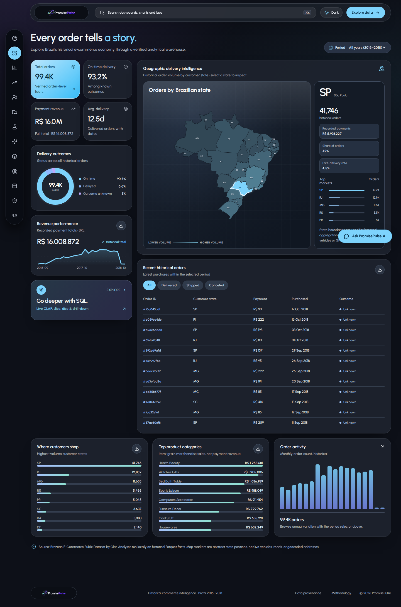
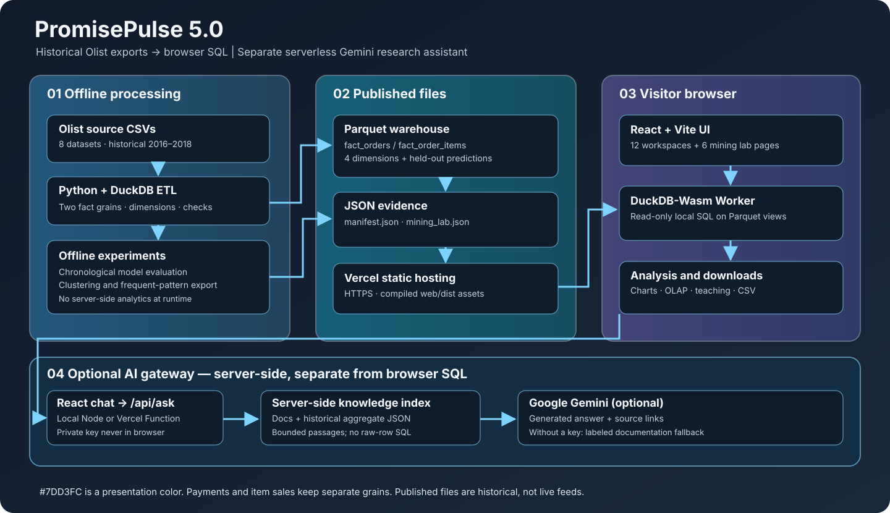

# PromisePulse

**Historical e-commerce intelligence, dimensional warehousing and reproducible data-mining experiments.**

[](https://github.com/kasim672/PromisePulse/actions/workflows/web-checks.yml)
[](LICENSE)
[](https://www.kaggle.com/datasets/olistbr/brazilian-ecommerce)

**[Website](https://promise-pulse-rose.vercel.app/)** · **[Architecture](docs/ARCHITECTURE_V5.md)** · **[Soft-cyan design system](docs/THEME_SYSTEM.md)** · **[Deployment guide](docs/DEPLOYMENT.md)** · **[Screenshots](docs/SCREENSHOT_GALLERY_CURRENT.md)** · **[Reproducibility](docs/RESEARCH_REPRODUCIBILITY.md)**


*PromisePulse 5.0, soft-cyan design (`#7DD3FC`). Browser-rendered capture of the repository's historical Olist dashboard. The [capture manifest](docs/screenshots/current/CAPTURE_MANIFEST.json) identifies the source SHA, capture date and viewport; images are not proof of a live Vercel release. The [gallery](docs/SCREENSHOT_GALLERY_CURRENT.md) also documents the light/dark AI assistant.*

## Overview

PromisePulse explores the **Brazilian E-Commerce Public Dataset by Olist**, a historical record of marketplace activity from **2016–2018**. An offline Python/DuckDB pipeline converts eight raw source CSVs into an audited dimensional warehouse. The website then downloads **Parquet files** and uses **DuckDB-Wasm in the visitor's browser** to execute real read-only SQL for interactive dashboards, OLAP, charting and CSV exports.

A separate offline experiment exporter provides six Data Mining Lab sections: warehouse/ETL, data lakes, exploratory preprocessing, classification and regression, clustering, and frequent-pattern mining. The experiments use published historical results, not simulated order activity or models retrained on each visit.

**This is a research and education dashboard, not a live fulfillment tracker or deployed risk-scoring service.** It requires no hosted SQL server, account system, Streamlit application or Python process to serve the public site.

## Current design and release status

The interface uses a **soft-cyan accent (`#7DD3FC`)** in place of fluorescent lime. Cyan appears on navigation selection, calls to action, KPI highlights, chart interactions, the historical Brazil map, Data Mining Lab controls, and the favicon. The dark graphite backgrounds and purple wordmark are retained. The design also provides a light theme, accessible dark-navy text on cyan backgrounds, and responsive layouts.

The current `main` release includes the original analytics and six mining lab modules, the step-by-step visualizers, the **Gemini-backed website knowledge assistant**, and its improved dark/light chat styling ([PR #18](https://github.com/kasim672/PromisePulse/pull/18), [PR #19](https://github.com/kasim672/PromisePulse/pull/19)). UI changes do not alter Olist data, SQL, historical model evaluation or mining results. See [release notes](docs/RELEASE_NOTES.md).

**GitHub source and public deployment are separate:** recent Vercel status checks reported deployment build-rate limits. Check **Deployments → Production**, its **Ready** status, and the deployed commit SHA before assuming the public URL reflects `main`. The [deployment guide](docs/DEPLOYMENT.md) explains verification; the [design system](docs/THEME_SYSTEM.md) covers both appearance modes.

## PromisePulse AI — website knowledge assistant

The merged React chatbot opens from **Ask PromisePulse AI** and calls `POST /api/ask`. Its server-side retrieval indexes the checked-in project guides, warehouse `manifest.json`, and selected **aggregate** mining results. Relevant passages support questions about workspaces, tables, charts, experiments and deployment. With a configured Google Gemini API key, it can also handle ordinary conversational questions. It **does not** query raw Parquet rows, inspect the visitor's current SQL output, search the live web or automatically discover new content outside the checked-in index.

**There are two response modes:** Gemini-generated explanations when the private key and model are available; clearly labelled **reference excerpts** if Gemini is missing or unavailable. A reference response is not a generated explanation. A local greeting may also be handled in React. The model currently defaults to `gemini-3.5-flash` unless `GEMINI_MODEL` overrides it; availability depends on the Google API project.

```bash
git clone https://github.com/kasim672/PromisePulse.git
cd PromisePulse/web
npm ci
npm run setup:gemini
# Add your private key to the untracked web/.env; never commit it.
npm run dev
# In another terminal: cd PromisePulse/web && npm run check:gemini
```

`npm run dev` starts the loopback-only Node API on `127.0.0.1:8787` and Vite on `127.0.0.1:5173`. Vite proxies `/api/ask` to the same handler used by the Vercel Function. The index is refreshed from checked-in docs and published aggregates on `predev` and `prebuild`.

Keep `GEMINI_API_KEY` in `web/.env` locally and in **Vercel server-side Environment Variables** for production; never use a `VITE_*` secret. Gemini processes submitted questions and selected source excerpts when enabled. See the [assistant guide](docs/GEMINI_RESEARCH_ASSISTANT.md) for privacy, quotas, testing, fallback behavior and limitations.

## Explore the current release

| Workspace | What it does |
| --- | --- |
| **Welcome** | Historical source-backed entry page and monthly order trend |
| **Overview** | Orders, payments, delivery outcomes, customer-state map and trends |
| **Intelligence** | Additional SQL-based marketplace and fulfillment comparisons |
| **Analytics Atlas** | 36 interactive chart definitions across nine analysis lenses |
| **Customer Cohorts** | Six cohort and repeat-customer analytics |
| **Delivery Lab** | Six descriptive promise-window and delivery analyses |
| **Research Studio** | Twelve basket, product-weight and freight analyses |
| **AI Studio** | Six held-out model diagnostics and a deterministic evidence assistant |
| **OLAP Lab** | Drill-down, roll-up, slice, dice and pivot operations |
| **Risk Center** | Exploration of evaluated historical late-delivery predictions |
| **Data Catalog** | Published source metadata, table grains and warehouse schemas |
| **Pipeline & Quality** | Transformation provenance and reconciliation checks |
| **Data Mining Lab** | An overview plus six detailed academic analysis sections |

There are **12 original navigation destinations** plus **one Data Mining Lab icon**. That icon opens the lab overview directly; the six analysis sections are selected from its cards or internal tabs. There is **no dropdown or separate icon for each lab section**.

The **66 original research chart definitions** come from 36 Atlas charts and 30 research expansion charts. Mining-lab diagrams, figures and tables are supplementary, not additions to that 66-definition count.

### Six Data Mining Lab sections

| Section | Recorded implementation |
| --- | --- |
| Warehouse & ETL | Dimensional models, order/item fact grain separation, ETL stages and quality |
| Data Lakes | File-level staging and curated data comparison (conceptual lake architecture, **no cloud object store**) |
| EDA & Preprocessing | Distributions, missingness, quartiles, descriptive statistics and correlations |
| Classification Lab | Offline Decision Tree, Gaussian Naive Bayes, logistic/majority baselines and regression comparisons |
| Clustering Lab | K-Means, Ward hierarchical clustering, Bisecting K-Means, PCA projections and real dendrogram links |
| Pattern Mining | Apriori, FP-Growth, Eclat, closed sets, support, confidence, lift and association rules |

The original university **30-hour syllabus breakdown** remains in the [syllabus methodology document](docs/SYLLABUS_V5.md); it is not shown as unnecessary micro-headlines on the website.

### Interactive algorithm walkthroughs

The original three mining areas now include an **interactive teaching visualizer**. Use numbered steps, **Previous**, **Next step**, and **Restart** to follow an actual calculation on clearly displayed example inputs.

- **K-Means:** Watch six plotted points move between computed centroid assignments, recalculated group means and convergence.
- **Decision Tree:** Follow highlighted conditions through a deliberately illustrative decision path.
- **Apriori:** Generate, count and prune itemsets at a fixed minimum support of three out of five example baskets.
- **FP-Growth:** Insert the same five baskets into an FP-tree and watch prefix counts update.
- **Eclat:** Intersect transaction-ID sets for item combinations.

**Teaching examples are not Olist training traces or live predictions.** The actual published classification metrics, 950-customer clustering evidence, and 649-basket association analysis stay in their original panels. For worked examples and limitations, read the [Algorithm Playground guide](docs/ALGORITHM_PLAYGROUND.md).

Loading is also more informative: warehouse initialization reports the manifest, WebAssembly engine and actual Parquet-file registration counts; analysis charts show query-specific placeholders. Warehouse and lab fetch failures provide diagnostic details and a retry action, without invented fallback data.

[](docs/screenshots/current/algorithm-k-means-light.png)

[See all five algorithm screenshots and mobile views](docs/SCREENSHOT_GALLERY_CURRENT.md).


### Actual screenshots

| Overview (light) | Overview (dark) |
| --- | --- |
| [](docs/screenshots/current/overview-light.png) | [](docs/screenshots/current/overview-dark.png) |

| Mining lab overview | Clustering |
| --- | --- |
| [](docs/screenshots/current/mining-hub-light.png) | [](docs/screenshots/current/clustering-light.png) |

[](docs/screenshots/current/assistant-light.png)

*The chatbot is now captured in light, dark and mobile mode. These screenshots show its rendered entry state, not a live Gemini response.*

**[See the complete soft-cyan desktop, dark-mode and mobile gallery](docs/SCREENSHOT_GALLERY_CURRENT.md).** Previous [V3](docs/SCREENSHOT_GALLERY.md), [V4](docs/SCREENSHOT_GALLERY_V4.md) and [early V5](docs/SCREENSHOT_GALLERY_V5.md) captures remain archived; some older screenshots predate the typography cleanup.

## System architecture



The system has **two distinct phases**:

1. **Offline data preparation:** Olist CSV files → Python/DuckDB staging and dimensional modeling → reconciliation checks → Parquet export and manifest. Optional chronological model evaluation produces held-out predictions; the mining exporter produces `mining_lab.json`.
2. **Public interactive application:** Vercel serves React/Vite build assets plus the versioned Parquet and JSON files. React instantiates DuckDB-Wasm in a browser worker, registers Parquet views and runs historical SQL against them. Lab charts display previously computed experiment results.

Read the **[full system architecture, end-to-end flow, ER/grain diagram and browser sequence diagram](docs/ARCHITECTURE_V5.md)**.

### Warehouse at a glance

| Published relation | Grain | Current manifest rows |
| --- | --- | ---: |
| `fact_orders` | Order | 99,441 |
| `fact_order_items` | Order item | 112,650 |
| `dim_customer` | Customer source record | 99,441 |
| `dim_product` | Product | 32,951 |
| `dim_seller` | Seller | 3,095 |
| `dim_date` | Calendar date | 774 |
| `risk_predictions` | Time-held-out prediction | 19,294 |

These figures are read from the checked-in [`manifest.json`](web/public/data/manifest.json); its recorded export date is **October 13, 2026**, not the time of your current visit.

**Avoid double-counting payments.** `fact_orders` contains order-grain payment totals; `fact_order_items` contains product/item prices and freight. Summing payment totals after joining one order to many items inflates revenue. The exporter provides separate, reconciled aggregations at the proper grains.

### Historical classification and mining limitations

The published held-out risk model has **precision ≈ 0.049**, **recall ≈ 0.288**, and **ROC AUC ≈ 0.698** at its recorded threshold of 0.60. These are limited minority-class results, not evidence of reliable operational alerts. A separate course classifier experiment has a different evaluation cohort and should not be merged numerically with the 19,294-row original model test.

The mining export uses a **950-customer** clustering sample and a **52-record** Ward dendrogram. Frequent pattern analysis uses **649 eligible multi-category baskets** under documented selection criteria, not every marketplace order. Correlation, cluster membership and itemset association do not establish causation.

See [research reproducibility](docs/RESEARCH_REPRODUCIBILITY.md), [syllabus experiments](docs/SYLLABUS_V5.md), and [original figure-to-SQL methodology](docs/ANALYTICS_ATLAS_METHODOLOGY.md).

## Run locally

A Node.js environment compatible with the project lockfile (CI uses **Node 22**) and npm are sufficient to run the already-published historical dashboard.

```bash
git clone https://github.com/kasim672/PromisePulse.git
cd PromisePulse
git switch main
cd web
npm ci
npm run dev
```

Open **http://127.0.0.1:5173/**. No Python environment, Kaggle download or credentials are required to **view** the bundled exported analytics.

To build and preview the static production output:

```bash
cd web
npm run build
npm run preview
```

The Vite build runs TypeScript checks and places the deployable site in `web/dist/`.

### Optional: regenerate warehouse and mining results

Install Python, create a virtual environment and prepare the eight raw Olist CSV files in `data/raw/` from the [Kaggle source](https://www.kaggle.com/datasets/olistbr/brazilian-ecommerce). From the repository root:

```bash
python3 -m venv .venv
source .venv/bin/activate
python -m pip install -r requirements-export.txt

python scripts/build_web_data.py --raw-dir data/raw --train
python scripts/verify_export.py
python scripts/build_mining_lab.py
python scripts/verify_mining_lab.py
```

`--train` evaluates the offline delivery-risk model chronologically and publishes test-period predictions. This is **optional** for running the site with its existing data; it is required if you want to reproduce the included evaluated model exports from raw input.

**Dataset licensing:** The application code is MIT, but the Olist dataset is **[CC BY-NC-SA 4.0](https://creativecommons.org/licenses/by-nc-sa/4.0/)**. The latter has attribution, noncommercial and share-alike conditions; MIT does not override them.

## Deploy on Vercel

The production domain is **[promise-pulse-rose.vercel.app](https://promise-pulse-rose.vercel.app/)**. Confirm that Vercel deployed the newest `main` commit before assuming the theme is live; deployment was rate-limited after the cyan merge. For a new Vercel import:

| Setting | Value |
| --- | --- |
| Repository | `kasim672/PromisePulse` |
| Production branch | `main` |
| Framework | Vite |
| **Root directory** | **`web`** |
| Install | `npm ci` |
| Build | `npm run build` |
| Output directory | `dist` |
| Required production secrets | None for the bundled static historical data |

Vercel deploys compiled HTML, JS, CSS, WebAssembly and `web/public/data` files. No live DuckDB server or Python deployment is involved. **[Read the complete setup, production QA, data-regeneration and troubleshooting guide](docs/DEPLOYMENT.md).**

## Validate the release

```bash
cd web
npm ci
npm run build

node ../tests/test_sql_generation.cjs
node ../tests/test_theme.cjs
node ../tests/test_atlas.cjs
node ../tests/test_research_expansion.cjs
node ../tests/test_syllabus_modules.cjs
node ../tests/test_mining_export_integrity.cjs
node ../tests/test_editorial_hierarchy.cjs
node ../tests/test_algorithm_playground.cjs
node ../tests/test_soft_cyan_theme.cjs
node ../tests/test_documentation.cjs
```

GitHub Actions runs these checks in [`.github/workflows/web-checks.yml`](.github/workflows/web-checks.yml). Browser navigation tests and capture scripts are in `web/scripts/` and install Playwright separately. The [capture gallery](docs/SCREENSHOT_GALLERY_CURRENT.md) documents the screenshot source, viewport and commit instead of relying on mockups.

## Project layout

```text
PromisePulse/
├── .github/workflows/         # Web build, data verification and browser QA
├── docs/
│   ├── ARCHITECTURE_V5.md     # Editable flow, ER and sequence diagrams
│   ├── architecture.svg       # Standalone overview diagram
│   ├── DEPLOYMENT.md          # Vercel and local deployment instructions
│   ├── THEME_SYSTEM.md        # Cyan palette, dark/light mode, logo, contrast
│   ├── SCREENSHOT_GALLERY_CURRENT.md
│   ├── SYLLABUS_V5.md         # Method mapping and empirical caveats
│   ├── RESEARCH_REPRODUCIBILITY.md
│   └── screenshots/
│       ├── current/           # Current browser screenshots and provenance
│       └── v3/, v4/, v5/     # Archived verified release captures
├── scripts/
│   ├── build_web_data.py      # Raw sources → warehouse → Parquet/manifest
│   ├── train_risk.py          # Chronological evaluation
│   ├── build_mining_lab.py    # Offline experimental methods
│   ├── verify_export.py
│   └── verify_mining_lab.py
├── tests/                     # Data, query, UX and export regression checks
├── web/
│   ├── public/data/           # Shipped Parquet and JSON; public on Vercel
│   ├── scripts/               # Actual Chromium browser/capture checks
│   ├── src/
│   │   ├── App.tsx            # Shell, navigation and original workspaces
│   │   ├── db.ts              # DuckDB-Wasm and SELECT-only query API
│   │   ├── Premium.tsx        # Overview / Intelligence / historical state map
│   │   ├── AnalyticsAtlas.tsx # Chart rendering and data exploration
│   │   ├── ResearchWorkspace.tsx
│   │   ├── SyllabusHub.tsx    # Single-click Data Mining Lab overview
│   │   ├── SyllabusLab.tsx    # Six analysis areas and clickable tabs
│   │   ├── editorial.css      # Readable typography refinements
│   │   └── soft-cyan.css      # Final cyan accent overrides
│   ├── package.json
│   └── vite.config.ts
├── requirements-export.txt
└── LICENSE
```

## Credit and license

PromisePulse builds on concepts from [Christopher Dougherty's `olist-sales-analytics-pipeline`](https://github.com/credough/olist-sales-analytics-pipeline), with a separate React + DuckDB-Wasm frontend, read-only OLAP exploration, chronological risk evaluation, quality reporting and the current research/mining lab additions.

- **Source code:** [MIT License](LICENSE).
- **Historical dataset:** Olist's [Brazilian E-Commerce Public Dataset](https://www.kaggle.com/datasets/olistbr/brazilian-ecommerce), **CC BY-NC-SA 4.0**.
- **Additional dependencies and licenses:** [Third-party notices](docs/THIRD_PARTY_NOTICES.md).

No live-delivery, real-time inference, scientific novelty, independent peer review or guaranteed prediction accuracy is asserted by these screenshots or this documentation.
