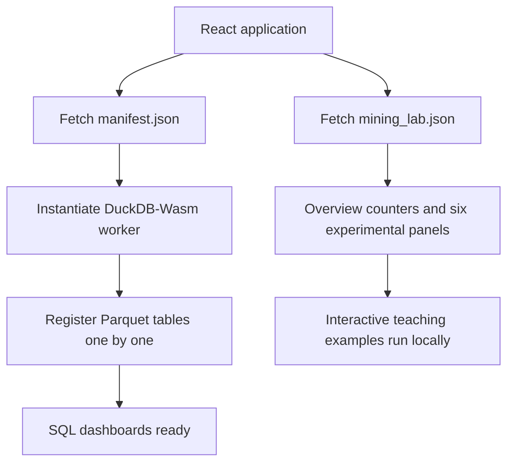
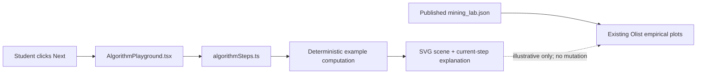

# PromisePulse 5.0 — Interactive algorithm walkthroughs

The existing empirical charts remain unchanged. This addition introduces **five interactive, computed teaching examples**, available inside the existing Data Mining Lab. They illustrate *how an algorithm proceeds*, not *what the previously trained Olist model did internally*.

**Live UI location:** Data Mining Lab → Classification Lab, Clustering Lab, or Pattern Mining.

## Use the visualizer

The component provides **Restart**, **Previous**, **Next step**, and numbered step buttons. For frequent-pattern mining, select **Apriori**, **FP-Growth**, or **Eclat**. Controls are keyboard operable and the current calculation is announced with `aria-live`. No autoplay or loop runs in the background.

| Lab | Interactive demonstration | Actual calculation performed |
| --- | --- | --- |
| Classification Lab | Decision Tree | Traversal of two explicitly displayed illustrative branch conditions |
| Clustering Lab | K-Means | Squared Euclidean distances, point-to-center assignments, arithmetic-mean centroid updates, convergence |
| Pattern Mining | Apriori | Candidate singleton/pair/triple support counts and anti-monotonic pruning |
| Pattern Mining | FP-Growth | Counts in a prefix tree as five illustrative baskets are inserted and a conditional-prefix example |
| Pattern Mining | Eclat | Explicit intersections of transaction ID sets; support counts and pruning |

These procedures are implemented in [`web/src/algorithmSteps.ts`](../web/src/algorithmSteps.ts) and rendered with [`AlgorithmPlayground.tsx`](../web/src/AlgorithmPlayground.tsx). Styling lives in [`algorithm-playground.css`](../web/src/algorithm-playground.css). All step data are derived deterministically from the tiny visible input, not generated by an external AI service.

### K-Means (six illustrative 2D points)

The six points A–F and the two initial centroids are displayed numerically and spatially. A genuine assignment pass computes which point is closest to each centroid, then the update pass computes the mean of points in each assigned group. The visualizer stops when centers no longer move.

\[
d^2(p,c)=(p_x-c_x)^2+(p_y-c_y)^2,\qquad c_j^{(t+1)}=\frac{1}{|S_j|}\sum_{p\in S_j}p.
\]

The coordinates **do not** represent the 950-customer scaled Olist RFM fit. Actual cluster assignments, silhouettes and Ward linkage are in the empirical panels below the teaching example.

### Decision Tree (one deliberately chosen illustrative path)

The sample order has three items and a six-day promised window. The visualizer tests whether the promised window is shorter than five days, then whether the item count exceeds two. The highlighted branch leads to an **illustrative** terminal label.

**Important:** These are *not split thresholds extracted from the published fitted Decision Tree*. No claim is made that the demonstration is a faithful replay of the training history or predicts an individual customer's order.

### The same five baskets for all three pattern miners

| Transaction | Items |
| --- | --- |
| T1 | A, B, C |
| T2 | A, B |
| T3 | B, C |
| T4 | A, C |
| T5 | A, B, C |

For minimum support **3/5 = 60%**, all three singleton counts equal four, each pair count equals three, and the three-itemset count equals two, so the triple is pruned. Apriori enumerates candidates, FP-Growth inserts ordered prefixes into a compact prefix tree, and Eclat intersects vertical TID sets (for example, TID(A) ∩ TID(B) = {T1, T2, T5}). The same sample should produce consistent counts for all three algorithms.

These baskets are **illustrative**. The actual Olist frequent-pattern export uses **649 eligible multi-category baskets** and a documented universe/threshold; it is displayed and exported separately beneath this example. Do not mix the example's support denominator of five with Olist's denominator of 649.

## Loading and failure recovery

The current release separately loads two types of data:

The warehouse load status reports its true stages: manifest, engine initialization, and `X of Y` Parquet files actually registered. The app **does not fabricate percentage completion for the entire startup**. SQL queries and `mining_lab.json` downloads show an indeterminate, clearly labeled status because the full duration is unknown. The app aborts stale fetches where supported.

If the warehouse or experiment JSON cannot load, the user receives a clear explanation, technical details, and a **Retry loading data** button. A retry makes a new request; no placeholders are substituted for measured historical results. The previously deployed Olist data are unchanged.

## Architecture and testing

- `node tests/test_algorithm_playground.cjs` checks computed K-Means updates, Apriori supports, FP prefix counts, Eclat TID intersections, and the app integrations.
- `web/scripts/smoke-algorithms.mjs` exercises step selection, Restart/Previous, desktop light/dark, mobile, and simulated HTTP 503 failures followed by successful Retry.
- The [browser screenshot workflow](../.github/workflows/v5-algorithm-playground.yml) stores genuine Chromium captures and an `ALGORITHM_CAPTURE_MANIFEST.json` describing their source.

### Screenshots

The screenshots under [`docs/screenshots/current/`](screenshots/current/) are **actual rendering** and label the examples accurately. See the [current screenshot gallery](SCREENSHOT_GALLERY_CURRENT.md) for the five methods in both themes, and the mobile view.

## Limitations

This is a compact algorithm *demonstrator*, not a second modeling pipeline. It does not execute full FP-Growth or Eclat on the Olist baskets in the browser, reveal private training inputs, select alternative real-world feature engineering, or recompute experimental benchmarks. For scientific methods and the reproducible original export, consult [SYLLABUS_V5.md](SYLLABUS_V5.md) and [RESEARCH_REPRODUCIBILITY.md](RESEARCH_REPRODUCIBILITY.md).
