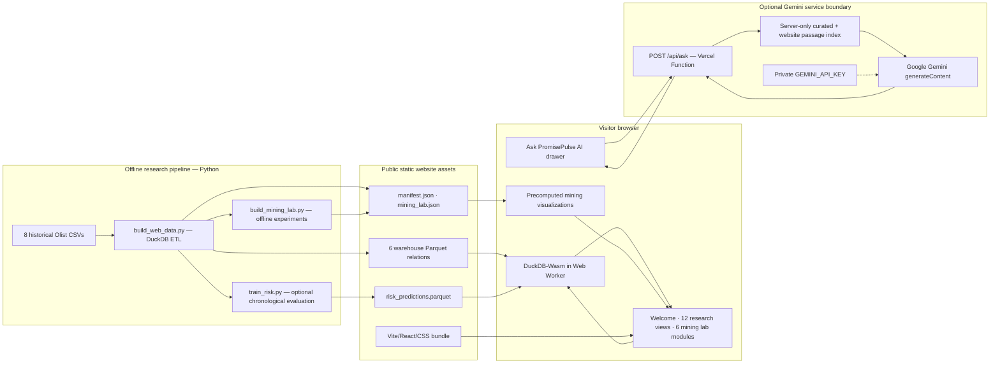
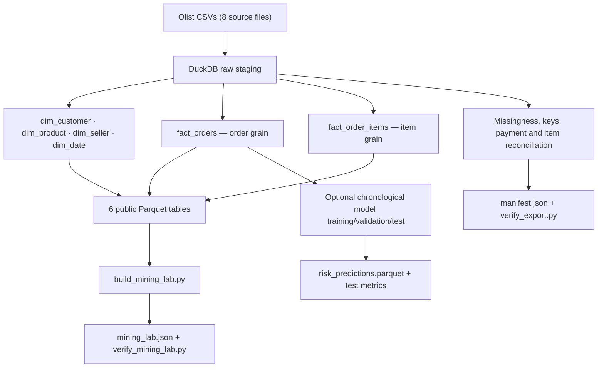
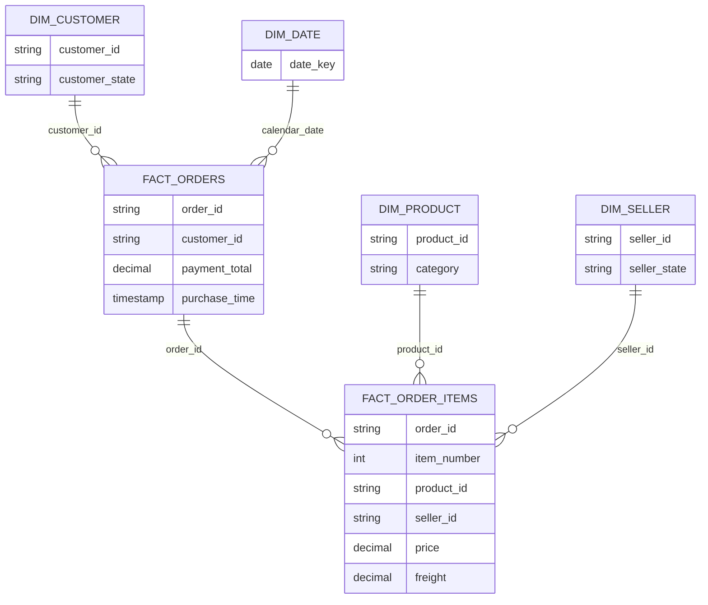
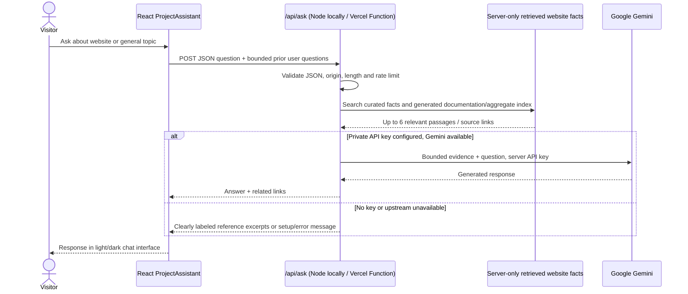

# PromisePulse 5.0 — system architecture

This guide describes the current `main` implementation: an **offline research data pipeline**, **static published warehouse**, **browser-run DuckDB-Wasm analytics**, and a separate **server-side Gemini assistant**. It replaces older descriptions of Gemini as an unmerged, project-only feature.


## 1. End-to-end data and application flow



**Boundaries that matter:** Python and scikit-learn do **not** run in the visitor's browser or in the production website request path. Vercel serves static resources for analytics. DuckDB-Wasm queries operate in a browser worker over downloaded historical data. The **only optional server-side runtime** is the Gemini assistant endpoint. A successful Vite build does not establish that the Vercel Function, Gemini API key, quota or deployment is working.

## 2. Offline export and integrity



The source files cover customers, sellers, products, orders, order items, payments, reviews and product-category translations. `scripts/build_web_data.py` stages these files and publishes order/item facts plus dimensions. With `--train`, the separate chronological risk evaluator publishes test-period predictions. `scripts/build_mining_lab.py` reads the checked-in-style exported Parquet tables to compute and publish Data Mining Lab results. The verifier scripts check counts and statistical consistency; they do not train anything at runtime.

The recorded [data manifest](../web/public/data/manifest.json) was generated on **2026-10-13**, covering a historical **2016–2018** marketplace period. Its timestamp is export provenance, **not** a live service freshness indicator.

### Warehouse relationship and grains



*The ER diagram is conceptual.* Actual column names, data types and join paths must be checked in the Data Catalog and generated Parquet. It is not a claim that physical foreign-key constraints are enforced by the browser.

| Relation | Grain | Published rows |
| --- | --- | ---: |
| `fact_orders` | Order | 99,441 |
| `fact_order_items` | Order item | 112,650 |
| `dim_customer` | Customer source record | 99,441 |
| `dim_product` | Product | 32,951 |
| `dim_seller` | Seller | 3,095 |
| `dim_date` | Calendar date | 774 |
| `risk_predictions` | Evaluated test prediction | 19,294 |

Payments are aggregated at **order grain**; price and freight are measured at **item grain**. Joining a one-order payment to multiple line items and summing payment again inflates revenue. The published quality manifest reports payment and item reconciliation deltas of zero cents. Unknown outcomes remain unknown rather than being silently marked on time.

## 3. Visitor browser and analytics SQL

```mermaid
sequenceDiagram
  participant Visitor
  participant React as React/Vite UI
  participant Host as Vercel static files
  participant DB as DuckDB-Wasm worker
  Visitor->>React: Open dashboard
  React->>Host: GET /data/manifest.json
  Host-->>React: Recorded dataset metadata
  React->>Host: GET /data/*.parquet
  Host-->>React: Public historical files
  React->>DB: Register buffers; CREATE VIEW for each Parquet file
  Visitor->>React: Select chart, filter or OLAP action
  React->>DB: Authored read-only SQL
  DB-->>React: Aggregated rows
  React-->>Visitor: Charts, tables, map, CSV export
  React->>Host: GET /data/mining_lab.json
  Host-->>React: Precomputed offline experiments
  React-->>Visitor: Lab figures / illustrative step visualizers
```

`web/src/db.ts` loads the manifest, chooses a DuckDB-Wasm bundle, creates a Web Worker, fetches the Parquet files and registers read-only views. The authored SQL wrapper permits a single leading `SELECT`, `WITH` or `EXPLAIN` query and rejects multiple statements. This is a browser-side application guard, **not** a production security sandbox for executing untrusted SQL. Source chart definitions live in `web/src/queries.ts`, `atlasQueries.ts`, `premiumQueries.ts`, and `researchQueries.ts`.

The browser does not issue SQL requests to Vercel or Gemini. The 36 Analytics Atlas chart definitions and 30 research expansion charts (66 in total) rely on the historical warehouse. The six Data Mining Lab modules use selected offline experiment exports and explicitly illustrative step-by-step K-Means/Tree/Apriori/FP-Growth/Eclat visualizers. Real fitted models are **not** replayed in those teaching animations.

## 4. Gemini research assistant: independent service boundary



**Implemented on `main`:** `web/src/ProjectAssistant.tsx` presents the drawer; `web/api/ask.js` handles `POST /api/ask`. Its `_knowledge.mjs`, `_retrieval.mjs` and generated server-only `_site-index.mjs` select evidence from the README, user guides, technical documentation, `manifest.json` and **selected aggregate** `mining_lab.json` output. `web/scripts/build-assistant-index.mjs` refreshes that index during `predev` and `prebuild`. The API does **not** read entire raw Olist CSVs, run SQL on individual orders, access arbitrary websites, or consume the current visitor's DuckDB query results.

- **Local:** `npm run dev` starts `web/scripts/local-gemini-server.mjs` bound to `127.0.0.1:8787`, verifies its health, and starts Vite on `127.0.0.1:5173`. `vite.config.ts` explicitly proxies `/api/ask` to loopback. The key is read only from ignored `web/.env`.
- **Vercel:** `web/api/ask.js` is deployed as a Function next to the static site. The private `GEMINI_API_KEY` (and optionally `GEMINI_MODEL`) is configured in Vercel Settings, never through a `VITE_*` frontend variable.
- **Safety and limits:** Requests have same-origin checks, limited question length, basic per-instance throttling and upstream timeout. These controls are **not** a replacement for Vercel edge/bot protections and Google usage/spending quotas. Google processes questions and selected evidence when Gemini is used; no persistent chat database was added.
- **Reference fallbacks:** Without a key, or when Gemini is inaccessible, the UI may display retrieved project passages labeled as references. Such passages should not be described as an AI-generated explanation or a successful Gemini service check.
- **Model name:** The code currently defaults to `gemini-3.5-flash` if `GEMINI_MODEL` is unset. Actual Google model availability and billing vary by account; verify supported model IDs for your own key.

See the [assistant guide](GEMINI_RESEARCH_ASSISTANT.md) for detailed configuration and limitations.

## 5. Research results and caveats

The published held-out risk evaluation uses a threshold of **0.60**, train/validation/test sizes of **58,731 / 12,435 / 19,294**, and held-out precision ≈ **0.049**, recall ≈ **0.288**, ROC AUC ≈ **0.698**. A low positive predictive value limits operational applicability. The six-module Data Mining Lab's classification experiment uses a **different** chronological evaluation population; do not merge those metrics.

The deterministic RFM clustering experiment samples **950** customers (Ward dendrogram at most 52 records). Frequent-pattern analysis uses **649 selected eligible** multi-category baskets, not every Olist order. Data Lakes conceptual diagrams do not imply a deployed cloud object store. The geographic map reports historical Brazilian state aggregates, not real GPS. [Methodology](RESEARCH_REPRODUCIBILITY.md) · [Lab syllabus](SYLLABUS_V5.md) · [Chart-to-SQL map](ANALYTICS_ATLAS_METHODOLOGY.md).

## 6. Presentation, snapshots and code ownership

The color system uses soft cyan `#7DD3FC`, graphite dark mode and an opaque white/pale-blue AI drawer in light mode. `web/src/theme.css`, `soft-cyan.css`, and `project-assistant.css` affect appearance, not analytics. The brand wordmark remains purple. Screenshot provenance is recorded in the [screenshot gallery](SCREENSHOT_GALLERY_CURRENT.md); earlier captures should not be confused with a newly deployed Vercel build.

| Responsibility | Source |
| --- | --- |
| Offline ETL and risk evaluation | `scripts/build_web_data.py`, `scripts/train_risk.py` |
| Export quality and mining evidence | `scripts/verify_export.py`, `scripts/build_mining_lab.py`, `scripts/verify_mining_lab.py` |
| Browser engine | `web/src/db.ts` |
| Analytics application shell | `web/src/App.tsx`, `web/src/Premium.tsx`, `web/src/AnalyticsAtlas.tsx`, `web/src/ResearchWorkspace.tsx` |
| Lab and algorithm walkthroughs | `web/src/SyllabusHub.tsx`, `web/src/SyllabusLab.tsx`, `web/src/AlgorithmPlayground.tsx` |
| Chat drawer | `web/src/ProjectAssistant.tsx`, `web/src/project-assistant.css` |
| Local Gemini development API | `web/scripts/dev.mjs`, `web/scripts/local-gemini-server.mjs`, `web/vite.config.ts` |
| Vercel Gemini endpoint and evidence | `web/api/ask.js`, `web/api/_knowledge.mjs`, `web/api/_retrieval.mjs`, `web/api/_site-index.mjs` |
| Build-time website evidence refresh | `web/scripts/build-assistant-index.mjs` |
| Capture scripts | `web/scripts/capture-current-docs.mjs`, `web/scripts/smoke-algorithms.mjs` |

For verified local and production setup, consult [deployment](DEPLOYMENT.md).
