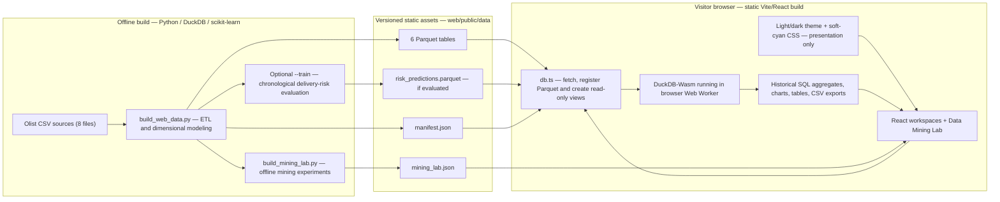
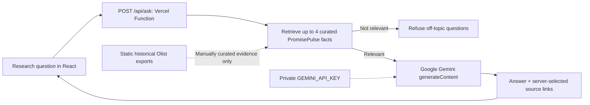
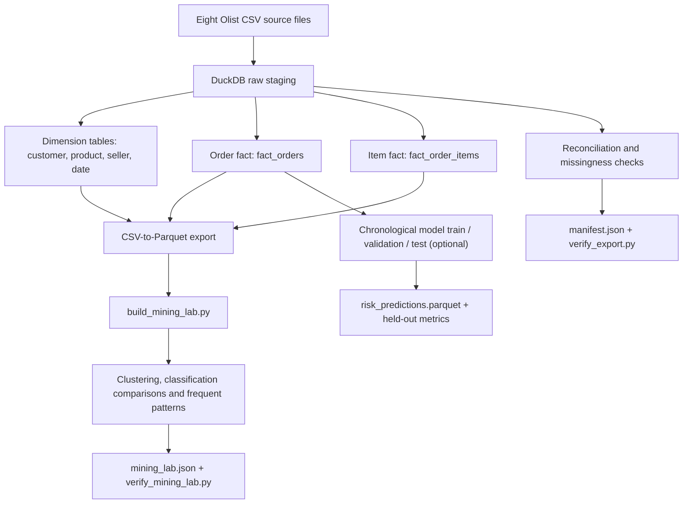
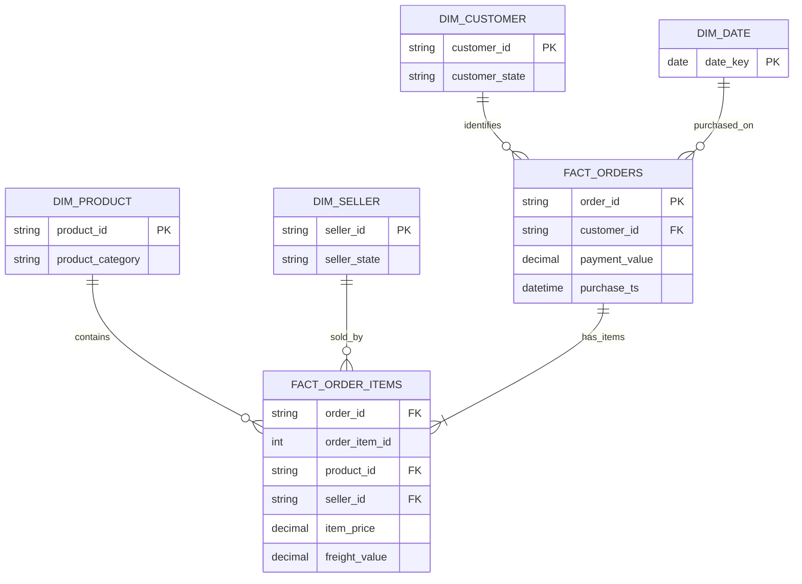
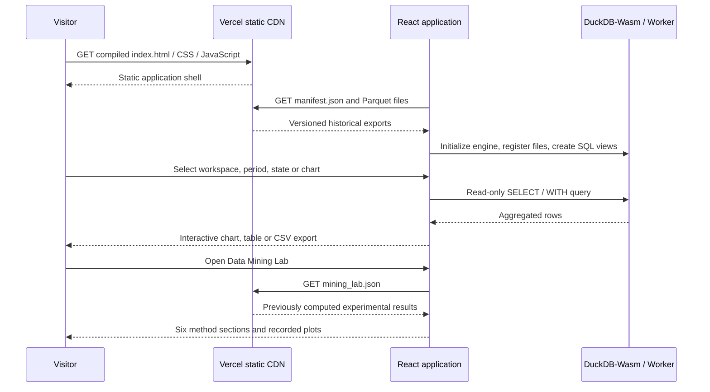
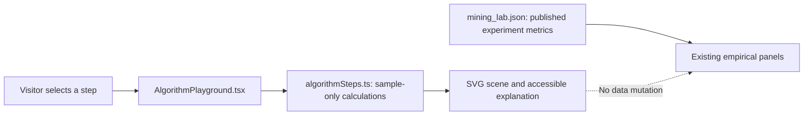
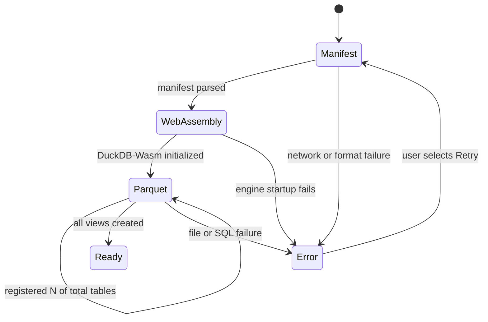
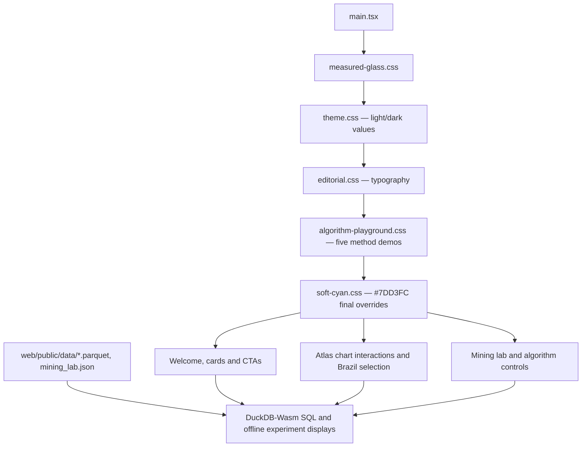

# PromisePulse 5.0 — Architecture and data flow

This document describes the **merged PromisePulse 5.0 `main` release**, including the typography improvements, algorithm walkthroughs, recoverable data-loading states, and **soft-cyan theme (`#7DD3FC`)**. The rejected V6 proposal is not part of this architecture.

The app has two separate execution environments: an **offline Python/DuckDB exporter** (used to generate the public analytical files) and a **static React web application** (used to explore those files in each visitor's browser). It is **not** a hosted live database, real-time logistics tracking system, or cloud ML service.

## 1. End-to-end architecture

**Hosting:** Vercel serves the compiled `web/dist/` files and static datasets over HTTPS. After these files are downloaded, DuckDB SQL runs **client-side**; Vercel does not execute Python ETL jobs or handle analytics queries. CSS color tokens are independent of the warehouse: changing from lime to cyan cannot change query outcomes. A merged GitHub commit does not prove a successful Vercel deployment.

### Important execution boundaries

- Offline training/experiment outputs are generated ahead of time. Interactive chart controls query the static warehouse in the browser; they do not retrain models.
- The visible AI Evidence Assistant is a deterministic explanation of published evaluation data, not a generative chatbot.
- Some Data Lakes and dimensional alternatives in the teaching lab are **conceptual views**, not separate cloud infrastructure.
- The map visualizes historic order aggregates by Brazilian state. It does not show live vehicle coordinates or customer addresses.
- All shipped `web/public/data` assets are **publicly downloadable**. Do not place credentials or sensitive customer information there.

### Optional Gemini assistant (separate server-side API boundary)

The optional `feat/gemini-project-research-assistant` introduces a **new serverless Vercel Function**, distinct from the existing in-browser DuckDB-Wasm analytics. It is inactive until a Gemini key is configured and the branch is merged and deployed. The static academic warehouse and original AI Studio do not depend on this function.

For local development, the `npm run dev` launcher starts a localhost-only Node API (port 8787) and Vite proxies `/api/ask` to the same handler after loading `GEMINI_API_KEY` from ignored `web/.env`. In production, Vercel hosts that handler and reads the private key from its Environment Variables. The backend receives the visitor question, filters and validates it, and sends selected project evidence to Gemini using a server-side key. Questions therefore leave the website for Google's API processing; no persistent chat database is added. It uses a curated reference catalog rather than loading the entire private repository or generating new live SQL results. It includes best-effort application throttling, but production bot and spending protection should be configured at the edge/provider. See [GEMINI_RESEARCH_ASSISTANT.md](GEMINI_RESEARCH_ASSISTANT.md) for full limitations and setup.

## 2. Offline export and verification

`scripts/build_web_data.py` writes six Parquet warehouse tables and `manifest.json`; passing `--train` additionally evaluates and exports the model's held-out predictions. The independent `scripts/build_mining_lab.py` reads the local exported Parquet and produces the source-backed mining lab JSON. `scripts/verify_export.py` and `scripts/verify_mining_lab.py` check the generated artifacts. The raw Olist CSVs are **not** part of the published website.

The manifest in this revision reports an export timestamp of **2026-10-13T02:24:01Z**; it is **not** a real-time update timestamp.

## 3. Dimensional warehouse: two distinct fact grains

The ER diagram is *conceptual*: it illustrates the two-grain relationship, not an exact copy of every exported column or every physical foreign-key constraint. Inspect the actual Parquet files or Data Catalog for exact schemas.

| Published table | Grain | Rows reported by manifest |
| --- | --- | ---: |
| `dim_customer` | Customer source record | 99,441 |
| `dim_product` | Product | 32,951 |
| `dim_seller` | Seller | 3,095 |
| `dim_date` | Calendar date | 774 |
| `fact_orders` | Order | 99,441 |
| `fact_order_items` | Order item | 112,650 |
| `risk_predictions` | Evaluated held-out prediction | 19,294 |

**Do not sum order-level payments after joining to multiple item rows.** The order fact and item fact must be aggregated at the proper grain first. The manifest records **zero payment/item reconciliation delta cents** for this export and **2,971 unlabeled orders**. An order's delivery-risk label is not known for every record.

## 4. Browser runtime and navigation

There are **12 original workspaces**, plus one **Data Mining Lab overview** and **six lab analysis pages**. The navigation dock has *one* graduation-cap button for the lab, **not six extra dock icons or a flyout menu**. Clicking it opens the lab overview; the six pages are accessed through overview cards and clickable in-page tabs.

The 66 registered Atlas/research chart definitions are **36 Analytics Atlas + 30 Research** charts. The Data Mining Lab adds supplementary experimental plots; do not treat those as part of the original 66 count.

### In-browser algorithm teaching and loading states

The new visualizer is **separate from the published Olist experiment export**. It computes deterministic examples in memory and does not change the dataset, retrain the original scikit-learn models, or insert new tables into DuckDB.

The K-Means demonstrator recalculates squared Euclidean distances and arithmetic means of six visible points; Decision Tree follows two displayed example rules; Apriori, FP-Growth, and Eclat use the **same five illustrative baskets**, allowing support and TID intersections to be checked by hand. Their five-basket denominator must never be conflated with the real **649 eligible Olist baskets**.

The browser's `loadWarehouse` reports actual loading stages via `WarehouseProgress`: manifest fetch, DuckDB-Wasm initialization, then how many required Parquet tables have been registered. It deliberately does **not** display a fictional overall completion percentage; individual SQL and mining JSON requests have unknown durations. An abort signal prevents stale fetch results from updating a navigated-away view, and failures expose **Retry loading data**. Measured data is never replaced by illustrative examples.

See [the full worked algorithm examples](ALGORITHM_PLAYGROUND.md) and [the current screenshot gallery](SCREENSHOT_GALLERY_CURRENT.md).

### Presentation-layer theme and file responsibilities

The source of truth for the brand color is `--pp-accent-cyan: #7DD3FC`. The light-background text alternative is `#0369A1`, while dark navy `#082F49` provides readable text on bright cyan selections. The previous CSS names containing “lime” or “green” remain **compatibility aliases**, not evidence of green rendering. The original purple lettering is kept; the brand logo uses a targeted green-pixel recolor filter and the favicon uses `web/public/favicon-cyan.svg`.

The color system is documented in [THEME_SYSTEM.md](THEME_SYSTEM.md). Screenshots in [SCREENSHOT_GALLERY_CURRENT.md](SCREENSHOT_GALLERY_CURRENT.md) are captured from the actual source app, not from a simulated graphic or a promised Vercel deployment.

## 5. Historical model and mining-sample limits

The published manifest's delivery-risk model was evaluated on **19,294** time-held-out prediction rows. Its positive-class precision at the published 0.60 threshold is about **0.049**, with recall about **0.288**. These are weak results; no production predictive capability is claimed. The separate syllabus classification module uses an independently exported experimental test cohort and should not be conflated with these 19,294 rows.

The syllabus mining export uses **950** sampled customer RFM vectors and at most **52** Ward-dendrogram records; its frequent-pattern dataset contains **649** eligible multi-category baskets. Support denominators apply to that selected basket population, not the full order table. See [SYLLABUS_V5.md](SYLLABUS_V5.md) and [RESEARCH_REPRODUCIBILITY.md](RESEARCH_REPRODUCIBILITY.md).

## 6. Code ownership and entry points

| File / folder | Role |
| --- | --- |
| `scripts/build_web_data.py` | Offline ETL, warehouse export and optional model evaluation |
| `scripts/train_risk.py` | Risk modeling/evaluation implementation |
| `scripts/build_mining_lab.py` | Offline six-area mining experiment export |
| `scripts/verify_export.py`, `scripts/verify_mining_lab.py` | Reproducibility/integrity checks |
| `web/src/db.ts` | Browser DuckDB-Wasm initialization and read-only query wrapper |
| `web/src/App.tsx` | Application shell, routing state and native analysis workspaces |
| `web/src/AnalyticsAtlas.tsx`, `web/src/ResearchWorkspace.tsx` | Charting and research analyses |
| `web/src/SyllabusHub.tsx`, `web/src/SyllabusLab.tsx` | Mining overview and six lab screens |
| `web/src/algorithmSteps.ts`, `web/src/AlgorithmPlayground.tsx` | Computed, labeled teaching-step visualizations (not empirical training traces) |
| `web/src/DataStates.tsx` | Real progress stages, accessible query loading and retryable errors |
| `web/public/data/` | Static historical analytical data; do not publish secrets |
| `web/src/editorial.css` | Readable typography and de-emphasis of decorative microcopy |
| `web/src/theme.css`, `web/src/soft-cyan.css` | Light/dark theme, cyan tokens and contrast-safe overrides |
| `web/public/favicon-cyan.svg` | Soft-cyan product favicon, preserving fallback icon |
| `docs/screenshots/current/` | Current-release browser captures (see manifest) |

See [Deployment](DEPLOYMENT.md) for the actual public Vercel setup and build commands.
