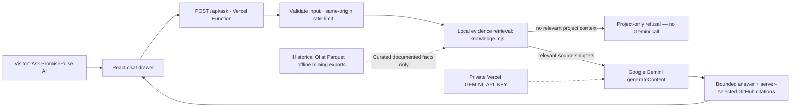

# PromisePulse — Gemini Project Research Assistant

This is an optional, **server-backed project-question-answer feature** built for PromisePulse 5.0. It uses the **Google Gemini API**, with a private API key, and deliberately retrieves only reviewed project facts. It does not replace the existing AI Studio's historical risk-model diagnostics.

**Branch:** `feat/gemini-project-research-assistant`. This feature is not active on the public website until it is reviewed, merged, a Gemini API key is configured, and Vercel deploys successfully.

## Architecture



**Key security rule:** only the server function at `web/api/ask.js` can read `process.env.GEMINI_API_KEY`. Never paste a key into this chat, commit it into GitHub, add it to `web/public`, place it inside `VITE_*` variables, or write it in a client-side `.env` file intended for Vite.

The helper `web/api/_knowledge.mjs` begins with an underscore so Vercel treats it as a **private helper**, not a separately deployed endpoint. It is imported by the function and bundled server-side. This architecture keeps the Google API key out of the downloadable JavaScript.

### Supported questions and scope

The assistant retrieves from a curated knowledge catalog tied to:

- Current README and architecture; React/Vite, browser DuckDB-Wasm, static Olist Parquet; two fact grains and ETL.
- Historical dataset source, licensing, data quality and warehouse row counts.
- The chronological model's actual test metrics and limitations.
- Analytics Atlas, customer cohorts, OLAP and Brazilian state map.
- The six Data Mining Lab modules and five **illustrative** algorithm visualizers.
- The soft-cyan visual identity, project build commands and deployment setup.

Responses include linked **related project sources** selected by the backend. These are GitHub repository document links, not arbitrary URLs from the model. Off-topic requests are refused *before* calling Gemini when no relevant evidence can be retrieved.

**Important limitation:** this is bounded keyword retrieval over a small, curated set of reviewed facts, not live document synchronization, unrestricted retrieval of all repository code, or a guarantee against every LLM hallucination or prompt injection. The Gemini system instruction tells the model to rely only on the evidence, acknowledge missing details and refuse unrelated directions. For research-critical claims, readers should follow the linked source and verify the cited export. The backend does not execute user-supplied SQL or give access to private GitHub files.

## Configure the Gemini key (Vercel)

1. Create or choose a Gemini Developer API key in [Google AI Studio](https://aistudio.google.com/apikey). Enable billing or quota as required by your Google project.
2. Open the **PromisePulse project** in [Vercel](https://vercel.com/dashboard) → **Settings** → **Environment Variables**.
3. Add `GEMINI_API_KEY` with the key value. Keep it **server-only**; do **not** prefix the variable with `VITE_`. Select the desired deployment environments (Production/Preview/Development) according to your testing needs.
4. Optionally add `GEMINI_MODEL` (default `gemini-2.5-flash`). Choose an available model listed for your Gemini API key. The server ignores a model name supplied by a visitor.
5. Deploy/redeploy the application using the repository's existing Vercel settings: **root directory `web`**, Vite, `npm ci`, `npm run build`, output `dist`. Its `web/api/ask.js` route is discovered as a Vercel Function at **`/api/ask`**.
6. Open the site, select **Ask PromisePulse AI**, and ask: “What is PromisePulse and how does it work?” Confirm an evidence-based answer and repository references. Try an unrelated request (“What is the capital of France?”) and verify an out-of-scope refusal.
7. Verify that your key does **not** appear in DevTools → Network requests, HTML, JavaScript bundles, Git commits or the user's input box. Only the server's request to Google includes the key.

Gemini request processing can incur charges or exhaust a free quota. This public endpoint has **basic best-effort in-memory per-IP throttling** (8 requests per 10 minutes per warm function instance) but serverless instances do not share that state. For public use, additionally configure **Vercel Firewall/rate limiting, bot protection, Google API quotas and spend alerts**. Do not advertise the simple in-memory limit as comprehensive abuse prevention.

### Run locally on Ubuntu (no Vercel account or CLI needed)

**The usual `npm run dev` now runs the Gemini endpoint locally.** The `npm run dev` launcher starts a **loopback-only Node API server** and Vite together; an explicit Vite proxy forwards `POST /api/ask` to the backend. Both local and Vercel routes invoke the **same server handler**. The Gemini key is read from the **server-side `web/.env`**; it is never injected into browser JavaScript.

The repository intentionally tracks **`web/.env.example` only**, not `web/.env`. To create your own local file without overwriting a key you might already have:

```bash
cd ~/PromisePulse
git fetch origin
git switch feat/gemini-project-research-assistant
git pull --ff-only
cd web
npm ci
npm run setup:gemini
nano .env
```

In the newly created `web/.env`, set your private value:

```dotenv
GEMINI_API_KEY=PASTE_YOUR_OWN_KEY_HERE
GEMINI_MODEL=gemini-2.5-flash
```

**`PASTE_YOUR_OWN_KEY_HERE` is just an example; replace it with the actual value inside your local file only.** Do not send the value to the chat or GitHub. You can generate an API key in [Google AI Studio](https://aistudio.google.com/apikey).

Then:

```bash
npm run dev
```

Open **http://127.0.0.1:5173/**, click **Ask PromisePulse AI**, and ask **“How does the PromisePulse warehouse work?”**. The chat will call your *local* `/api/ask` route, which sends the selected project evidence to Gemini over HTTPS. Restart `npm run dev` after changing `.env`.

#### If the chat says “/api/ask route was not found”

This is an **HTTP 404 route problem**, not evidence that the Gemini API key is incorrect. The local development terminal now prints two startup messages:

```text
[PromisePulse API] Listening at http://127.0.0.1:8787/api/ask (loopback only)\nVITE v6.x ready ... http://127.0.0.1:5173/
```

From a **second terminal**, check the route without using Gemini credits or exposing the key:

```bash
cd ~/PromisePulse/web
curl -i -X POST http://127.0.0.1:5173/api/ask \
  -H 'Content-Type: application/json' \
  -d '{"question":"hi"}'
```

Expected: **HTTP 400** with `Enter a question between 3 and 450 characters.` This invalid question verifies the endpoint without calling Google. If you receive **HTTP 404**, stop Vite (`Ctrl+C`), update `main` with `git pull --ff-only origin main`, and restart `npm run dev` from the `web` folder. Open the URL Vite prints, usually **http://127.0.0.1:5173/**.

An empty `GEMINI_API_KEY` produces **HTTP 503** for a valid project question, not 404. Short greetings such as `hi` are handled locally with a project-focused welcome message (no Gemini API call). Other two-character inputs receive an inline validation message.


If you prefer, `cp .env.example .env` does the same initialization manually, but **`npm run setup:gemini` is safer** because it refuses to overwrite an existing local `.env`.

#### Local architecture

```mermaid
flowchart LR
  Browser["React site at localhost:5173"] --> Vite["Vite development server"]
  Vite --> Route["Same-origin /api/ask proxy"]\n  Route --> Local["Loopback Node API server :8787"]
  Local --> Handler["Same web/api/ask.js used by Vercel"]
  Env["Ignored web/.env: GEMINI_API_KEY"] -. "Node server only" .-> Handler
  Handler --> Sources["Curated project-only evidence"]
  Handler --> Google["Gemini API over HTTPS"]
  Google --> Browser
```

**No Gemini key is required** just to run the analytics website. With an empty/missing `GEMINI_API_KEY`, the assistant explains the missing configuration; normal Olist dashboards still work. Vercel environment variables are required *later* when deploying, not for this local setup. Both the root `.gitignore` and `web/.gitignore` exclude all real `.env` variants, but allow the example template. Run `git check-ignore web/.env` at the repository root to verify your local key file remains ignored.

The historical Olist Parquet and `mining_lab.json` remain unchanged; no dataset rebuild is needed.

### Test without any real Gemini key

```bash
cd PromisePulse/web
npm ci
npm run build
node ../tests/test_gemini_assistant.mjs
# Local HTTP test requires npm run dev in a separate terminal and an empty local key
node ../tests/test_gemini_local_http.mjs
```

The test intercepts the outgoing Gemini `fetch` request and verifies a mocked answer, references, refusal behavior, bad input, cross-origin blocking, missing key handling, throttling contract and upstream error responses. It never calls Google's live API or consumes tokens.

## Privacy, operations and error recovery

- A visitor's **question and the retrieved project snippets are transmitted to Gemini** by the server. They are not sent directly from the browser to Google; they still leave Vercel for Google's processing. Do not claim that user questions never leave the site.
- The chat is kept in **React memory only**, not saved to browser storage or your GitHub repository. A page refresh clears the local conversation. Vercel/Google service-level logging and retention are governed by their own policies.
- On a missing key, the UI displays a configuration message. On authentication errors, Google limits, network failures or timeouts, it displays a retryable error without pretending a generated response succeeded.
- All questions are capped at **450 characters**, and responses at **4,200 characters**. The server gives Gemini only up to four retrieved reviewed snippets, not unlimited source files or an arbitrary URL.
- No extra permissions, read-write warehouse access, user accounts, persistent chat database or new AI models have been introduced.

Current official references: [Gemini generateContent REST](https://ai.google.dev/api/generate-content) and [Vercel Functions with Vite](https://vercel.com/docs/frameworks/frontend/vite).


### Local API reliability (current)

`npm run dev` launches `scripts/local-gemini-server.mjs` and `scripts/dev.mjs` before opening Vite. The local server listens only on `127.0.0.1:8787`; the browser still calls `http://127.0.0.1:5173/api/ask` through Vite's explicit reverse proxy. The launcher probes `/__gemini_health` before starting Vite. Vite also has `strictPort: true` so an older server cannot quietly remain at 5173 while the new app opens on 5174. Closing the terminal stops both processes.

If you see `EADDRINUSE`, first stop old `npm run dev` processes rather than using another port or exposing the local Gemini API publicly. The port 8787 is for internal loopback traffic only. Your `web/.env` is loaded by the Node backend, never into client-visible `import.meta.env`.
