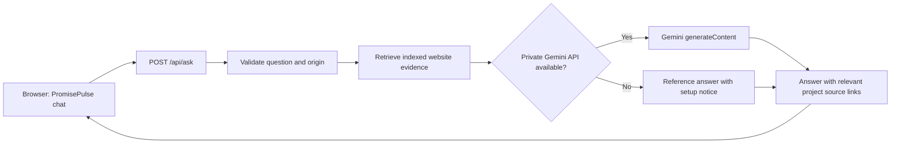

# PromisePulse AI — website-wide research assistant

This describes the AI assistant in PromisePulse 5.0. It is a conversational assistant when Gemini is configured, with searchable project evidence so answers about the website can cite documented facts. It is **not** a live database query service or an autonomous agent.

## What it knows

At development/build time, `web/scripts/build-assistant-index.mjs` generates the server-only `web/api/_site-index.mjs` from checked-in:

- README and the user, architecture, analytics, data-mining, algorithm, reproducibility, deployment, UI, and research guides.
- Published `web/public/data/manifest.json`: Olist sources, file and warehouse row counts, lineage, data quality, and held-out delivery-risk evaluation.
- Selected **aggregate** entries in `web/public/data/mining_lab.json`: EDA, classification and regression scores, clustering experiments, and association patterns.

The index contains search passages rather than copying millions of Parquet records into the model prompt. The `web/api/_retrieval.mjs` module selects relevant passages for each question. Rebuilding `npm run dev` or `npm run build` refreshes it from the checked-in files.

**Boundaries:** PromisePulse data is historical Brazilian Olist e-commerce data (2016–2018). The assistant does not issue SQL against individual Parquet records, fetch arbitrary websites, synchronize GitHub changes at runtime, execute user-supplied code, or train models. It should not invent exact metrics not shown in the source evidence. An indexed passage is supporting context, not a guarantee that generated prose is correct; follow citations for research claims. Access to the site does not grant access to private GitHub file links.

## Conversation behavior

- When Gemini is configured and reachable, people can ask natural general questions, introduce the assistant, and ask detailed questions about the dashboard, data sources, warehouse, charts, models and methods.
- For project-specific claims, the API supplies relevant documented website evidence; for general conversation, there may be no supporting project sources.
- It uses a bounded previous-user-question context for short follow-ups.
- If Gemini is unavailable or unconfigured, the API presents **clearly labeled reference passages** when it finds relevant project knowledge. These are not AI-generated explanations. For unrelated requests with no Gemini key, it explains the setup limitation instead of pretending a generated answer.
- A useful question may still require a deeper direct SQL investigation. The assistant cannot see a visitor's unsaved SQL query results or current screen state.

## Architecture and security



The `GEMINI_API_KEY` is read only from the server environment. Never place it in `VITE_*` variables, browser code, `web/public`, Git commits, or chat messages. The backend uses bounded inputs, same-origin checking, in-memory best-effort per-IP rate limiting and upstream timeouts. For public deployment, add Vercel firewall/abuse controls, Google quotas and spending alerts; instance-local throttling is not sufficient on its own. Visitors' questions and selected supporting passages are sent to Google whenever Gemini runs.

## Local Ubuntu / Linux setup

```bash
git switch main
git pull --ff-only origin main
cd web
npm ci
npm run setup:gemini
nano .env
```

In the untracked `web/.env` set:

```dotenv
GEMINI_API_KEY=YOUR_PRIVATE_GOOGLE_AI_STUDIO_KEY
GEMINI_MODEL=gemini-3.5-flash
```

The model value is configurable; use a model available for the associated API key. Google now limits access to the older Gemini 2.5 Flash model for some projects. If you copied an earlier `web/.env`, update its `GEMINI_MODEL` explicitly because existing environment variables override the new default. A Gemini HTTP 404 may indicate model access, not a missing PromisePulse API route. Restart the server after changing `.env`:

```bash
npm run dev
```

In another terminal run `npm run check:gemini`. It checks the local /api/ask route without a Google request. Then test **“Tell me about the data used”**, **“Introduce yourself”**, **“Compare the classification models”**, and **“Tell me a joke”**. A reference-only notice means Gemini is missing or unavailable; it does not mean the chat is performing generative reasoning.

The local app is served at `http://127.0.0.1:5173`; `npm run dev` runs a loopback-only API on port 8787 and proxies `/api/ask` through the explicit TypeScript Vite configuration. The production Vercel function uses the same `web/api/ask.js` handler.

## Deploy to Vercel

Use root directory `web`, Vite, install `npm ci`, build `npm run build`, output `dist`, production branch `main`. Create server-only `GEMINI_API_KEY` under Project Settings → Environment Variables; add `GEMINI_MODEL` only if needed. Redeploy after changing secrets. Verify the production deployment is Ready and on the intended Git SHA. The repository previously experienced Vercel build-rate limits; GitHub being merged does not prove deployment is live.

## Tests

```bash
cd web
npm run build
node ../tests/test_gemini_assistant.mjs
npm run dev
# in another terminal:
node ../tests/test_gemini_local_http.mjs
```

Browser smoke tests use simulated Gemini responses and do not prove a real Google API key, billing, model availability or quotas are working. The server unit tests similarly mock Google requests. Check actual Gemini responses from a real locally configured key separately.
