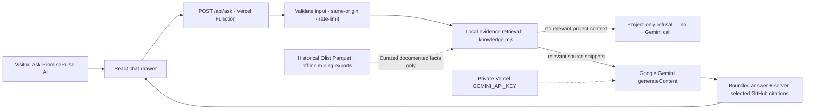

# PromisePulse — Gemini Project Research Assistant

This is an optional, **server-backed project-question-answer feature** built for PromisePulse 5.0. It uses the **Google Gemini API**, with a private API key, and deliberately retrieves only reviewed project facts. It does not replace the existing AI Studio's historical risk-model diagnostics.

**Branch:** `feat/gemini-project-research-assistant`. This feature is not active on the public website until it is reviewed, merged, a Gemini API key is configured, and Vercel deploys successfully.

## Architecture



**Key security rule:** only the server function at `web/api/ask.js` can read `process.env.GEMINI_API_KEY`. Never paste a key into this chat, commit it into GitHub, add it to `web/public`, place it inside `VITE_*` variables, or write it in a client-side `.env` file intended for Vite.

The helper `web/api/_knowledge.mjs` begins with an underscore so Vercel treats it as a **private helper**, not a separately deployed endpoint. It is imported by the function and bundled server-side. This architecture keeps the Google API key out of the downloadable JavaScript.

### Supported questions and scope

The assistant retrieves from a curated knowledge catalog tied to:

- Current README and architecture; React/Vite, browser DuckDB-Wasm, static Olist Parquet; two fact grains and ETL.
- Historical dataset source, licensing, data quality and warehouse row counts.
- The chronological model's actual test metrics and limitations.
- Analytics Atlas, customer cohorts, OLAP and Brazilian state map.
- The six Data Mining Lab modules and five **illustrative** algorithm visualizers.
- The soft-cyan visual identity, project build commands and deployment setup.

Responses include linked **related project sources** selected by the backend. These are GitHub repository document links, not arbitrary URLs from the model. Off-topic requests are refused *before* calling Gemini when no relevant evidence can be retrieved.

**Important limitation:** this is bounded keyword retrieval over a small, curated set of reviewed facts, not live document synchronization, unrestricted retrieval of all repository code, or a guarantee against every LLM hallucination or prompt injection. The Gemini system instruction tells the model to rely only on the evidence, acknowledge missing details and refuse unrelated directions. For research-critical claims, readers should follow the linked source and verify the cited export. The backend does not execute user-supplied SQL or give access to private GitHub files.

## Configure the Gemini key (Vercel)

1. Create or choose a Gemini Developer API key in [Google AI Studio](https://aistudio.google.com/apikey). Enable billing or quota as required by your Google project.
2. Open the **PromisePulse project** in [Vercel](https://vercel.com/dashboard) → **Settings** → **Environment Variables**.
3. Add `GEMINI_API_KEY` with the key value. Keep it **server-only**; do **not** prefix the variable with `VITE_`. Select the desired deployment environments (Production/Preview/Development) according to your testing needs.
4. Optionally add `GEMINI_MODEL` (default `gemini-2.5-flash`). Choose an available model listed for your Gemini API key. The server ignores a model name supplied by a visitor.
5. Deploy/redeploy the application using the repository's existing Vercel settings: **root directory `web`**, Vite, `npm ci`, `npm run build`, output `dist`. Its `web/api/ask.js` route is discovered as a Vercel Function at **`/api/ask`**.
6. Open the site, select **Ask PromisePulse AI**, and ask: “What is PromisePulse and how does it work?” Confirm an evidence-based answer and repository references. Try an unrelated request (“What is the capital of France?”) and verify an out-of-scope refusal.
7. Verify that your key does **not** appear in DevTools → Network requests, HTML, JavaScript bundles, Git commits or the user's input box. Only the server's request to Google includes the key.

Gemini request processing can incur charges or exhaust a free quota. This public endpoint has **basic best-effort in-memory per-IP throttling** (8 requests per 10 minutes per warm function instance) but serverless instances do not share that state. For public use, additionally configure **Vercel Firewall/rate limiting, bot protection, Google API quotas and spend alerts**. Do not advertise the simple in-memory limit as comprehensive abuse prevention.

### Local development

The existing `npm run dev` uses Vite for the static React frontend. **Vite alone does not run Vercel Functions**; the UI will show a clear service-unavailable message when the API route is missing.

Run in Vercel's local function environment:

```bash
cd PromisePulse/web
npm ci
npx vercel login
npx vercel link
npx vercel dev
```

Use the local URL provided by `vercel dev`. Keep `GEMINI_API_KEY` in Vercel environment settings and pull to the local Vercel runtime when necessary, rather than committing `.env` files. Alternatively, use a local, untracked environment file read by the Vercel CLI and keep it out of version control.

The website's bundled Olist Parquet and `mining_lab.json` remain unchanged; you do not need to regenerate academic experiments to use the chat.

### Test without any real Gemini key

```bash
cd PromisePulse/web
npm ci
npm run build
node ../tests/test_gemini_assistant.mjs
```

The test intercepts the outgoing Gemini `fetch` request and verifies a mocked answer, references, refusal behavior, bad input, cross-origin blocking, missing key handling, throttling contract and upstream error responses. It never calls Google's live API or consumes tokens.

## Privacy, operations and error recovery

- A visitor's **question and the retrieved project snippets are transmitted to Gemini** by the server. They are not sent directly from the browser to Google; they still leave Vercel for Google's processing. Do not claim that user questions never leave the site.
- The chat is kept in **React memory only**, not saved to browser storage or your GitHub repository. A page refresh clears the local conversation. Vercel/Google service-level logging and retention are governed by their own policies.
- On a missing key, the UI displays a configuration message. On authentication errors, Google limits, network failures or timeouts, it displays a retryable error without pretending a generated response succeeded.
- All questions are capped at **450 characters**, and responses at **4,200 characters**. The server gives Gemini only up to four retrieved reviewed snippets, not unlimited source files or an arbitrary URL.
- No extra permissions, read-write warehouse access, user accounts, persistent chat database or new AI models have been introduced.

Current official references: [Gemini generateContent REST](https://ai.google.dev/api/generate-content) and [Vercel Functions with Vite](https://vercel.com/docs/frameworks/frontend/vite).
