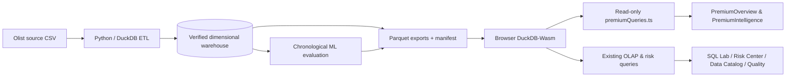

# PromisePulse 2.0 — design, analytics and verification

## Product direction
This branch reimagines PromisePulse as an **obsidian-and-glass historical intelligence command center**. Visual inspiration is the user-provided dark bento logistics dashboard, adapted into an original PromisePulse interface with restrained ultraviolet, citrus-green, editorial type, calm motion, 24px cards and responsive layouts.

All figures shown in the interface must be attributable to the project's official, exported Olist order, item, customer, and model evaluation Parquet files. The interface never claims to offer live deliveries, GPS vehicle tracking, active fleets, real-time warehouse inventory, or a connected commercial operational system.

## Screens and responsibilities
| Screen | Contents | Source |
|---|---|---|
| Overview | 4 KPIs, delivery status donut, revenue line, historical state cartogram, latest recorded purchases, state sales, merchandise categories, monthly order activity | `fact_orders`, `fact_order_items`, `dim_customer`, `dim_product` |
| Intelligence | Repeat-buyer rate, monthly delivery outcomes, delivery duration, review distribution, basket mix, buying frequency, seller-state sales, freight cost, weekday demand, historical model risk calibration | Exported warehouse tables and (where present) `risk_predictions` |
| OLAP Lab | SQL ROLLUP, drill-down, slice, dice, pivot and raw CSV export | DuckDB-Wasm against dimensional warehouse |
| Risk Center | Held-out predictions, validation-selected threshold, exploratory confusion matrix | Actual evaluated `risk_predictions` plus manifest |
| Data Catalog | Original source licensing, source counts and table browser | `manifest.json` plus Parquet |
| Pipeline & Quality | Grain-sensitive reconciliation, lineage, key integrity | Generated manifest and ETL assertions |

Each Intelligence chart is computed with its own read-only SQL in `web/src/premiumQueries.ts`. Charts do not inject arbitrary values to fill missing observations. SQL aggregates use **one row per order** for payments, **one row per item** for product/seller merchandise sales, and **one row per unique individual** when computing repeat purchasing.

## Geographic visualization
The command center uses a **real 27-state Brazil SVG choropleth**. Each state polygon is interactive and its visual intensity is driven by historical Olist order volume for that state. Selecting a state reveals order count, recorded payment revenue, share of orders, late-delivery rate, and its rank among state markets.

The state SVG geometry is adapted from Lucas Bassetti's MIT-licensed `mapa-brasil-svg`; the required notice is retained in `docs/THIRD_PARTY_NOTICES.md`. This layer is intended for dashboard presentation, not survey-grade GIS work. PromisePulse does **not** depict live vehicles, GPS pings, delivery routes, or real-time operational locations.

## Data provenance and model limits
- Official source: [Olist Brazilian E-Commerce Public Dataset](https://www.kaggle.com/datasets/olistbr/brazilian-ecommerce).
- Source period: 2016–2018, historical, not live.
- The existing warehouse contains 99,441 order facts, 112,650 item facts and a chronologically held-out risk evaluation export according to its checked-in manifest.
- Risk score metrics must not be described as production performance, causal evidence, or statistically calibrated without additional testing.
- **Synthetic scenarios are not included in this branch.** If added later, keep them in a distinct directory, mark every such view *SYNTHETIC DEMO*, preserve dataset provenance, and prohibit joins that silently combine fake and observed records.

## Code structure


## Intended validation
The GitHub connector can write the branch, but it cannot run npm, Playwright, or Python in the user's local project. Do not assume the branch passed a build or browser QA until these checks execute in a real workspace:

```bash
cd web
npm ci
npm run build
npm run dev
```

Visually inspect at desktop 1440px, laptop 1024px, tablet 768px and mobile 375px. Confirm correct read-only SQL rows; no zero-filled missing results; yearly filters; keyboard tab order; map accessibility; scrolling tables; CSV export; risk threshold interactions; and all five OLAP operations. Test the original Python pipeline using official data and its documented setup. Maintain a screenshot evidence log before merging.

## Production improvements after first pass
- Set up CI with `npm ci && npm run build` and Python tests
- Browser-test behavior and export labels
- Add selectively rendered physical maps with authentic geospatial data, where source licensing permits
- Add actual measurement summaries for performance, accessibility and model drift
- Add SQL-side memoization and query cancellation if live use identifies slow interactions

This is an initial functional redesign branch, **not a claim that every possible enhancement is already built or tested**.
