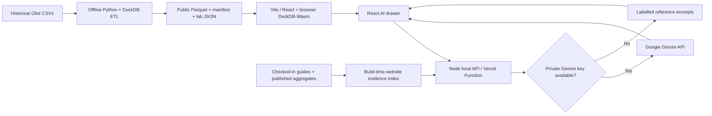

# PromisePulse — current release notes

**Release line:** PromisePulse 5.0, maintained on [`main`](https://github.com/kasim672/PromisePulse/tree/main). Documentation and deployment maintenance reviewed October 30, 2026.

This is an **academic historical e-commerce intelligence dashboard**, not a live order-fulfilment, live model inference, or production forecasting service. Each shipped analytical number refers to the Olist historical export, and a successful GitHub merge is not itself evidence of a production deployment.

## October 30 maintenance: build metadata and automation

The web package and lockfile use version **5.0.0**, matching this release line. A `web/vercel.json` explicitly specifies the Vite build command, `npm ci` and `dist` output. Vercel root-directory selection, existing build-rate limits, environment variables and deployment readiness still require verification in the Vercel dashboard.

Three read-only/manual QA workflows are restored under `.github/workflows/`; eleven older, branch-specific or write-back workflows stay in `.github/workflows-paused/`. The restored workflows do not run automatically. See [Actions status](../.github/ACTIONS_PAUSED.md). No product feature, screenshot, historical dataset or model result changed.

## Included in the source release

| Area | Current implementation | Evidence |
| --- | --- | --- |
| Website | React 18, TypeScript, Vite 6, soft-cyan `#7DD3FC`, light/dark and responsive navigation | [UI guide](USER_GUIDE.md), [theme](THEME_SYSTEM.md) |
| Data | Offline Python/DuckDB ETL from eight Olist CSVs (2016–2018); six dimensional Parquet tables plus a separate held-out risk table | [Manifest](../web/public/data/manifest.json) |
| Analytics | Browser DuckDB-Wasm SQL, 12 primary workspaces, 36 Analytics Atlas and 30 Research Expansion chart definitions | [Methodology](ANALYTICS_ATLAS_METHODOLOGY.md) |
| Data Mining Lab | Six syllabus modules backed by published offline experiments; five separately labelled illustrative algorithm walkthroughs | [Lab export](../web/public/data/mining_lab.json), [syllabus](SYLLABUS_V5.md) |
| AI assistant | React chat with server-side `/api/ask`, searchable website guides and aggregate evidence; Gemini chat when configured, labelled reference fallback otherwise | [AI guide](GEMINI_RESEARCH_ASSISTANT.md), [assistant merged PR](https://github.com/kasim672/PromisePulse/pull/18) |
| Chat theme | Readable opaque light-mode cards, cyan user bubbles, clear contrast, dark mode preserved | [Chat theme PR](https://github.com/kasim672/PromisePulse/pull/19) |
| Hosting | Vercel static assets **plus** optional serverless Gemini function; no production Python or hosted SQL service | [Deployment](DEPLOYMENT.md) |

## Verified data scope

The checked-in manifest reports 99,441 order-grain facts, 112,650 item-grain facts, 99,441 customers, 32,951 products, 3,095 sellers and 774 date rows. The separate held-out risk prediction table contains 19,294 rows. Payment and item-grain totals must **not** be summed together after a naive many-to-one join.

For the original delivery-risk evaluation, the manifest records threshold **0.60**, held-out precision **0.04883**, recall **0.28783**, ROC AUC **0.6980** and PR AUC **0.06777**. These results, especially low minority-class precision, do **not** establish operational alert reliability. The six-module mining experiments use their **own** evaluated populations and may report different test row counts and sample/selection criteria. Always verify against the published JSON and [reproducibility guide](RESEARCH_REPRODUCIBILITY.md) rather than combining metrics.

## Architecture boundaries



The Google API key stays server-side. When Gemini is invoked, the visitor question and selected passages are sent to Google. The assistant does not query individual browser Parquet rows, execute arbitrary SQL, scrape external websites or use an always-current data feed. The website and offline model figures work without an AI key.

## Documentation and screenshots

- [README](../README.md) — introduction, features, setup and validation.
- [System architecture](ARCHITECTURE_V5.md) and [SVG diagram](architecture.svg) — data/query/API boundaries.
- [User guide](USER_GUIDE.md) and [AI guide](GEMINI_RESEARCH_ASSISTANT.md) — practical navigation and limitations.
- [Screenshot gallery](SCREENSHOT_GALLERY_CURRENT.md) — real Chromium captures and recorded provenance, including the chat drawer once recaptured.
- [Deployment guide](DEPLOYMENT.md) — `web` project root, build, Gemini environment variables and production acceptance checklist.

Screenshot manifests record the SHA **when images were captured**. A capture made before a later chat styling or doc commit does not depict every subsequent change. To update images, run the checked-in screenshot scripts; never relabel older images as if they came from a newer SHA. **Production state must be checked separately in Vercel**.

## Reproduction

```bash
git clone https://github.com/kasim672/PromisePulse.git
cd PromisePulse/web
npm ci
npm run build
node ../tests/test_documentation.cjs
node ../tests/test_theme.cjs
node ../tests/test_gemini_assistant.mjs
npm run dev
```

For Gemini, copy the private local configuration template using `npm run setup:gemini`, populate `web/.env`, restart `npm run dev`, and run `npm run check:gemini` in a second terminal. The check confirms the API route, **not** live Google model availability. For publication, inspect your Vercel production deployment status and commit SHA.

## Related merged work

The original cyan and visualizer changes were merged through [PR #10](https://github.com/kasim672/PromisePulse/pull/10) and [PR #9](https://github.com/kasim672/PromisePulse/pull/9). The assistant route fixes and broader website knowledge integration were merged through [PR #17](https://github.com/kasim672/PromisePulse/pull/17) and [PR #18](https://github.com/kasim672/PromisePulse/pull/18), followed by the chat contrast improvements in [PR #19](https://github.com/kasim672/PromisePulse/pull/19).
