# PromisePulse 3.0 — Authentic UI Screenshot Gallery

All screenshots below are generated by the **actual React/Vite application running the repository's historical Olist Parquet files in Chromium**. They are **not mockups, AI-generated illustrations, synthetic chart values or screenshots of the Cadra reference website**.

Captures are produced reproducibly by [capture-doc-screens.mjs](../web/scripts/capture-doc-screens.mjs), and the capture environment/date/screenshots are recorded in [CAPTURE_MANIFEST.json](screenshots/v3/CAPTURE_MANIFEST.json). Desktop captures use 1440×900 and mobile captures use 390×844, with full-page screenshots and reduced motion for consistency.

**Verified capture:** October 22, 2026, 22:37 UTC. All 18 files were regenerated after warehouse initialization and their underlying query/loading states completed. The screenshot workflow failed closed on query errors or incomplete loading indicators; captured images contain actual order counts, map state polygons, heatmaps and model diagnostics.

## At a glance — light and dark

| Screen | Light | Dark |
| --- | --- | --- |
| Executive overview and historical Brazil map | [](screenshots/v3/overview-light.png) | [](screenshots/v3/overview-dark.png) |
| Intelligence dashboards | [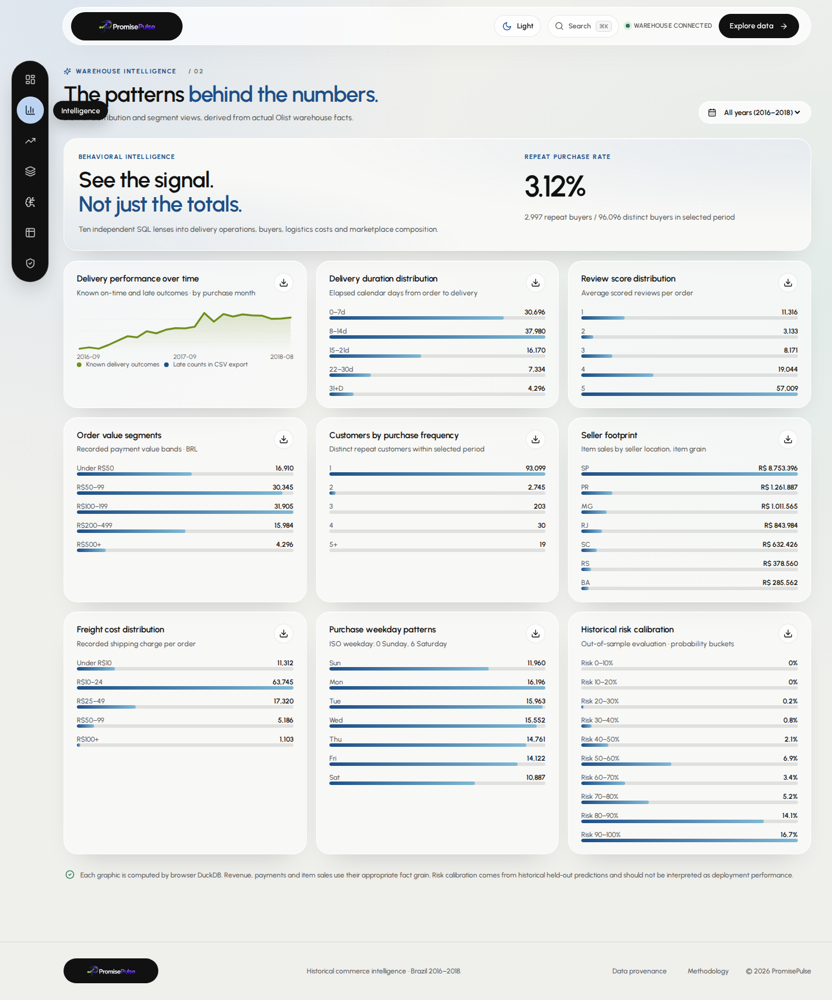](screenshots/v3/intelligence-light.png) | [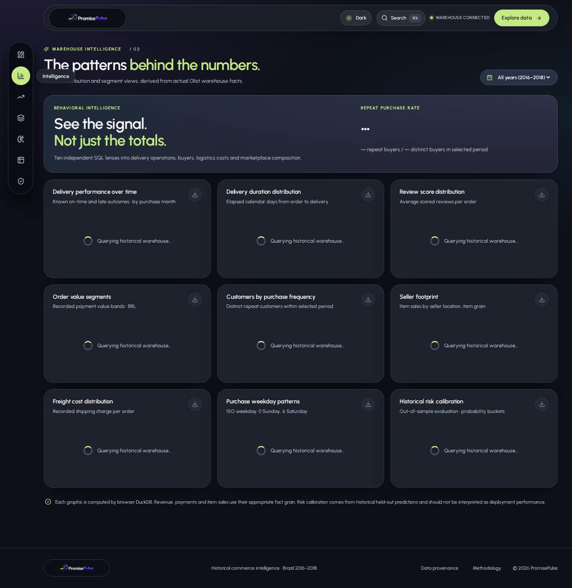](screenshots/v3/intelligence-dark.png) |
| Analytics Atlas (four commerce figures) | [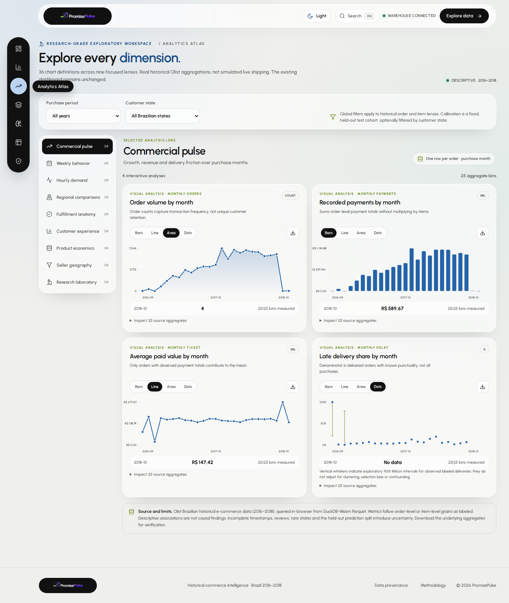](screenshots/v3/atlas-commerce-light.png) | [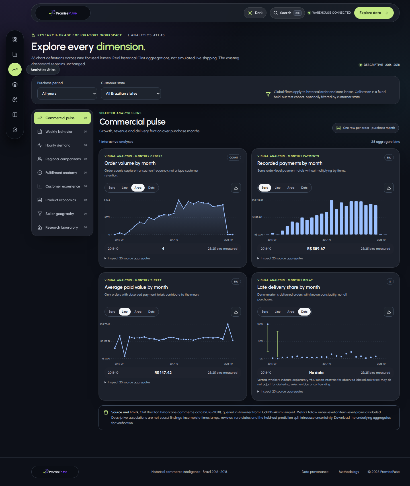](screenshots/v3/atlas-commerce-dark.png) |
| Research laboratory heatmaps and held-out calibration | [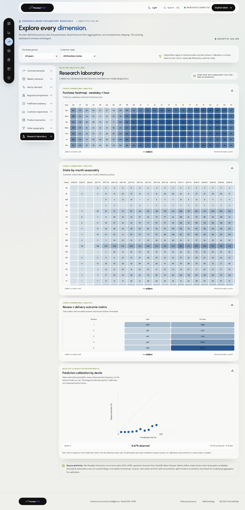](screenshots/v3/atlas-laboratory-light.png) | [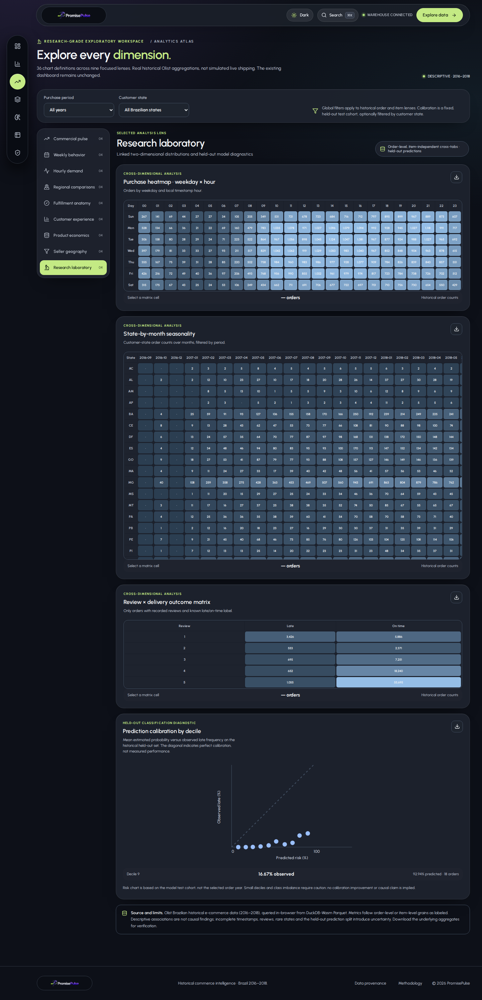](screenshots/v3/atlas-laboratory-dark.png) |
| OLAP Lab, visual operations and result table | [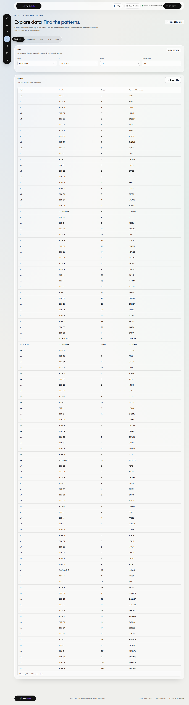](screenshots/v3/olap-lab-light.png) | [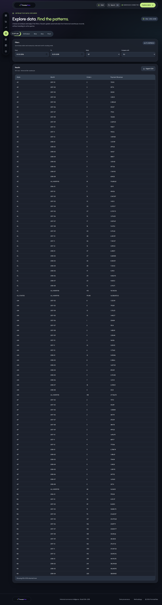](screenshots/v3/olap-lab-dark.png) |
| Historical Risk Center | [](screenshots/v3/risk-center-light.png) | [](screenshots/v3/risk-center-dark.png) |
| Warehouse Data Catalog | [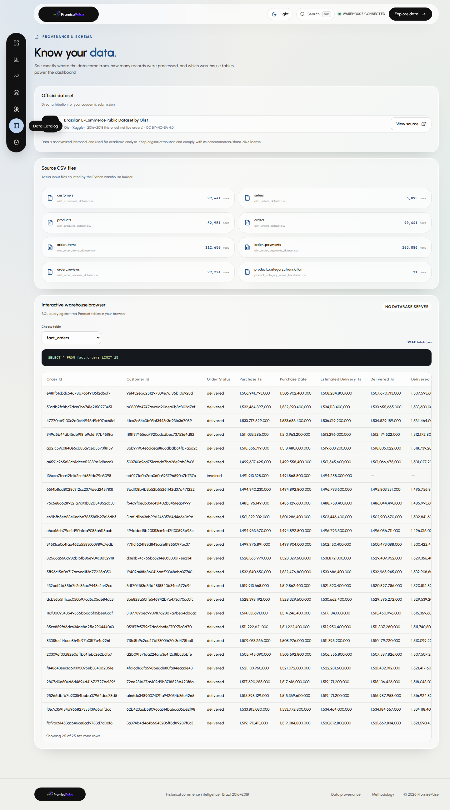](screenshots/v3/data-catalog-light.png) | [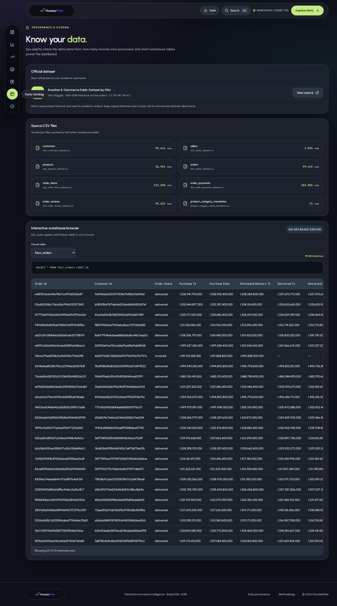](screenshots/v3/data-catalog-dark.png) |
| ETL Pipeline & Quality | [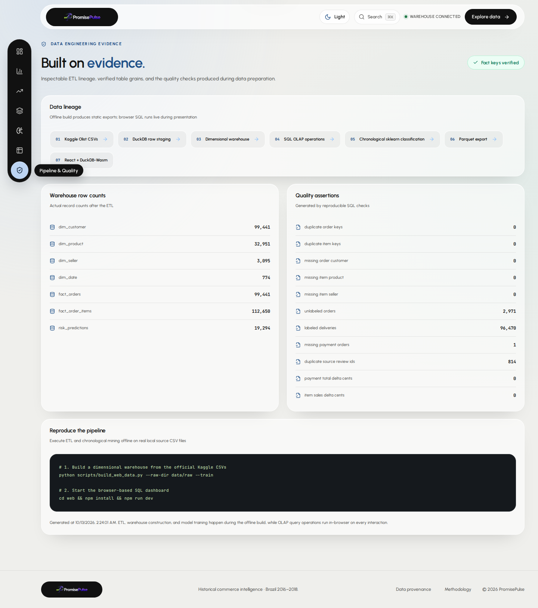](screenshots/v3/pipeline-quality-light.png) | [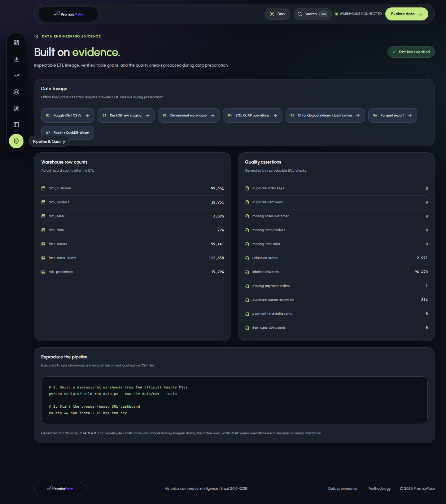](screenshots/v3/pipeline-quality-dark.png) |

## Mobile captures

| Overview and dock | Analytics Atlas |
| --- | --- |
| [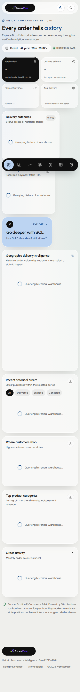](screenshots/v3/overview-mobile-light.png) | [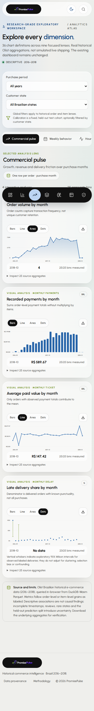](screenshots/v3/atlas-commerce-mobile-light.png) |

## Figure selection and research interpretation

1. **Overview — geographic delivery intelligence.** The Brazil state map displays historical *customer-state aggregates*, not live trucks, couriers or geocoded customer addresses. Counts derive from the fact table and state dimension.
2. **Intelligence — descriptive trends.** Patterns describe Olist order history; variations can reflect source coverage and seasonality.
3. **Atlas commercial lens — four linked dimensions.** Order count, paid order value, mean payment and observed late share are queried from the same order-grain facts; the display toggles between line, area, bars and dots and exposes source aggregates.
4. **Research laboratory — cross-tabs.** The matrices are based on weekday×hour, customer-state×month and review-score×punctuality counts; the model diagnostic uses actual held-out predictions where supplied.
5. **OLAP Lab — five operations.** Interactive roll-up, drill-down, slice, dice and pivot return genuine warehouse query results. The SQL preview is intentionally not shown.
6. **Risk Center.** Threshold changes and classification metrics rely on a fixed historical hold-out split. The reported classifier has low precision; a screenshot cannot change or validate that fact.
7. **Catalog and pipeline.** Physical Parquet tables, license and lineage context, key integrity and financial-grain reconciliation underpin the visual presentation.

For methodological details and exact counts, consult [Research Reproducibility](RESEARCH_REPRODUCIBILITY.md) and [Analytics Atlas Methodology](ANALYTICS_ATLAS_METHODOLOGY.md). Figures must not be cited as proof of causal effects or Q1-journal suitability.

## Reproduce the screenshots

From the repo root, with a working Node.js installation:

```bash
cd web
npm ci
npm install --no-save --package-lock=false playwright
npx playwright install chromium
npm run dev -- --host 127.0.0.1 --port 4173
```

In a second terminal:

```bash
cd PromisePulse/web
PP_BASE_URL=http://127.0.0.1:4173 node scripts/capture-doc-screens.mjs
```

The script checks that the actual dashboard appears before screenshots are taken, waits for historical Atlas queries, and fails rather than silently replacing failed data with invented chart values. The one-shot GitHub Actions [Capture authentic UI screenshots](../.github/workflows/capture-screenshots.yml) workflow records the same assets automatically.

**Capture limitations:** the gallery establishes appearance under the recorded browser, viewport and state; it does not replace manual WCAG testing, independent source-data query execution, benchmark replication or on-device responsive review. Screenshots of the older blue-theme design may remain under `docs/screenshots/` for historical comparison, but they are **not current PromisePulse 3.0 UI captures**.
