# PromisePulse 5.0 — Current-release screenshots and provenance

These captures are generated by **Playwright Chromium rendering the actual checked-in source**, with the historical Olist Parquet warehouse and offline mining export. They cover the dashboard, five interactive teaching visualizers, and integrated Gemini chat drawer in both appearance modes. The assistant captures use its initial UI state; no Google API calls or fabricated AI answers are needed. The captures are **not simulated mock-ups**, and they do not claim that Vercel has deployed the same commit.

The reproducible scripts are [`capture-current-docs.mjs`](../web/scripts/capture-current-docs.mjs) and [`smoke-algorithms.mjs`](../web/scripts/smoke-algorithms.mjs). The [page capture manifest](screenshots/current/CAPTURE_MANIFEST.json) and [algorithm capture manifest](screenshots/current/ALGORITHM_CAPTURE_MANIFEST.json) record the source commit, date, viewport, and image filenames. Use the [design system](THEME_SYSTEM.md) for palette and contrast specifications.

## Landing and original analytics

| Welcome / landing | Dashboard Overview |
| --- | --- |
| [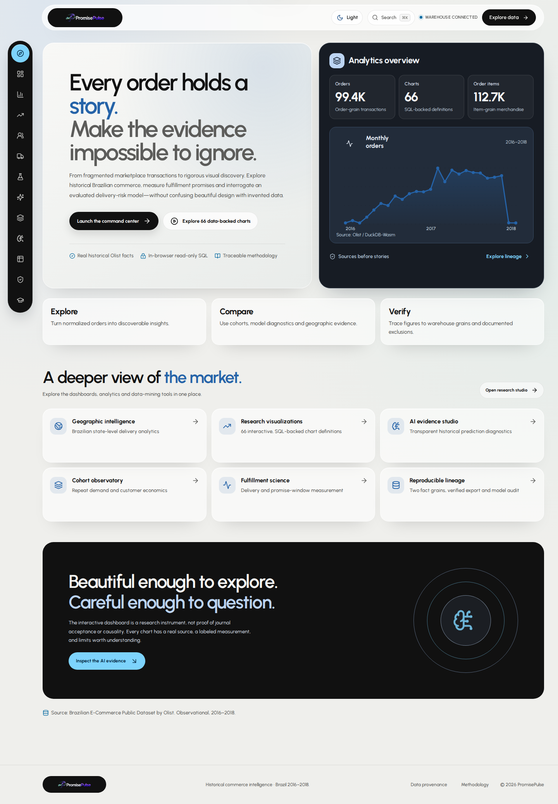](screenshots/current/welcome-light.png) | [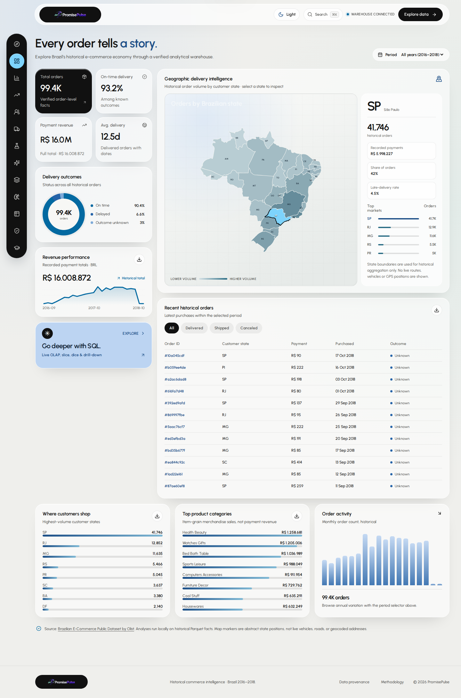](screenshots/current/overview-light.png) |

[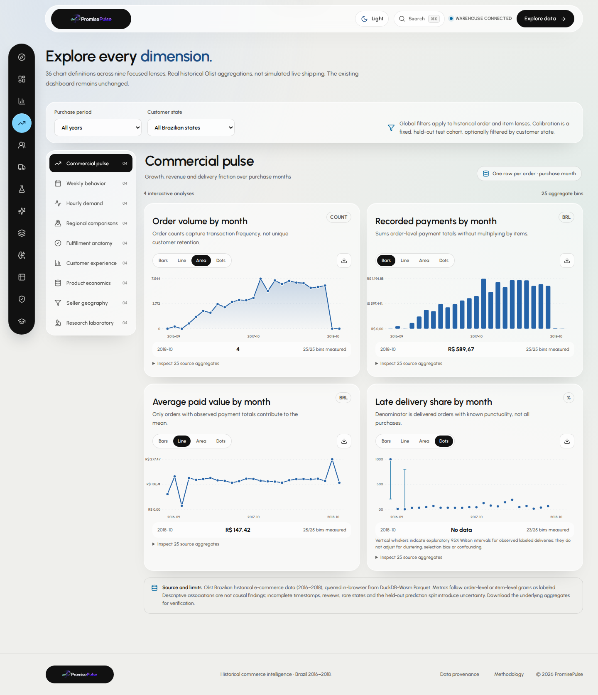](screenshots/current/analytics-atlas-light.png)

The Overview retains the historical state-level map. This is **not** a live courier or GPS tracking screen.

## Integrated AI assistant — light and dark

| Light mode: opaque white cards and cyan controls | Dark mode: preserved graphite surfaces |
| --- | --- |
| [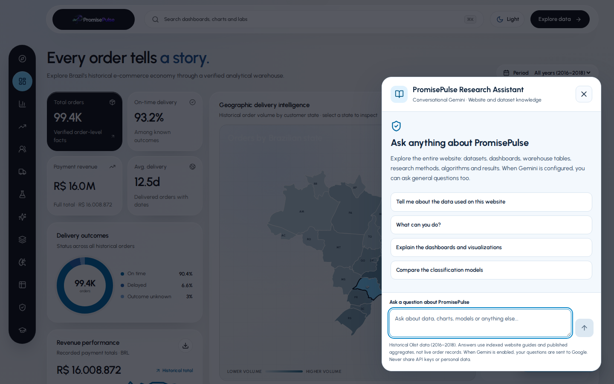](screenshots/current/assistant-light.png) | [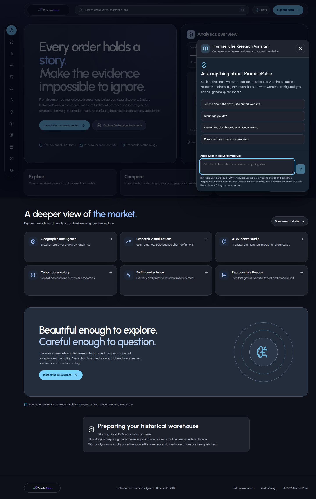](screenshots/current/assistant-dark.png) |

These are **real browser captures of the open chat drawer**, not generated model responses or proof of API-key availability. The assistant is part of `main`, uses a server-side `/api/ask` route, and can display labeled reference-only results when Gemini is unavailable. See [assistant documentation](GEMINI_RESEARCH_ASSISTANT.md).

## Data Mining Lab and experimentally verified figures

| Lab overview | Warehouse & ETL |
| --- | --- |
| [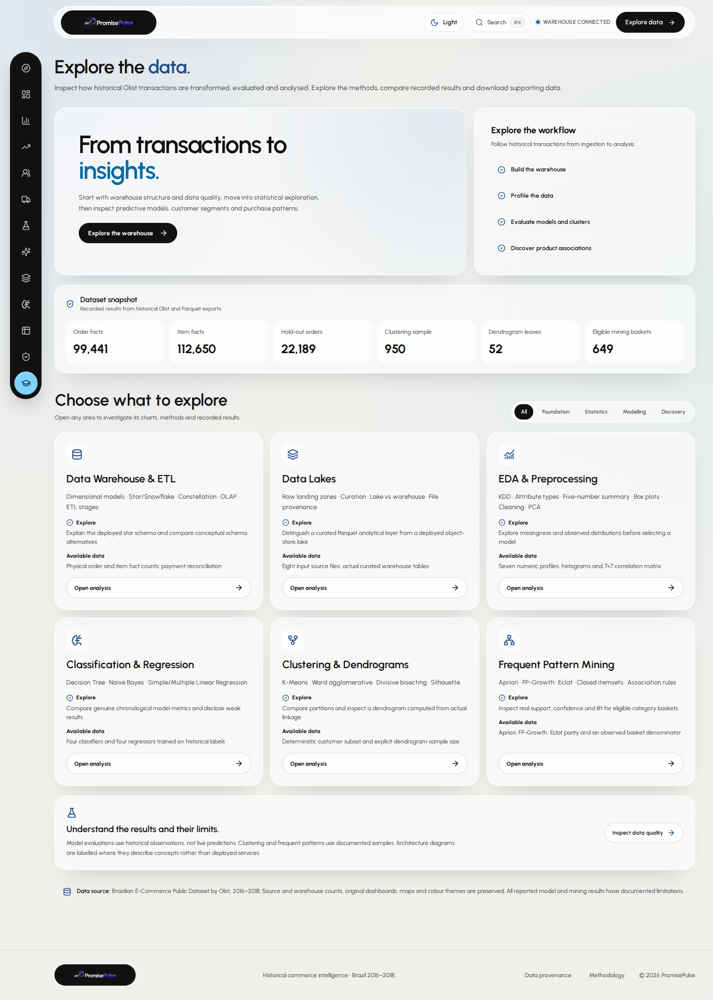](screenshots/current/mining-hub-light.png) | [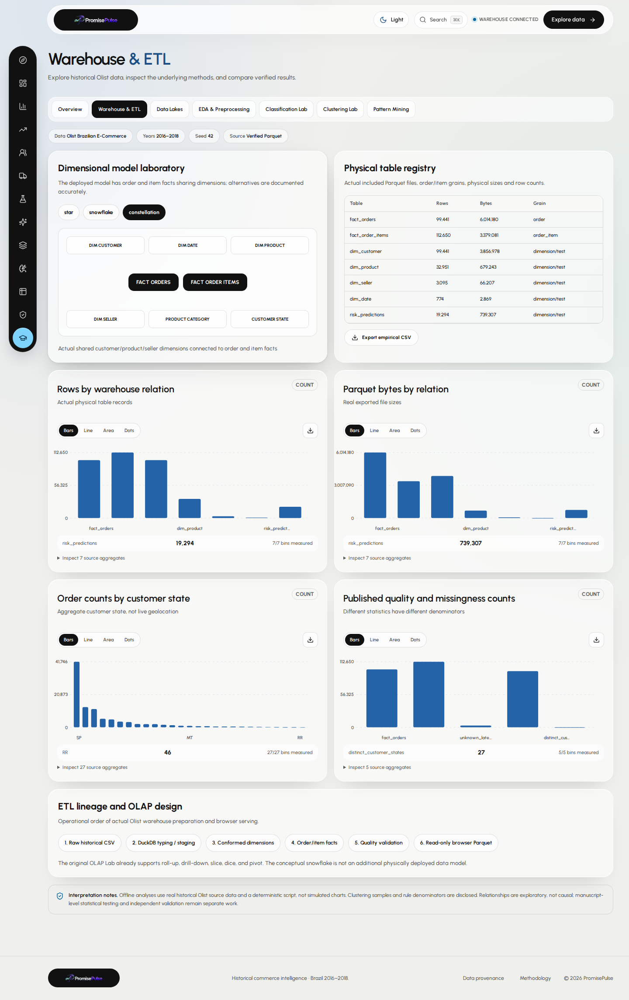](screenshots/current/warehouse-etl-light.png) |

| Clustering and dendrogram | Apriori / FP-Growth / Eclat |
| --- | --- |
| [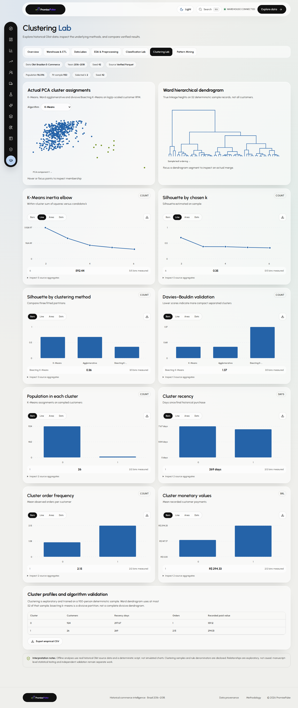](screenshots/current/clustering-light.png) | [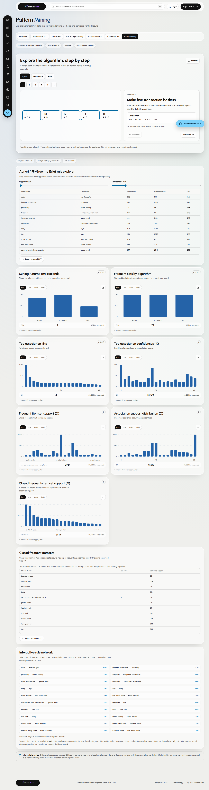](screenshots/current/pattern-mining-light.png) |

The lab overview opens from the graduation-cap icon **without a popup**. Its six analysis sections use overview cards and internal tabs. The teaching hour breakdown is kept in the [course documentation](SYLLABUS_V5.md), not displayed as tiny banners on the website.

## New step-by-step algorithm visualizations

The five methods below use **computed, explicitly illustrative inputs**. They are browser screenshots of the working visualizer, not images fabricated by a graphics tool. The actual Olist experiment figures remain on the same pages below the teaching scenes.

| K-Means calculated centroid updates | Decision Tree sample path |
| --- | --- |
| [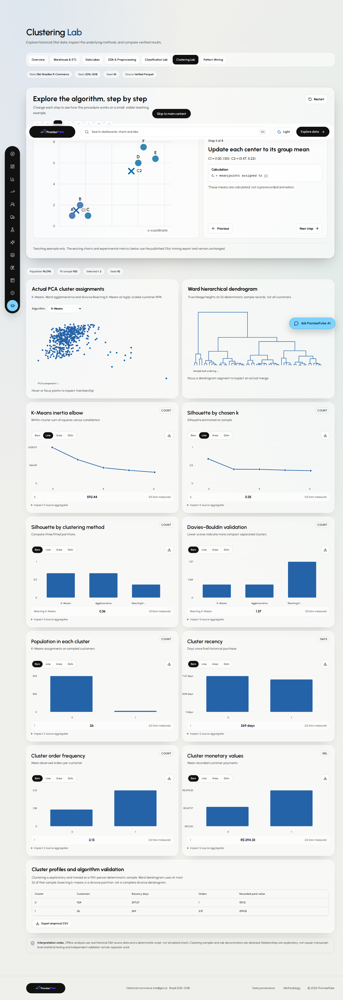](screenshots/current/algorithm-k-means-light.png) | [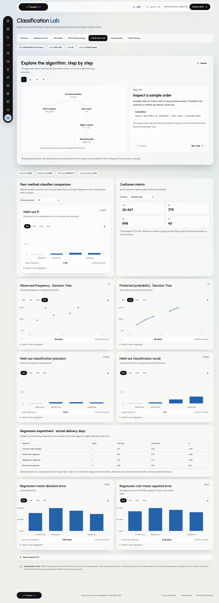](screenshots/current/algorithm-decision-tree-light.png) |

| Apriori candidate counting | FP-Growth prefix counts | Eclat TID intersections |
| --- | --- | --- |
| [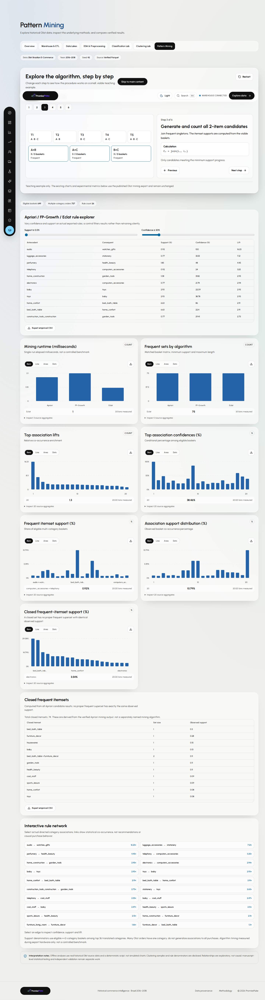](screenshots/current/algorithm-apriori-light.png) | [](screenshots/current/algorithm-fp-growth-light.png) | [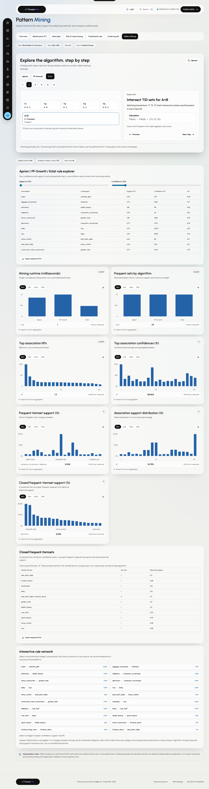](screenshots/current/algorithm-eclat-light.png) |

[Dark mode visualizer capture](screenshots/current/algorithm-k-means-dark.png) · [Mobile visualizer capture](screenshots/current/mobile-algorithm-k-means-light.png) · [Algorithm screenshot provenance](screenshots/current/ALGORITHM_CAPTURE_MANIFEST.json).

These scenes use **six sample points for K-Means** and **five small baskets for pattern mining**. Actual scientific results come from Olist's exported experiments. See [the worked algorithm guide](ALGORITHM_PLAYGROUND.md) for formulas, sample inputs and limitations.

## Dark mode and mobile

| Dark Welcome | Dark Data Mining Lab |
| --- | --- |
| [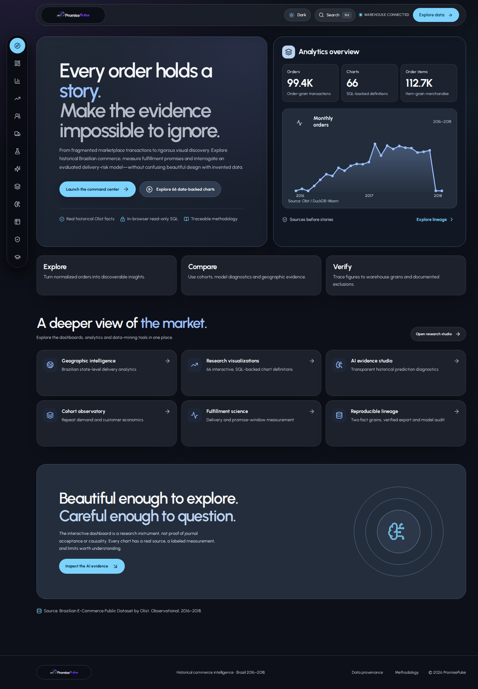](screenshots/current/welcome-dark.png) | [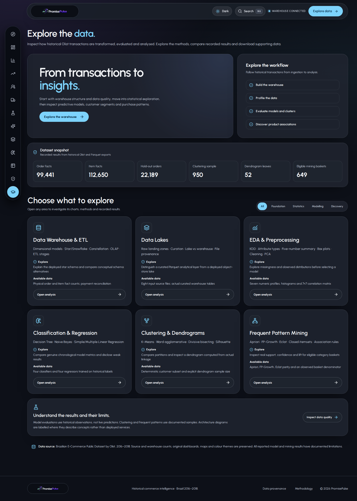](screenshots/current/mining-hub-dark.png) |

| Mobile Welcome | Mobile Overview | Mobile Mining Hub |
| --- | --- | --- |
| [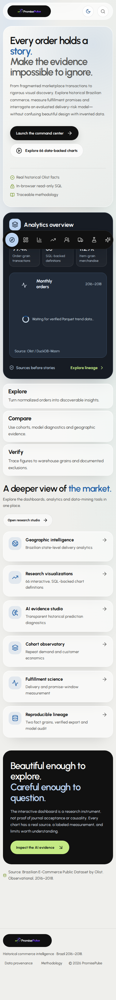](screenshots/current/mobile-welcome-light.png) | [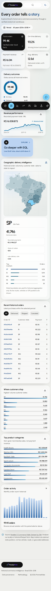](screenshots/current/mobile-overview-light.png) | [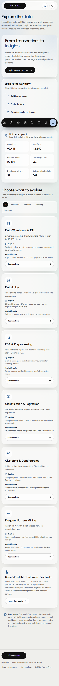](screenshots/current/mobile-mining-hub-light.png) |

Screenshots show the **soft-cyan source release**, not necessarily the current public deployment. An earlier release experienced a Vercel deployment-rate-limit failure. Check current deployment status and commit SHA rather than assuming that historical failure persists. Check the [deployment guide](DEPLOYMENT.md) before claiming production readiness.

Screenshots are evidence of actual rendering, **not independent validation of model accuracy or causal claims**. The dataset is historical. The classification results are weak, cluster fit uses bounded samples, and pattern mining uses a selected basket population.

### Refresh captures after future visual changes

Run the current screenshot script in the web directory once the development server is running on port 4173:

```bash
cd web
npm ci
npm install --no-save --package-lock=false playwright
npx playwright install chromium
npm run dev -- --host 127.0.0.1 --port 4173
# In a second terminal:
PP_BASE_URL=http://127.0.0.1:4173 node scripts/capture-current-docs.mjs
PP_BASE_URL=http://127.0.0.1:4173 node scripts/smoke-algorithms.mjs
```

The scripts write page captures, five teaching-method captures and provenance manifests to `docs/screenshots/current/`. Do **not** hand-edit captures or substitute invented values. The CI capture workflow can refresh the same files automatically after an approved documentation update.

### Archived galleries

Earlier screenshots remain available as historical release records. Some contain UI copy that has since been removed; **do not use them as the primary images for the current release**.

- [Original dashboards and Analytics Atlas (V3)](SCREENSHOT_GALLERY.md)
- [Research expansion and Welcome (V4)](SCREENSHOT_GALLERY_V4.md)
- [Six mining-lab sections, before final editorial refinements (V5)](SCREENSHOT_GALLERY_V5.md)
