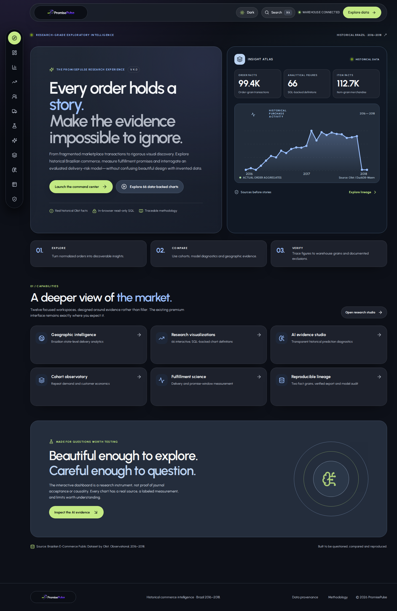
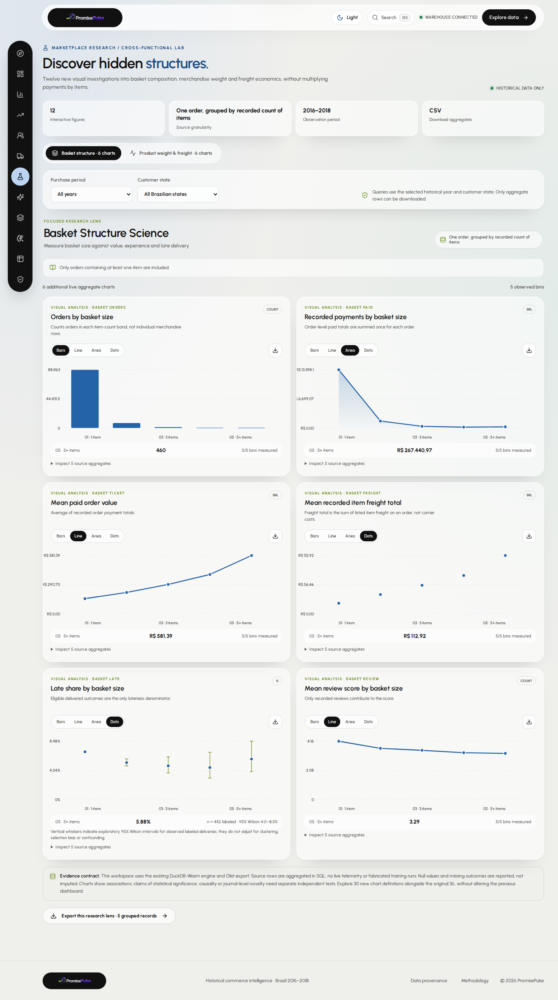
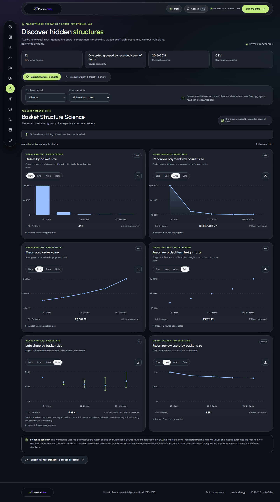
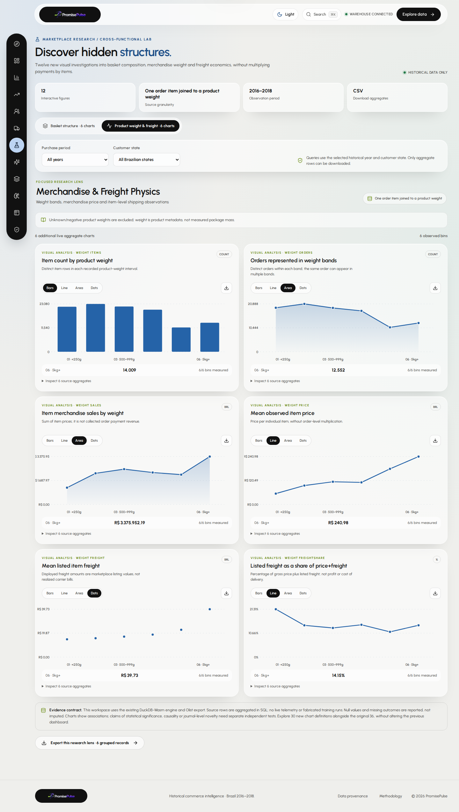
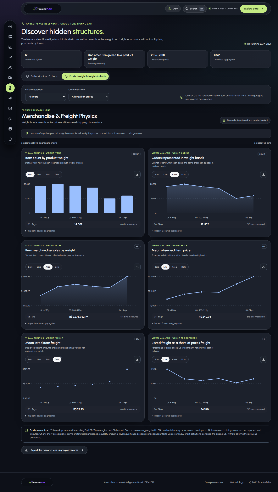
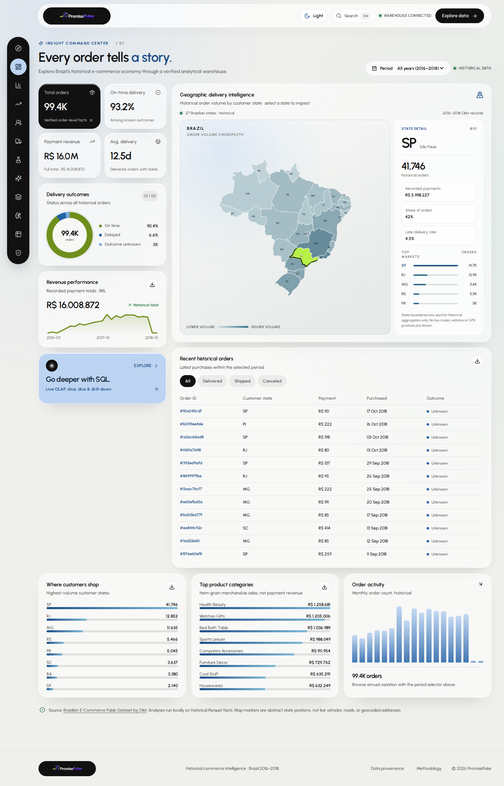
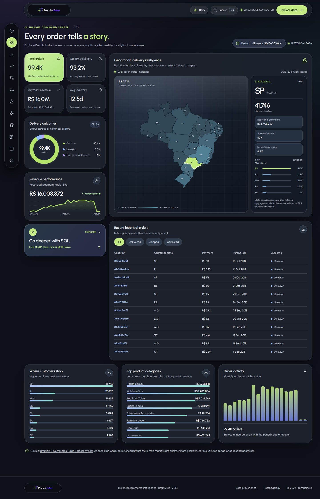
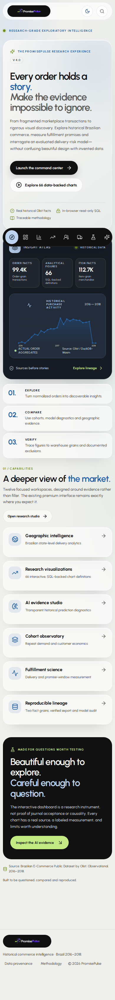
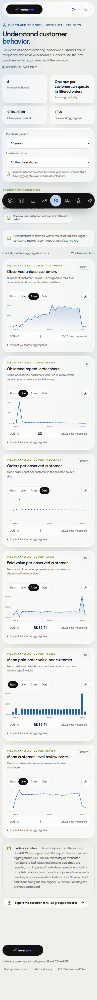

# PromisePulse 4.0 — Verified Landing, AI and Research Screenshots

**Source:** the actual running PromisePulse React application using the checked-in historical Olist Parquet facts through DuckDB-Wasm; captured with Playwright/Chromium. Nothing in this gallery is rendered from invented transaction records, a dummy AI forecast, or the SmartCart AI reference code.

The screenshots are from `docs/screenshots/v4/`. The accompanying [capture manifest](screenshots/v4/CAPTURE_MANIFEST.json) records the verification date, viewports and exact files. [Chromium smoke/capture script](../web/scripts/capture-v4.mjs) checks that six chart instances are populated from DuckDB results in each new research route, the AI Evidence Assistant updates when switching questions and the original dashboard still renders; it fails the job on data-query errors. Light and dark desktop captures use 1440×900, while the light mobile captures use 390×844.

## Editorial first impression

<details open>
<summary>View the premium research landing in both appearances</summary>

| Light mode | Dark mode |
| --- | --- |
| [](screenshots/v4/welcome-light.png) | [](screenshots/v4/welcome-dark.png) |

The right-hand evidence card contains *actual* `fact_orders`/`fact_order_items` counts from the manifest and a historical purchase-month trend queried from the order table. The CTAs navigate to the running analytics, AI and quality views.

</details>

## Additional scientific analysis

| Workspace | Light mode | Dark mode | Measurement scope |
| --- | --- | --- | --- |
| **Customer Cohorts** | [](screenshots/v4/customer-cohorts-light.png) | [](screenshots/v4/customer-cohorts-dark.png) | Six first-observed-customer cohort metrics; repeats are not right-censor adjusted |
| **Delivery Lab** | [](screenshots/v4/delivery-lab-light.png) | [](screenshots/v4/delivery-lab-dark.png) | Six observed lead-time and promise-window metrics, eligible deliveries only |
| **Research Studio — baskets** | [](screenshots/v4/research-basket-light.png) | [](screenshots/v4/research-basket-dark.png) | Six order-grain basket/payment analyses |
| **Research Studio — weight and freight** | [](screenshots/v4/research-weight-light.png) | [](screenshots/v4/research-weight-dark.png) | Six item-grain weight/price/freight analyses |
| **AI Evidence Studio** | [](screenshots/v4/ai-studio-light.png) | [](screenshots/v4/ai-studio-dark.png) | Six genuine held-out risk-band diagnostics; deterministic source-labeled explanations |
| **Preserved original dashboard** | [](screenshots/v4/overview-preserved-light.png) | [](screenshots/v4/overview-preserved-dark.png) | Original payment figures, Brazilian state choropleth and KPIs unchanged |

## Mobile usability

| Mobile welcome | Mobile customer cohorts |
| --- | --- |
| [](screenshots/v4/welcome-mobile-light.png) | [](screenshots/v4/customer-cohorts-mobile-light.png) |

The original premium icon-dock styling is retained. Twelve destinations scroll in the left vertical dock on limited-height desktops and horizontally on narrow screens, instead of shrinking targets below an accessible size. Revalidate swipe affordances with actual touch-device users before claiming WCAG compliance.

## Research ethics and image interpretation

1. **66 SQL-backed chart definitions** means the 36 original Atlas metric views plus 30 new empirical figure views. Line, area, bar and dot representations of the same figure are not counted as separate research results.
2. **AI Studio** is not an LLM, autonomous agent, or live logistics forecast. The source includes chronological scikit-learn test predictions and model manifest. The clickable evidence summaries are deterministic functions of evaluated historical data.
3. **Cohorts and review/delivery outcomes** can be biased by follow-up time, missingness, product mix and confounding. Treat charts as exploratory and make denominators visible in analysis exports.
4. **Financial measures** separate order-grain payments from item-grain merchandise prices. Multiple items can share an order; neither graph nor publication analysis should multiply order paid totals by item count.
5. **Screenshots are communication artifacts.** They document functionality at capture time, not a statistical significance test, an independent scientific replication or a guarantee of journal acceptance.

For chart-by-chart formulas see [PromisePulse 4.0 Research Expansion](RESEARCH_EXPANSION_V4.md) and for the existing 36-chart Atlas see [Analytics Atlas Methodology](ANALYTICS_ATLAS_METHODOLOGY.md).

## Reproduce these authentic captures

```bash
cd web
npm ci
npm install --no-save --package-lock=false playwright
npx playwright install chromium
npm run dev -- --host 127.0.0.1 --port 4173
# In a separate terminal, from the web directory:
PP_BASE_URL=http://127.0.0.1:4173 node scripts/capture-v4.mjs
```

Browser output and terminal errors should be inspected. The automated smoke validates that SQL-backed charts are present and interactive in selected filter states; a full scholarly reproducibility protocol still requires raw-to-warehouse reconstruction, appropriate uncertainty analysis, manual accessible testing and peer review.
