# PromisePulse 5.0 — Six Syllabus Modules: Authentic Screenshot Gallery

**Provenance:** Each image is generated by a headless Chromium browser running the actual React application, reading the existing Olist Parquet warehouse and the independently checked offline `mining_lab.json` experiment export. No graphical assets, synthetic orders, fabricated model metrics or simulated association rules were substituted.

Capture script: [`web/scripts/capture-v5.mjs`](../web/scripts/capture-v5.mjs). Machine-readable manifest: [`docs/screenshots/v5/CAPTURE_MANIFEST.json`](screenshots/v5/CAPTURE_MANIFEST.json).

The completed capture suite checked **six additional syllabus routes**, actual chart marks, true Ward dendrogram linkage, the persisted original Overview, both themes, and 390px mobile modules. These screenshots demonstrate browser rendering; they are not an independent scientific peer review.

| University syllabus module | Light theme | Dark theme | Key empirical evidence |
| --- | --- | --- | --- |
| **1. Data Warehouse & ETL** | [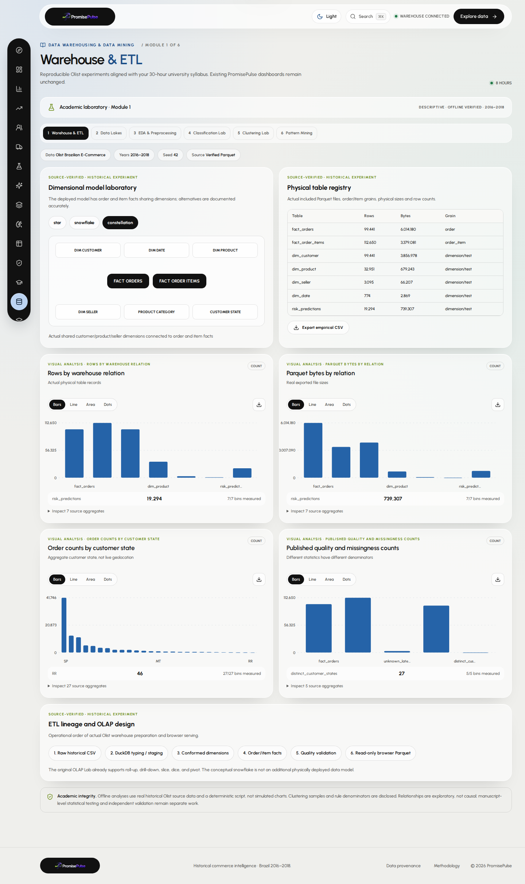](screenshots/v5/warehouse-etl-light.png) | [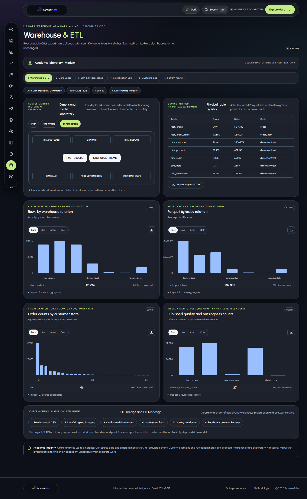](screenshots/v5/warehouse-etl-dark.png) | Conformed dimensions, order/item fact grains, ETL stages, row/byte inventory |
| **2. Data Lakes** | [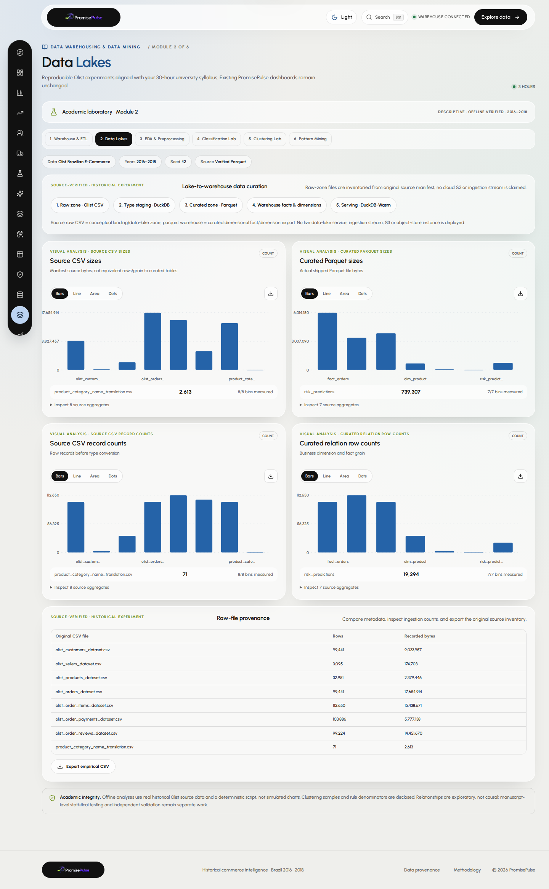](screenshots/v5/data-lakes-light.png) | [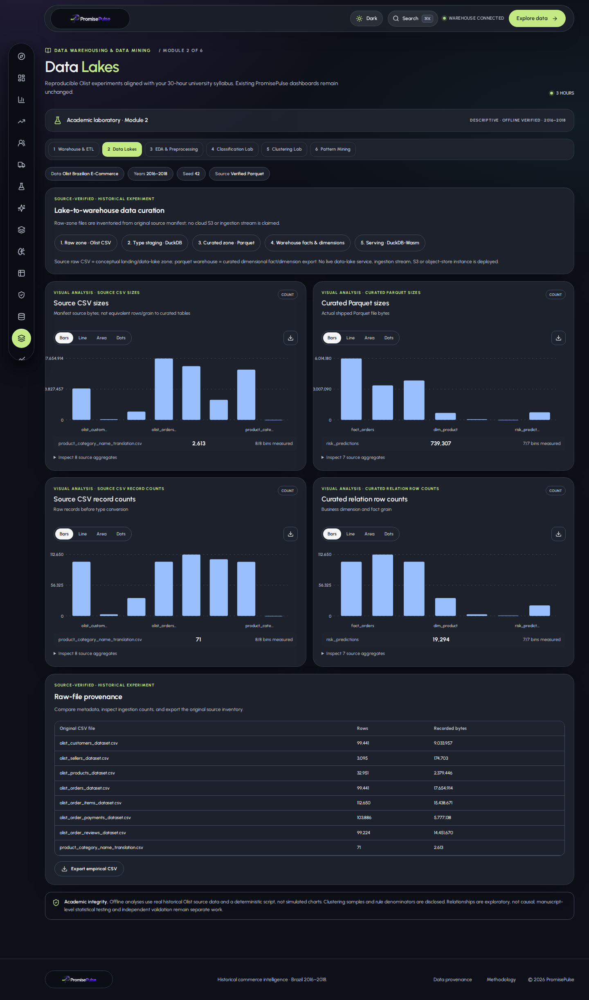](screenshots/v5/data-lakes-dark.png) | Real source CSV metadata versus curated Parquet physical footprint; no cloud lake claim |
| **3. Data Exploration & Preprocessing** | [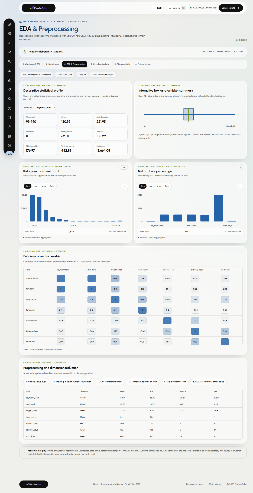](screenshots/v5/eda-preprocessing-light.png) | [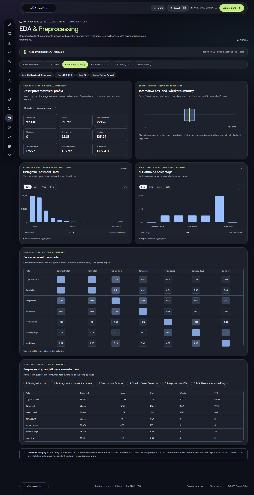](screenshots/v5/eda-preprocessing-dark.png) | Statistical summary, histograms, Pearson correlation matrix, missingness, quartile box plot |
| **4. Classification & Regression** | [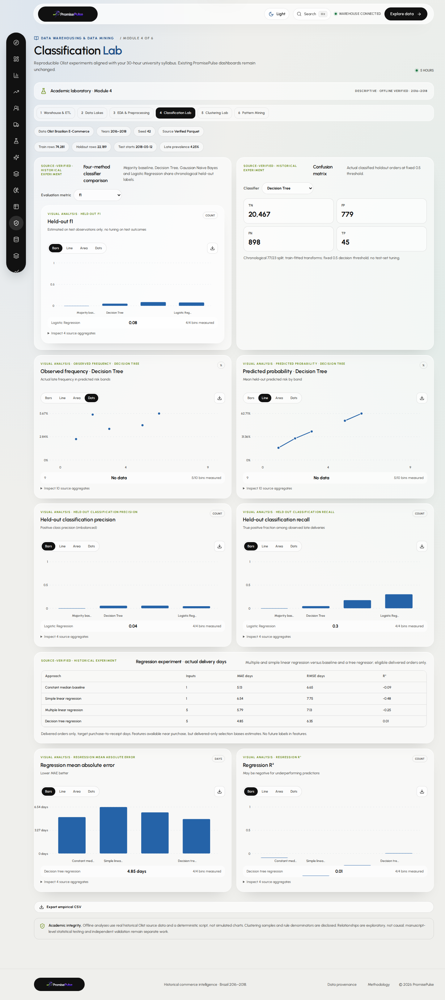](screenshots/v5/classification-regression-light.png) | [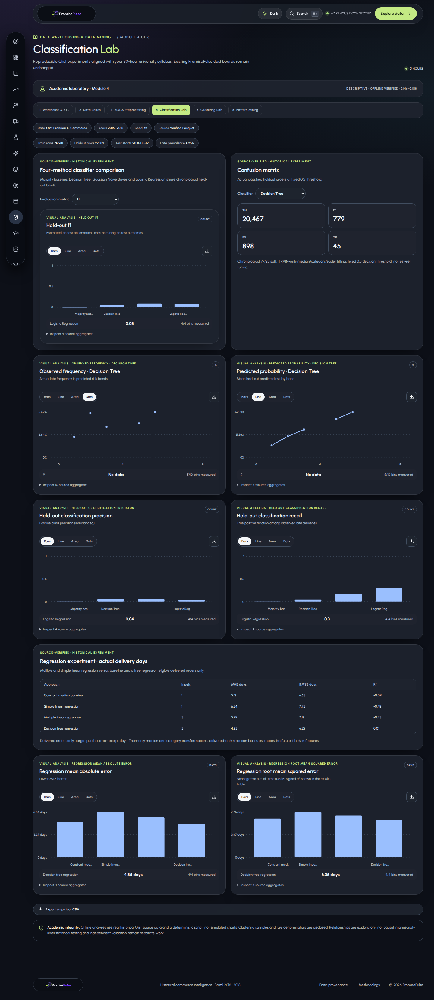](screenshots/v5/classification-regression-dark.png) | Decision Tree, Gaussian NB, logistic and baseline evaluation, confusion matrices, linear regression |
| **5. Clustering** |  | [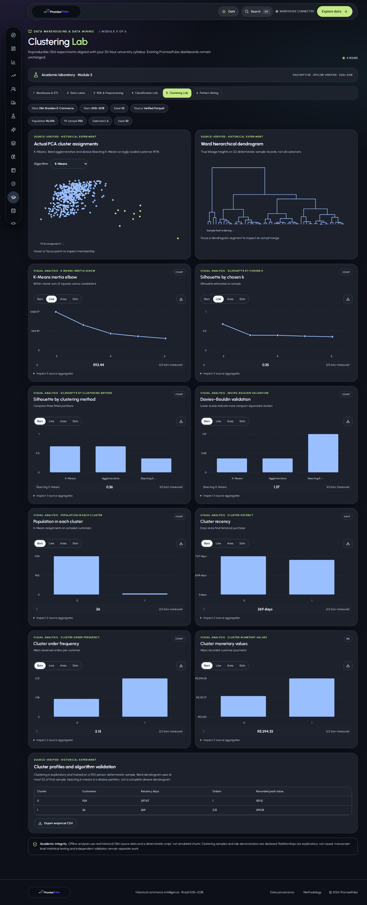](screenshots/v5/clustering-dendrogram-dark.png) | K-Means, Ward agglomerative and divisive Bisecting K-Means; genuine hierarchical dendrogram and PCA points |
| **6. Frequent Pattern Mining** | [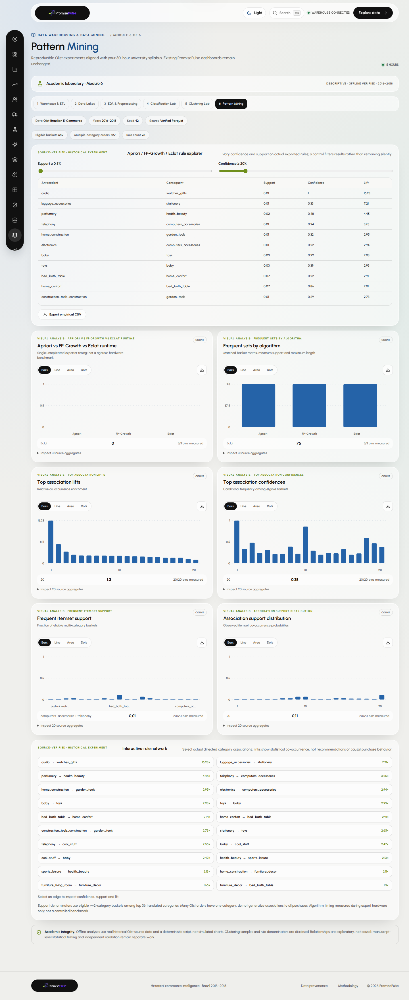](screenshots/v5/apriori-fpgrowth-eclat-light.png) |  | Apriori, FP-Growth, Eclat, actual eligible baskets, association-rule lift, confidence, support and network explorer |

### Responsive and backward-compatibility captures

| Test | Screenshot |
| --- | --- |
| Mobile descriptive-statistics module, 390px | [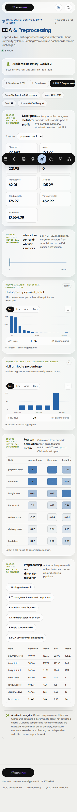](screenshots/v5/eda-preprocessing-mobile-light.png) |
| Mobile clustering and dendrogram, 390px | [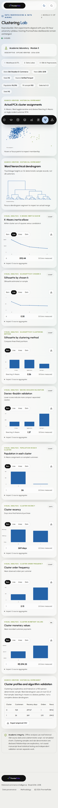](screenshots/v5/clustering-dendrogram-mobile-light.png) |
| **Original Overview retained**, light | [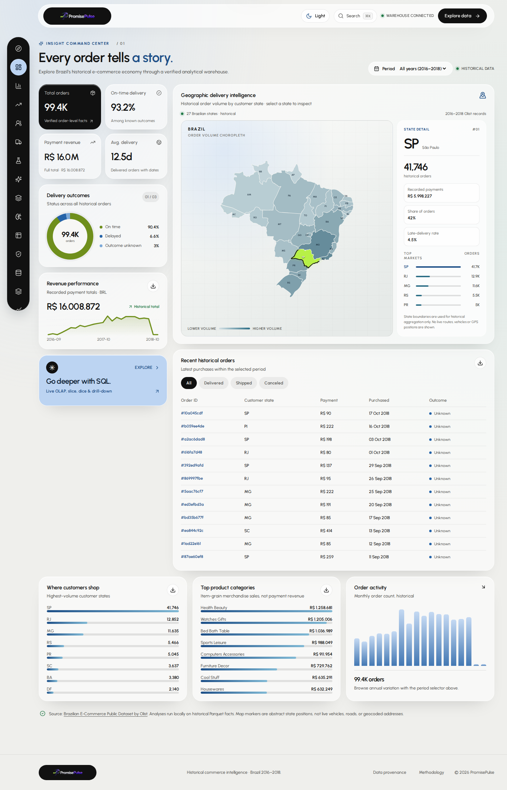](screenshots/v5/preserved-overview-light.png) |
| **Original Overview retained**, dark | [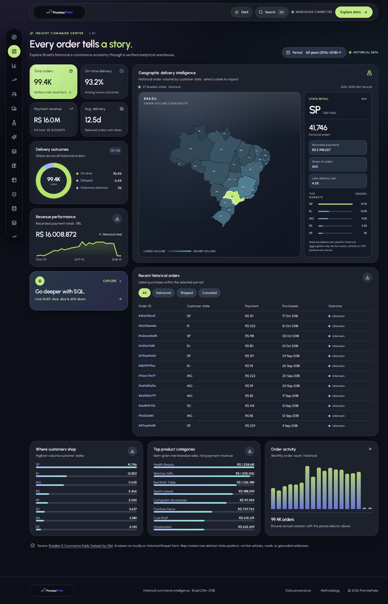](screenshots/v5/preserved-overview-dark.png) |

**Math and methodology:** [SYLLABUS_V5.md](SYLLABUS_V5.md) provides the complete 30-hour syllabus mapping, actual evaluated outcomes and caveats. The existing [V4 gallery](SCREENSHOT_GALLERY_V4.md) and [V3 gallery](SCREENSHOT_GALLERY.md) remain available unchanged.

### Responsible screenshot interpretation

- The 950-customer cluster fit and 52-record dendrogram represent deterministic tractability samples, not a hierarchical analysis of all 96,096 observed unique customers.
- Newly evaluated classifiers have weak minority-class precision. Do not interpret attractive confusion and calibration figures as superior performance or a production risk service.
- Association support is measured over 649 eligible multi-category baskets for the top-category universe, rather than all orders. Apriori/FP-Growth/Eclat have matching 75-itemset output in the published first export.
- In the Data Lakes module, the raw-data architecture is a documented physical-file/curation representation. No separate object store, managed data lake or stream service has been deployed.
- A visual depiction of a star/snowflake/constellation is not the deployment of three separate database instances.
