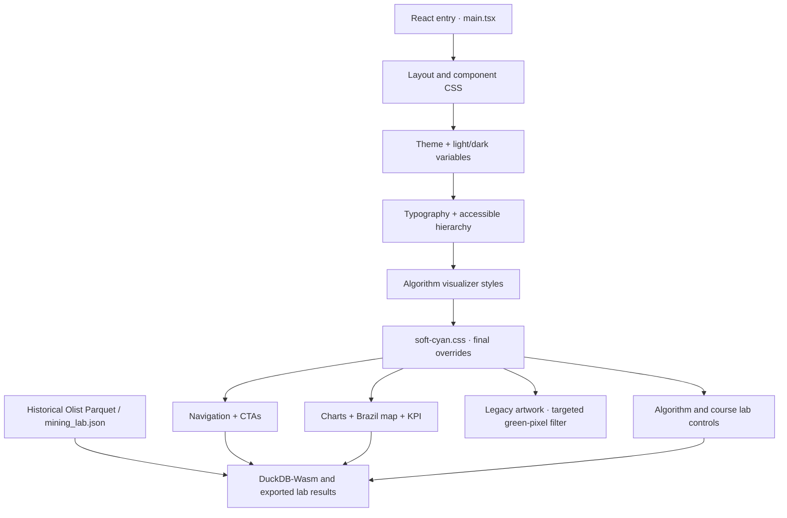

# PromisePulse 5.0 — Soft-cyan visual system

This page documents the **merged `main` release**, not an experimental theme proposal.

| Usage | Token / value | Notes |
| --- | --- | --- |
| Primary accent | `#7DD3FC` | Soft cyan; replaces the previous fluorescent lime |
| Accent hover | `#BAE6FD` | Lighter cyan for hover surfaces |
| Ink on cyan | `#082F49` | Dark navy on cyan buttons, selection and bright cards |
| Cyan text on light surfaces | `#0369A1` | Darker blue used where light cyan text would have weak contrast |
| Cyan text on dark surfaces | `#7DD3FC` | Primary cyan for dark-surface emphasis |
| Companion gradient | `#BAE6FD` → `#38BDF8` | Highlighted KPI card in dark mode |

The product's dark graphite surfaces, purple logo lettering and original Olist data visualizations remain recognizable. The theme change **does not** alter the data source, SQL definitions, customer-state boundaries, classifier metrics or the numerical meaning of any chart.

## What was changed

| UI surface | Change |
| --- | --- |
| Header and prominent calls to action | Soft-cyan backgrounds, navy text, pale-cyan hover |
| Selected sidebar and control buttons | Cyan active state in light and dark themes |
| Homepage | Primary buttons, illustrative accents, proof icons |
| Overview | Highlight KPI, positive indicators, progress bars and bar/line accents |
| Brazil state map | Selected-state fill and outline emphasis; geographic data unchanged |
| Analytics Atlas and Research | Selected chart/analysis lens, focus and chart tokens |
| Six Data Mining Lab screens | Tab/active controls and teaching visualizations |
| Brand assets | New `web/public/favicon-cyan.svg`; the existing PNG remains as an alternate favicon |
| Logo artwork | Existing raster logo is retained; an SVG filter targets the old green detail while leaving the purple wordmark |

### Color tokens and CSS cascade

The main entry point `web/src/main.tsx` loads the component styles, then `theme.css`, `editorial.css`, `algorithm-playground.css`, and finally **`soft-cyan.css`**. That last file applies cross-surface accent corrections.

```css
:root {
  --pp-accent-cyan: #7DD3FC;
  --pp-accent-cyan-hover: #BAE6FD;
  --pp-accent-cyan-ink: #082F49;
  --pp-accent-cyan-text: #0369A1;
}
html[data-theme="dark"] {
  --pp-accent-cyan-text: #7DD3FC;
}
```

The legacy `--cadra-brand-lime` and `--pp-chart-green` CSS custom property names remain as **compatibility aliases**, despite their names. Their values now resolve to the cyan palette rather than green. Renaming those properties throughout the application would not change the UI and was intentionally avoided.



The SVG logo filter is defined in `web/src/App.tsx` as `pp-brand-cyan` and applied to `.brand-logo-image` and `.footer-logo-image`. It is a visual filter rather than a replacement of the source logo asset; the original PNG/WebP can therefore still be reused.

## AI assistant light and dark appearance

The current chatbot drawer is styled in `web/src/project-assistant.css`. Its **light mode** uses explicit opaque whites (`#FFFFFF`), a pale-blue transcript background (`#F3F8FD`), a soft-cyan user bubble (`#DEF2FF`) and deep readable text (`#10263E`). This avoids the dim translucent `--cadra-glass` background on pale pages. **Dark mode is unchanged** and inherits the established graphite palette. Both use the existing cyan action accent.

Theme switching is applied with `html[data-theme="light"]`/`html[data-theme="dark"]`, reflecting the saved user preference. The integrated chat inherits those states. `tests/test_theme.cjs` asserts that light-theme chatbot surfaces are explicitly scoped and key foreground/background pairs meet the normal-text 4.5:1 contrast threshold. See [captured chat light/dark appearances](SCREENSHOT_GALLERY_CURRENT.md); unlike a visual mock-up, those PNGs come from browser capture scripts.

## Accessibility and usage

- Use navy foreground `#082F49` against a cyan button or bright highlight; do not use white text on `#7DD3FC`.
- On light surfaces, use `#0369A1` for text-level emphasis rather than relying on low-contrast pale cyan.
- Keep focus-visible outlines, keyboard operation, reduced-motion preferences, and both light/dark appearance preferences.
- The app retains a single source-backed geographic map. A cyan fill denotes selection, **not** a new geographical measurement.
- Any image of the interface should come from actual browser rendering of this release, not a generated mock-up. Use [the current screenshot gallery](SCREENSHOT_GALLERY_CURRENT.md) and its manifests.

## Confirm the release locally

```bash
git clone https://github.com/kasim672/PromisePulse.git
cd PromisePulse/web
npm ci
npm run build
node ../tests/test_soft_cyan_theme.cjs
node ../tests/test_theme.cjs
node ../tests/test_editorial_hierarchy.cjs
npm run dev
```

Open **http://127.0.0.1:5173/**, switch light/dark, visit Welcome, Overview, Analytics Atlas and Data Mining Lab, and inspect the selected Brazil state and cyan favicon. The verified CI run for the merged theme's source commit is [Soft Cyan Theme QA #40349362649](https://github.com/kasim672/PromisePulse/actions/runs/40349362649), which includes desktop light/dark and mobile dark-mode browser screenshots.

### Source and deployment are separate statuses

The base cyan theme was merged in [PR #10](https://github.com/kasim672/PromisePulse/pull/10); the chat-specific light-mode refinement arrived in [PR #19](https://github.com/kasim672/PromisePulse/pull/19). Vercel had an earlier deployment-rate-limit failure, but verify the **current** Vercel Ready status and deployed SHA before drawing conclusions about the public domain. See [Deployment](DEPLOYMENT.md) for how to retry and confirm the deployed commit.

The platform's historical Olist data still describe 2016–2018 transactions. The cyan screenshots show the checked-in source running locally with those public assets; they are not evidence of a successful Vercel production deployment.
